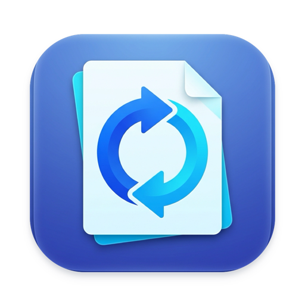

# LocalConvert

<p align="center">
  
</p>

<p align="center">
  <strong>Native, private, offline file conversion for Apple Silicon Macs.</strong><br />
  Convert, optimize, edit, and organize your files entirely on your Mac.
</p>

<p align="center">
  <a href="https://github.com/RighteousLife/LocalConvert/releases/latest">Latest Release</a> ·
  <a href="https://github.com/RighteousLife/LocalConvert/releases/tag/v1.0.0">v1.0.0</a> ·
  <a href="#features">Features</a> ·
  <a href="#supported-formats">Formats</a> ·
  <a href="#installation">Installation</a> ·
  <a href="#building-from-source">Build</a>
</p>

---

## Why LocalConvert?

LocalConvert is a native macOS application built with **Swift and SwiftUI** for converting and working with images, PDFs, Office documents, audio, and video.

Your files stay on your Mac. LocalConvert does not upload conversion data to a cloud service and does not require Homebrew, Python, or separate command-line tools for the released application.

**LocalConvert 1.0.0 is available as a self-contained Apple Silicon DMG.**

## Download

### LocalConvert 1.0.0

- **[Download the Apple Silicon DMG](https://github.com/RighteousLife/LocalConvert/releases/download/v1.0.0/LocalConvert-1.0.0-arm64.dmg)**
- **[Verify the SHA-256 checksum](https://github.com/RighteousLife/LocalConvert/releases/download/v1.0.0/SHA256SUMS.txt)**
- **[View the full release](https://github.com/RighteousLife/LocalConvert/releases/tag/v1.0.0)**

**Requirements:** Apple Silicon Mac (arm64), macOS 15.0 or later.

> **Distribution note:** The current GitHub release is **ad-hoc signed and not notarized by Apple**. macOS may therefore require manual approval the first time the application is opened. See [Installation](#installation).

## Features

### Image Toolbox Pro (`⌘8`) & Image Conversion

- **Image Toolbox Pro (`⌘8`)**:
  - **Universal JPEG XL (`libjxl 0.13.0`)**: Full read & write (`* ↔ JXL`), lossy/lossless encoding, compression effort `1–9`, 8/16-bit precision, alpha, animated JXL (`GIF/APNG ↔ JXL`), embedded ICC/EXIF/XMP container boxes, and lossless `JPEG ↔ JXL` bitstream transcoding & bit-exact JPEG reconstruction
  - **Batch Resize & Resampling**: Exact dimensions, percentage, max width/height, fit inside, fill (crop-to-fit), Nearest / Bilinear / Bicubic / Lanczos resampling, post-resize sharpening, and multi-size preset export
  - **Crop, Rotate & Flip**: Aspect presets, custom pixel size, 3×3 anchor positioning, normalized rectangle crop, `90°`/`180°` rotation, and horizontal/vertical mirror
  - **Optimize File Size & Compression Profiles**: Target max file size search (KB/MB presets + honest quality-floor tradeoff reporting) and 6 compression profiles (`Maximum Quality`, `Balanced`, `Small File`, `Web Optimized`, `Archive / Lossless`, `Custom`)
  - **Metadata & Privacy Cleaner**: EXIF/IPTC/TIFF/XMP/GPS/camera audit, 1-click GPS or full metadata strip, selective scrub, and inline edit across ImageIO formats and JXL containers
  - **Watermark & Color Management**: Positioned (9-anchor) or tiled text/logo image watermarks with opacity/rotation/margin; ICC inspection plus `sRGB` and `Display P3` conversion
  - **On-Device Background Removal & Interactive Compare**: Apple Vision foreground instance mask segmentation (transparent or solid fill with alpha-strip warnings) and split-slider / side-by-side Before/After zoom inspector
- Additional supported image formats: PNG, JPG/JPEG, WebP (lossy/lossless), HEIC, TIFF, BMP, GIF, APNG, AVIF, JP2, PSD, EXR, PPM, HDR, QOI, PCX, WBMP, TGA, ICO, ICNS, SVG, and RAW/DNG (read-only)
- Batch processing and image-to-PDF conversion

### PDF Toolbox Pro (`⌘3`)

- **Organize**: Merge, split pages/ranges, multi-up slide splitter, extract, delete, reorder, rotate, PDF ↔ images, PDF → DOCX/PPTX/XLSX
- **OCR & Searchable PDF**: Apple Vision (`VNRecognizeTextRequest`) Accurate/Fast OCR with dynamically queried recognition languages, invisible CoreText selectable text layer preserving visual fidelity, skip-searchable-page detection, page ranges, and optional `.txt` sidecar export
- **PDF/A & Archiving**: Genuine archival export (`PDF/A-1b`, `PDF/A-2b`, `PDF/A-3b`, `PDF/A-4`) via bundled LibreOffice `draw_pdf_Export`, plus XMP `pdfaid` / `/OutputIntents` / font-embedding / encryption / transparency validation (`PDF/A-2u` generation explicitly marked unsupported)
- **Permanent Redaction**: Text-search matches, interactive region boxes, and whole pages permanently rasterized & sanitized (zero text-stream residual, overlapping annotation removal, metadata scrubbing, and independent post-redaction verification; never overwrites source files)
- **Compare**: LCS page alignment (insert/remove/modify), normalized line-level text diff, dimensions/rotation diff, and normalized pixel diff + red overlay highlight
- **Advanced Compression**: 6 profiles (`Maximum Quality` lossless, `Balanced`, `Small File`, `Web Optimized`, `Email Attachment`, `Custom`) with configurable DPI, JPEG / JPEG 2000 / Lossless Flate, metadata stripping, size estimate range, and integrity validation
- **Forms**: AcroForm inspection, inline editing, JSON export/import, and burn-in flattening (`PDFAnnotation` → static content), plus explicit read-only `/XFA` detection
- **Inspect & Security**: Deep `CGPDFDocument`/`PDFKit` structure inspector (PDF version, fonts + embedding, images/color spaces, transparency, `/OutputIntents`, XMP, signatures, cipher & permissions) plus password encryption, granular `CGPDFAccessPermissions`, and owner-verified decryption

### Office & documents

- DOCX, DOC, XLSX, XLS, PPTX, PPT
- ODT, ODS, ODP, RTF
- CSV, TSV, HTML
- Office → PDF through bundled LibreOffice
- PDF → editable Office formats where supported
- Native CSV ↔ TSV conversion

### Audio Toolbox, Audio & Video

- **Audio formats**: MP3, WAV, FLAC, M4A, M4B, AAC, OGG, OPUS, AIFF, CAF, ALAC, AC-3, E-AC-3, DTS, WMA, AU, WV, MKA (plus read-only AMR, APE)
- **Audio Toolbox (`⌘7`)**:
  - Per-container codec controls (`aac`, `aac_at` VBR, `alac`, `libmp3lame` CBR/VBR, `flac` 16/24-bit, PCM 16/24/32/f32 LE/BE, `libopus`, `vorbis`, `ac3`, `eac3`, `dca`, `wmav2`, `wavpack`, and stream copy)
  - Non-destructive waveform trimming, multi-segment extraction, multi-file merge, speed & pitch scaling, fades, reverse, and silence detection/removal
  - Audio DSP: 5-band parametric EQ, high/low-pass filters, compressor, peak limiter, channel balance/stereo width, EBU R128 & peak normalization, `afftdn` noise reduction, and de-click
  - **Spotify Compatibility & Safe Normalization**: Inspect MP3, M4A, MP4, M4B, M4P, FLAC, WAV, OGG, and Opus tracks against Spotify Desktop Local Files compatibility rules (`Officially Documented`, `Conditional Compatibility`, `Unsupported Format`, `DRM Protected`, `Unknown`, `Incompatible Video Container`), validate JPEG/PNG cover art magic bytes, and write safe normalized copies (ID3v2.3.0 UTF-16 + `USLT` lyrics + `APIC` Front Cover for MP3; native `moov.udta.meta.ilst` atoms + `stco`/`co64` offset shifting for AAC M4A/MP4) while preserving bit-exact compressed audio packets verified via SHA-256 `streamhash`
- **Video**: MP4, MOV, MKV, WebM, AVI, WMV, M4V, 3GP, 3G2, MPG, TS, FLV, F4V, VOB, M2V (plus read-only OGV, MTS, M2TS)
- Video → GIF, audio extraction, route-aware soft-subtitle handling, and Apple VideoToolbox acceleration where supported

### Metadata

- View and edit supported image, audio, video, PDF, and Office metadata
- EXIF/IPTC/TIFF/XMP workflows where supported
- ID3, Vorbis/comment, QuickTime/MP4 atoms, lyrics (`USLT`/`©lyr`), and PDF metadata
- Cover artwork validation & embedding (`mp3`, `m4a`, `m4b`, `alac`, `flac`)
- Remove supported metadata for privacy

### Jobs, presets & history

- Multi-file conversion queue
- Configurable concurrency
- Live progress and batch summaries
- Before/after file-size comparison
- Retry and cancellation
- Saved presets
- Searchable conversion history
- Repeat previous conversions
- Technical error details with sensitive-value redaction

### macOS integration

- Finder Quick Actions and Services
- Drag-and-drop files and folders
- Smart folder import for supported files
- Custom `localconvert://` URL handoff
- Native macOS keyboard shortcuts
- Optional menu bar integration
- Light/Dark appearance support
- Accessibility labels and native macOS controls

## Supported Formats

| Category | Input | Output |
|---|---|---|
| **Images** | PNG, JPG/JPEG, WebP, HEIC, TIFF, BMP, GIF, APNG, AVIF, JPEG XL (JXL), JP2, PSD, EXR, PPM, HDR, QOI, PCX, WBMP, TGA, ICO, ICNS, SVG, SGI (read-only), XPM (read-only), Camera RAW (DNG, CR2, CR3, NEF, NRW, ARW, RAF, RW2, ORF, PEF, SRW — read-only) | PNG, JPG/JPEG, WebP, HEIC, TIFF, BMP, GIF, APNG, AVIF, JPEG XL (JXL), JP2, PSD, EXR, PPM, HDR, QOI, PCX, WBMP, TGA, ICO, ICNS, PDF |
| **PDF** | PDF, supported image formats | PDF, PNG, JPG, TIFF, DOCX, PPTX, XLSX |
| **Office & Documents** | DOCX, DOC, DOTX, DOCM (macros dropped), ODT, RTF, TXT, MD, HTML, XLSX, XLS, XLTX, XLSM, XLSB (read-only), ODS, CSV, TSV, PPTX, PPT, POTX, PPTM, PPSX/PPS (read-only), ODP | DOCX, DOC, DOTX, ODT, RTF, TXT, MD, HTML, EPUB (export from Writer/MD/HTML), PDF, XLSX, XLS, XLTX, ODS, CSV, TSV, PPTX, PPT, POTX, ODP |
| **Audio** | MP3, WAV, FLAC, M4A, M4B, AAC, OGG, OPUS, AIFF, CAF, ALAC, AC-3, E-AC-3, DTS, WMA, AU, WV, MKA, AMR (read-only), APE (read-only) | MP3, WAV, FLAC, M4A (AAC / ALAC), M4B, AAC, OGG, OPUS, AIFF, CAF, ALAC, AC-3, E-AC-3, DTS, WMA, AU, WV, MKA |
| **Video** | MP4, MOV, MKV, WebM, AVI, WMV, ASF, M4V, 3GP, 3G2, MPG/MPEG, TS, FLV, F4V, VOB, M2V, MTS (read-only), M2TS (read-only), OGV (read-only) | MP4, MOV, MKV, WebM, AVI, WMV, ASF, M4V, 3GP, 3G2, MPG, TS, FLV, F4V, VOB, M2V, GIF, APNG, supported audio outputs, text subtitles |
| **Subtitles** | SRT, VTT, ASS, SSA, SUB (MicroDVD read-only), text subtitle streams inside MKV/MP4/MOV/WebM/AVI/M4V/TS | SRT, VTT, ASS, SSA |
| **Archives** | ZIP, 7Z, TAR, TAR.GZ (TGZ), TAR.BZ2 (TBZ2), TAR.XZ (TXZ), GZ, BZ2, RAR (read-only; encrypted RAR not supported) | ZIP, 7Z, TAR, TAR.GZ (TGZ), TAR.BZ2 (TBZ2), TAR.XZ (TXZ), GZ, BZ2 |

See [docs/FORMAT_COMPATIBILITY.md](docs/FORMAT_COMPATIBILITY.md) for full read/write capability flags, codec behavior, and route warnings.

> LocalConvert intentionally focuses on **consumer and Apple-ecosystem formats**. Professional/broadcast formats such as ProRes RAW, REDCODE RAW, XAVC/XDCAM, and broadcast MXF are outside the project's scope.

## Installation

1. Download `LocalConvert-1.0.0-arm64.dmg` from [GitHub Releases](https://github.com/RighteousLife/LocalConvert/releases/latest).
2. Open the DMG.
3. Drag **LocalConvert** to **Applications**.
4. Open LocalConvert from Applications or Spotlight.

Because the current release is ad-hoc signed and not notarized, macOS may block the first launch.

If that happens:

1. Right-click (or Control-click) **LocalConvert.app** in Applications.
2. Choose **Open**.
3. Confirm **Open** in the macOS security dialog.

This is expected for the current open-source distribution model. The release should not be interpreted as Apple-notarized or Gatekeeper-approved.

## Keyboard Shortcuts

| Shortcut | Action |
|---|---|
| `⌘O` | Add Files |
| `⌘↩` | Start Conversion |
| `Esc` | Cancel Active Conversion |
| `⌘⇧R` | Repeat Last Conversion |
| `⌘1` | Convert |
| `⌘2` | Jobs Center |
| `⌘3` | PDF Toolbox |
| `⌘4` | Metadata Editor |
| `⌘5` | Presets |
| `⌘6` | History |
| `⌘7` | Audio Toolbox |
| `⌘8` | Image Toolbox |
| `⌘,` | Settings |
| `⌘Q` | Quit |

## Privacy & Security

- Conversion processing is designed to remain on-device.
- The released application has **no Homebrew runtime dependency**.
- FFmpeg/ffprobe, libwebp, libjxl, and LibreOffice runtimes are bundled with the distribution.
- Office subprocesses use isolated temporary profiles and watchdogs.
- Sensitive values are redacted from technical error details.
- Password-protected PDF credentials are handled ephemerally and are not persisted by the application workflow.
- No telemetry or conversion-data upload service is included.

## Building from Source

### Prerequisites

- macOS 15.0+
- Xcode 16.0+
- Apple Silicon Mac
- XcodeGen

XcodeGen can be installed separately with Homebrew:

```bash
brew install xcodegen
```

### Build & test

```bash
git clone https://github.com/RighteousLife/LocalConvert.git
cd LocalConvert

./scripts/verify-dependencies.sh
xcodegen generate

xcodebuild test \
  -project LocalConvert.xcodeproj \
  -scheme LocalConvert \
  -destination 'platform=macOS,arch=arm64'

xcodebuild -project LocalConvert.xcodeproj \
  -scheme LocalConvert \
  -configuration Release \
  -destination 'platform=macOS,arch=arm64' build
```

The source repository intentionally does **not** track the large LibreOffice runtime. See [docs/DEPENDENCIES.md](docs/DEPENDENCIES.md) and [scripts/setup-runtime.sh](scripts/setup-runtime.sh) for the development/runtime setup.

## Architecture

LocalConvert is organized around capability-driven conversion and shared application services:

- `ConversionRegistry` — actual source/target conversion capabilities
- `ConversionManager` / `ConversionQueue` — jobs, progress, cancellation, and concurrency
- `OutputManager` — output destinations and collision handling
- `PresetManager` — saved preset persistence and validation
- `HistoryManager` — conversion history
- `MetadataManager` — metadata providers and capability discovery
- Native ImageIO/CoreGraphics/PDFKit where appropriate
- Bundled FFmpeg/ffprobe for media conversion
- Bundled LibreOffice for Office conversion

For more detail, see [ARCHITECTURE.md](ARCHITECTURE.md).

## Licensing

LocalConvert source code is licensed under the **MIT License**.

Third-party components retain their respective licenses:

- **libwebp / libsharpyuv** — BSD 3-Clause
- **FFmpeg / ffprobe** — LGPLv3+
- **LibreOffice** — MPL 2.0 plus applicable third-party licenses

See [THIRD_PARTY_NOTICES.md](THIRD_PARTY_NOTICES.md) for license texts, build information, and attribution details.

## Release Notes

- [LocalConvert 1.0.0](docs/RELEASE_NOTES_1.0.0.md)
