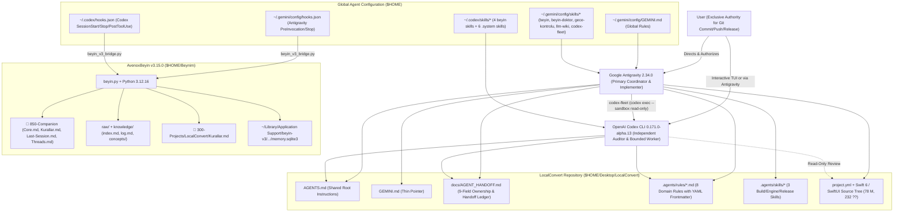

# Comprehensive AI Development Environment & Agent Ecosystem Audit

- **Audit Date:** `2026-11-23`
- **Audit Mode:** Strictly read-only diagnostic inventory (single permitted output file: `docs/AI_DEVELOPMENT_ENVIRONMENT_AUDIT.md`).
- **Target Project:** `$HOME/Desktop/LocalConvert`
- **Central Memory Vault:** `$HOME/Beynim` (AvenoxBeyin `v3.15.0`)

---

## 1. Executive Summary

This report documents an evidence-based, read-only audit of the AI-assisted development ecosystem used for **LocalConvert**. The environment integrates two primary coding agents — **Google Antigravity (`2.34.0`)** as primary coordinator/implementer and **OpenAI Codex CLI (`0.171.0-alpha.13`)** as secondary developer/independent auditor — backed by a local source-backed second-brain vault (**AvenoxBeyin `v3.15.0`** at `$HOME/Beynim`).

### Key Baseline Counts
- **Active Skills:** `21` active in the current project context (`5` global Antigravity user skills, `3` project-level `LocalConvert` skills, `13` mounted Antigravity built-in skills), plus `10` Codex skills (`4` global user skills + `6` `.system` skills), `4` vault-scoped skills in `$HOME/Beynim/.agents/skills/`, and `47` inactive skills bundled inside `3` disabled Antigravity Marketplace plugins (`78` skill definitions discovered on disk in total; `2` built-in Antigravity skills on disk — `native_swarm` and `permissioned-github` / `swarm_narrator` — are not mounted in the active session).
- **Configured MCP Servers:** `19` discovered across all configurations (`0` enabled in Antigravity `~/.gemini/config/mcp_config.json`; `16` present but **inactive/disabled** inside disabled Antigravity plugins `gemini-api` and `data-agent-kit-plugin`; `3` configured in Codex CLI — `node_repl` and `cua_repl` enabled, `codex_app` disabled).
- **Rules & Persistent Instructions:** `12` active instruction/rule files (`1` global `~/.gemini/config/GEMINI.md`, `1` project `AGENTS.md`, `1` project `GEMINI.md`, `8` project `.agents/rules/*.md` files with YAML frontmatter triggers, plus `1` vault-local `$HOME/Beynim/AGENTS.md`).
- **Lifecycle Hooks & Workflows:** `4` hook configurations discovered (`1` active global Antigravity hook config, `1` active global Codex hook config, `1` active vault-local hook config in `$HOME/Beynim/.agents/hooks.json`, and `1` inactive hook config inside the disabled `data-agent-kit-plugin`).
- **Agents & Subagents:** `2` top-level harnesses (Antigravity, Codex CLI) + `4` built-in Antigravity subagents (`self`, `research`, `browser`, `image-generator`) + native `swarm` / `run_workflow` orchestration primitives.
- **Security Posture:** `0` Critical findings, `2` High findings (eager auto-execution / non-workspace file access in global Antigravity settings; large uncommitted working tree of `310` items in `LocalConvert` increasing collision risk if multi-agent writes are not strictly gated), `3` Medium findings, `3` Low findings, `3` Informational findings.

---

## 2. Environment Overview

| Property | Value | Status / Evidence |
| --- | --- | --- |
| Operating System | macOS `27.2.1` (Build `26B131`), Darwin `27.2.0` | `VERIFIED` (`sw_vers`, `uname -mrs`) |
| Hardware Architecture | Apple Silicon `arm64` (`Apple M2 Pro`) | `VERIFIED` (`uname -m`, `sysctl`) |
| Antigravity App Version | `2.34.0` (Build `2.34.0`) | `VERIFIED` (`/Applications/Antigravity.app/Contents/Info.plist`) |
| Antigravity App Location | `/Applications/Antigravity.app` | `VERIFIED` |
| Antigravity Runtime Dirs | `$HOME/.gemini/antigravity`, `$HOME/.gemini/config`, `$HOME/Library/Application Support/Antigravity` | `VERIFIED` |
| Codex CLI Symlink Path | `$HOME/.local/bin/codex` | `VERIFIED` (`zsh -l -c 'command -v codex'`) |
| Codex CLI Binary Target | `/Applications/ChatGPT.app/Contents/Resources/codex-cli/CodexCLI.app/Contents/MacOS/codex` | `VERIFIED` (`ls -la $HOME/.local/bin/codex`) |
| Codex CLI Version | `codex-cli 0.171.0-alpha.13` | `VERIFIED` (`codex --version`) |
| Codex Desktop App Version | `26.1117.41037` (bundled with `/Applications/ChatGPT.app`) | `VERIFIED` (`codex doctor`) |
| Default Shell | `/bin/zsh` — `zsh 5.9 (arm64-apple-darwin26.0)` | `VERIFIED` (`$SHELL`, `zsh --version`) |
| Login Shell `PATH` | `$HOME/.local/bin`, `/opt/homebrew/bin`, `/opt/homebrew/sbin`, `$HOME/.gemini/antigravity/bin`, `$HOME/Library/Application Support/Antigravity/bin`, `/usr/local/bin`, `/usr/bin`, `/bin`, `/usr/sbin`, `/sbin`, `$HOME/.docker/bin` | `VERIFIED` (`~/.zprofile` + active process `PATH`; note non-login subshells spawned before `~/.zprofile` reload lack `$HOME/.local/bin` unless login shell or explicit `PATH` is used) |
| Active Project Root | `$HOME/Desktop/LocalConvert` | `VERIFIED` (`git rev-parse --show-toplevel`) |
| Git Branch & `HEAD` | `main` @ `85d6ba2cd4a6ffb5cf41700c3d288947f2945d99` (`docs: polish 1.0.0 release notes`) | `VERIFIED` (`git branch --show-current`, `git rev-parse HEAD`) |
| Git Worktrees | Single worktree: `$HOME/Desktop/LocalConvert` (`85d6ba2 [main]`) | `VERIFIED` (`git worktree list`) |
| Working Directory Alignment | Both Antigravity and Codex operate on the **same project root** (`$HOME/Desktop/LocalConvert`) by default; no secondary worktrees are currently mounted | `VERIFIED` |

---

## 3. Global Antigravity Configuration

Global Antigravity settings and customizations reside under `$HOME/.gemini/config/` and `$HOME/.gemini/antigravity/`.

### Global Execution & Security Policies (`$HOME/.gemini/config/config.json`)
- `artifactReviewMode`: `"ARTIFACT_REVIEW_MODE_TURBO"` (`VERIFIED`)
- `autoExecutionPolicy`: `"CASCADE_COMMANDS_AUTO_EXECUTION_EAGER"` (`VERIFIED`)
- `enableTerminalSandbox`: `false` (`VERIFIED`)
- `nonWorkspaceFileAccessPolicy`: `"AGENT_SETTING_POLICY_ALLOW"` (`VERIFIED`)
- `remoteControlEnabled`: `true` (`VERIFIED`)
- `sandboxEnabledAtV2Migration`: `true` (`VERIFIED`)

### Global Antigravity Configuration Inventory

| Name | Type | Location | Scope | Status | Purpose | Dependencies | Invocation | Evidence |
| --- | --- | --- | --- | --- | --- | --- | --- | --- |
| `config.json` | Core Settings | `$HOME/.gemini/config/config.json` | Global | Enabled / Operationally verified | Stores plugin enablement, sidecar state, and user execution/sandbox settings | Antigravity runtime | Automatic on startup | `VERIFIED` (direct file read) |
| `GEMINI.md` | Global Rule | `$HOME/.gemini/config/GEMINI.md` | Global | Enabled / Operationally verified | Injects AvenoxBeyin bridge block (`<!-- beyin-v3-bridge -->`) and 6 cross-project memory/workflow rules (Kurallar, Kartlar, Gece Kontrolü, LLM Wiki) | `$HOME/Beynim/beyin.py`, Python `3.12` | Always-on global rule loaded into every Antigravity session | `VERIFIED` (loaded in system prompt `<RULE[user_global]>`) |
| `hooks.json` | Lifecycle Hooks | `$HOME/.gemini/config/hooks.json` | Global | Enabled / Operationally verified | Runs `beyin_v3_bridge.py` on `PreInvocation` (`SessionStart`) and `Stop` for workspaces under `$HOME` | `/opt/homebrew/opt/python@3.12/bin/python3.12`, `$HOME/Beynim/.claude/scripts/beyin_v3_bridge.py` | Automatic on `PreInvocation` (turn 0) and `Stop` (when idle) | `VERIFIED` (`doctor --json` shows `antigravity: observed_metadata ["SessionStart", "Stop"]`) |
| `mcp_config.json` | MCP Config | `$HOME/.gemini/config/mcp_config.json` | Global | Present but inactive (0 bytes) | Global user MCP server configuration file | None (empty file) | Automatic on startup | `VERIFIED` (`0` bytes on disk) |
| `beyin` | Global Skill | `$HOME/.gemini/config/skills/beyin/SKILL.md` | Global | Enabled / Available | Cross-project CLI runbook for querying/updating `$HOME/Beynim` | Python `3.12`, `$HOME/Beynim/beyin.py` | On-demand progressive disclosure | `VERIFIED` (mounted in `<skills>`) |
| `beyin-doktor` | Global Skill | `$HOME/.gemini/config/skills/beyin-doktor/SKILL.md` | Global | Enabled / Available | Health check and index sync wrapper for `$HOME/Beynim` | Python `3.12`, `$HOME/Beynim/beyin.py` | On-demand progressive disclosure | `VERIFIED` (mounted in `<skills>`) |
| `gece-kontrolu` | Global Skill | `$HOME/.gemini/config/skills/gece-kontrolu/SKILL.md` | Global | Enabled / Operationally verified | Read-only 3-question nightly memory audit wrapping `beyin-kontrol` | Python `3.12`, `$HOME/Beynim/beyin.py` | Explicit user request ("gece kontrolü", "beyin kontrol") | `VERIFIED` (executed earlier in session) |
| `llm-wiki` | Global Skill | `$HOME/.gemini/config/skills/llm-wiki/SKILL.md` | Global | Enabled / Available | Karpathy LLM Wiki flow (`raw/ → knowledge/concepts/ → index.md → log.md`) | Python `3.12`, `$HOME/Beynim/beyin.py` | On-demand progressive disclosure | `VERIFIED` (mounted in `<skills>`) |
| `codex-fleet` | Global Skill | `$HOME/.gemini/config/skills/codex-fleet/SKILL.md` | Global | Enabled / Operationally verified | Invokes Codex CLI (`codex exec`) for bounded read-only reviews and isolated tasks | `$HOME/.local/bin/codex` (`0.171.0-alpha.13`) | On-demand progressive disclosure | `VERIFIED` (mounted in `<skills>` and tested on `OutputManager.swift`) |
| `data-agent-kit-plugin` | Marketplace Plugin | `$HOME/.gemini/config/plugins/data-agent-kit-plugin/plugin.json` | Global | Installed / **Disabled** (`enabled: false`) | Google Cloud Data Agent Kit (`15` MCP servers, `2` hooks, `41` skills) | `node` | Inactive while disabled in `config.json` | `VERIFIED` (`config.json` + plugin directory inspection) |
| `gemini-api` | Marketplace Plugin | `$HOME/.gemini/config/plugins/gemini-api/plugin.json` | Global | Installed / **Disabled** (`enabled: false`) | Gemini API developer docs MCP (`1` server) + `5` skills | Network access | Inactive while disabled in `config.json` | `VERIFIED` (`config.json` + plugin directory inspection) |
| `google-antigravity-sdk` | Marketplace Plugin | `$HOME/.gemini/config/plugins/google-antigravity-sdk/plugin.json` | Global | Installed / **Disabled** (`enabled: false`) | Antigravity Python SDK skill (`1` skill) | Python | Inactive while disabled in `config.json` | `VERIFIED` (`config.json` + plugin directory inspection) |
| `swarm/swarm_board` | Sidecar Config | `$HOME/.gemini/config/config.json` (`sidecars`) | Global | Configured | Shared message-board sidecar state for native `swarm` tool | Built-in `swarm` runtime | On `swarm` tool invocation | `VERIFIED` (`config.json`) |

---

## 4. Project-Level Configuration

Inspection of `$HOME/Desktop/LocalConvert/` revealed that `.gemini/`, `.codex/`, `.claude/`, and `.github/` directories **do not exist** in the project root (`VERIFIED`). All project-level agent configuration is consolidated in `AGENTS.md`, `GEMINI.md`, `docs/AGENT_HANDOFF.md`, and `.agents/` (`.agents/rules/` and `.agents/skills/`).

### Project Configuration Analysis

1. **`$HOME/Desktop/LocalConvert/AGENTS.md`** (`VERIFIED`)
   - **Purpose:** Single shared root instruction source for both **Google Antigravity** and **OpenAI Codex**. Defines technical invariants (`Swift 6`, `SwiftUI`, `macOS 15.0+`, `arm64`, `project.yml` XcodeGen source of truth, offline-first/privacy-first, no Homebrew runtime deps), agent role split, 7 file-ownership rules, 9-field task record schema, and pointers to `docs/AGENT_HANDOFF.md` and `$HOME/Beynim`.
   - **Readers:** Antigravity (auto-loaded as `<RULE[.../AGENTS.md]>`) and Codex CLI (auto-discovered at repository root).
   - **Scope & Authority:** Project-specific, **authoritative** for agent coordination and top-level boundaries; defers detailed domain rules to `.agents/rules/*.md`.
2. **`$HOME/Desktop/LocalConvert/GEMINI.md`** (`VERIFIED`)
   - **Purpose:** Thin Antigravity entrypoint that points to `AGENTS.md`, `docs/AGENT_HANDOFF.md`, `.agents/rules/`, and `.agents/skills/` without duplicating rules.
   - **Readers:** Antigravity (auto-loaded as `<RULE[.../GEMINI.md]>`).
   - **Scope & Authority:** Project-specific, **supplementary pointer** (prevents rule drift between `GEMINI.md` and `AGENTS.md`).
3. **`$HOME/Desktop/LocalConvert/docs/AGENT_HANDOFF.md`** (`VERIFIED`)
   - **Purpose:** Shared operational ledger recording fixed project decisions, active task ownership (using the 9-field schema), completed tasks/verification evidence, and next-session handoff notes.
   - **Readers:** Antigravity and Codex (explicitly required by `AGENTS.md` before and after task execution).
   - **Scope & Authority:** Project-specific, **authoritative** for live file ownership and task handoff state.
4. **`$HOME/Desktop/LocalConvert/.agents/rules/*.md` (`8` files)** (`VERIFIED`)
   - **Purpose:** Domain-specific engineering guardrails with valid Antigravity YAML frontmatter (`trigger: always_on`, `trigger: model_decision`, `trigger: glob`, `trigger: manual`).
   - **Readers:** Antigravity (native frontmatter trigger engine) and Codex (via explicit reference from `AGENTS.md`).
   - **Scope & Authority:** Project-specific, **authoritative** for domain technical constraints.
5. **`$HOME/Desktop/LocalConvert/.agents/skills/*/SKILL.md` (`3` directories)** (`VERIFIED`)
   - **Purpose:** Standardized execution runbooks for building/testing (`localconvert-build-test`), engine verification (`localconvert-engine-verification`), and release packaging (`localconvert-release-package`).
   - **Readers:** Antigravity (auto-discovered in `<skills>`) and Codex (readable on demand).

### Relationship & Conflict Check (`AGENTS.md` vs `.agents/rules/` vs Global `GEMINI.md`)
- **No contradictions found (`VERIFIED`):** `AGENTS.md` summarizes core invariants and points to `.agents/rules/core.md` rather than redefining conflicting rules.
- **Minor stale historical note (`VERIFIED`):** `docs/AGENT_HANDOFF.md` section 2 still records the earlier `blocked` note from when Codex pointed to `127.0.0.1:11434` and mentions `228` untracked files (actual untracked count before this report was `232`), because `AGENT_HANDOFF.md` was preserved untouched during subsequent user-level Codex configuration fixes.

---

## 5. Complete Skills Inventory

All skill packages across Antigravity (global, built-in, project, disabled plugins), Codex (`~/.codex/skills`), and the AvenoxBeyin vault (`$HOME/Beynim/.agents/skills`) were inspected.

### Active & Directly Accessible Skills Table

| Name | Scope / Location | Harness | Trigger / Invocation | Dependencies & Scripts | Auto-Discoverable | Tested / Status | Overlap / Notes |
| --- | --- | --- | --- | --- | --- | --- | --- |
| `beyin` | Global (`~/.gemini/config/skills/beyin/SKILL.md`) & Codex (`~/.codex/skills/beyin/SKILL.md`) | Antigravity, Codex | Memory lookup, rule capture, task creation, session receipt | Python `3.12`, `$HOME/Beynim/beyin.py` (no bundled `scripts/`) | Yes | `VERIFIED` (Operational) | Thin global wrapper pointing to `$HOME/Beynim/.agents/skills/beyin/SKILL.md` |
| `beyin-doktor` | Global (`~/.gemini/config/skills/beyin-doktor/SKILL.md`) & Codex (`~/.codex/skills/beyin-doktor/SKILL.md`) | Antigravity, Codex | "beyin doktor", health/hook check | Python `3.12`, `$HOME/Beynim/beyin.py` | Yes | `VERIFIED` (Operational) | Thin global wrapper pointing to vault `beyin-doktor` |
| `gece-kontrolu` | Global (`~/.gemini/config/skills/gece-kontrolu/SKILL.md`) & Codex (`~/.codex/skills/gece-kontrolu/SKILL.md`) | Antigravity, Codex | Explicit "gece kontrolü", "beyin kontrol", "hafızayı denetle" | Python `3.12`, `$HOME/Beynim/beyin.py` (`doctor`, `triage`, `audit`, `recap`) | Yes | `VERIFIED` (Operational) | Read-only 3-question audit wrapping vault `beyin-kontrol` |
| `llm-wiki` | Global (`~/.gemini/config/skills/llm-wiki/SKILL.md`) & Codex (`~/.codex/skills/llm-wiki/SKILL.md`) | Antigravity, Codex | Ingesting raw sources or updating wiki concepts | Python `3.12`, `$HOME/Beynim/beyin.py`, `$HOME/Beynim/knowledge/SCHEMA.md` | Yes | `VERIFIED` (Operational) | Implements Karpathy LLM Wiki flow on `$HOME/Beynim` |
| `codex-fleet` | Global (`~/.gemini/config/skills/codex-fleet/SKILL.md`) | Antigravity | Delegating code review, concurrency checks, or parallel tasks to Codex CLI | `$HOME/.local/bin/codex` (`0.171.0-alpha.13`), optional `caffeinate -i` | Yes | `VERIFIED` (Operational) | Adapted from `avenoxai/avenoxskills`; not mirrored in `~/.codex/skills/` |
| `localconvert-build-test` | Project (`LocalConvert/.agents/skills/localconvert-build-test/SKILL.md`) | Antigravity, Codex | Building LocalConvert or running scoped `XCTest` checks | `xcodegen`, `xcodebuild` (no bundled `scripts/`) | Yes (in project) | `VERIFIED` (Installed/Available) | Enforces `git status` check, `xcodegen generate`, focused `-only-testing` |
| `localconvert-engine-verification` | Project (`LocalConvert/.agents/skills/localconvert-engine-verification/SKILL.md`) | Antigravity, Codex | Media engine, codec, subprocess, metadata, or memory verification | Bundled `ffmpeg`/`ffprobe`, LibreOffice, `libwebp`, `libjxl` | Yes (in project) | `VERIFIED` (Installed/Available) | Requires isolated temp dirs and independent probe validation |
| `localconvert-release-package` | Project (`LocalConvert/.agents/skills/localconvert-release-package/SKILL.md`) | Antigravity, Codex | Explicit release packaging, signing, DMG/ZIP, checksums | `scripts/package-release.sh`, `scripts/verify-dependencies.sh`, `codesign`, `shasum` | Yes (in project) | `VERIFIED` (Installed/Available) | Gated on explicit user authorization |
| `agy-customizations` | Built-in (`~/.gemini/antigravity/builtin/skills/agy-customizations/SKILL.md`) | Antigravity | Questions or work on skills, rules, plugins, hooks, MCP | Bundled `docs/` (`rules.md`, `skills.md`, `hooks.md`, `plugins.md`, `mcp_servers.md`, `json_configs.md`) | Yes (Mounted) | `VERIFIED` (Operational) | Authoritative reference for Antigravity customization system |
| `antigravity-guide` | Built-in (`~/.gemini/antigravity/builtin/skills/antigravity_guide/SKILL.md`) | Antigravity | Questions about AGY, CLI, IDE, SDK, slash commands | Bundled `references/` | Yes (Mounted) | `VERIFIED` (Available) | Built-in product guide |
| `automation` | Built-in (`~/.gemini/antigravity/builtin/skills/automation/SKILL.md`) | Antigravity | Creating recurring scheduled tasks (`/automation`) | Built-in `schedule` tool | Yes (Mounted) | `VERIFIED` (Available) | Interactive automation designer |
| `generative_ui` | Built-in (`~/.gemini/antigravity/builtin/skills/generative_ui/SKILL.md`) | Antigravity | Rendering interactive HTML widgets/visualizations | None | Yes (Mounted) | `VERIFIED` (Available) | Built-in UI skill |
| `mcp-app-development` | Built-in (`~/.gemini/antigravity/builtin/skills/mcp-app-development/SKILL.md`) | Antigravity | Building/debugging interactive MCP Apps | Node/MCP SDK | Yes (Mounted) | `VERIFIED` (Available) | Built-in MCP UI guide |
| `migrate-agent-settings` | Built-in (`~/.gemini/antigravity/builtin/skills/migrate-agent-settings/SKILL.md`) | Antigravity | Migrating configs from Claude Code, Codex, Cursor, Gemini CLI | None | Yes (Mounted) | `VERIFIED` (Available) | Packages migrated settings into an Antigravity plugin |
| `migrate-workflows` | Built-in (`~/.gemini/antigravity/builtin/skills/migrate-workflows/SKILL.md`) | Antigravity | Migrating legacy workflows to modern `SKILL.md` | None | Yes (Mounted) | `VERIFIED` (Available) | Built-in migration utility |
| `plugin` | Built-in (`~/.gemini/antigravity/builtin/skills/plugin/SKILL.md`) | Antigravity | Managing or authoring Antigravity plugins (`/plugin`) | None | Yes (Mounted) | `VERIFIED` (Available) | Built-in plugin manager guide |
| `run-workflow` | Built-in (`~/.gemini/antigravity/builtin/skills/run-workflow/SKILL.md`) | Antigravity | Writing Python multi-agent orchestration scripts for `run_workflow` | `run_workflow` tool | Yes (Mounted) | `VERIFIED` (Available) | Built-in workflow script reference |
| `swarm_monitor` | Built-in (`~/.gemini/antigravity/builtin/skills/swarm_monitor/SKILL.md`) | Antigravity | Reserved ONLY for native-swarm monitor worker | `swarm`, `schedule` | Yes (Mounted) | `VERIFIED` (Available) | Do not load in coordinator |
| `swarm_pane` | Built-in (`~/.gemini/antigravity/builtin/skills/swarm_pane/SKILL.md`) | Antigravity | Coordinator overview/timeline for Swarm UI | `swarm` tool | Yes (Mounted) | `VERIFIED` (Available) | Loaded before adding swarm workers |
| `ui-plugin-navigation` | Built-in (`~/.gemini/antigravity/builtin/skills/ui-plugin-navigation/SKILL.md`) | Antigravity | Surfacing one-click pills to open UI plugin panels | UI plugins | Yes (Mounted) | `VERIFIED` (Available) | Built-in UI helper |
| `create-statusline` | Codex System (`~/.codex/skills/.system/create-statusline/SKILL.md`) | Codex CLI | Custom MCP statusline in Codex terminal footer | `assets/statusline.py`, `references/statusline.d.ts`, `agents/` | Yes (in Codex) | `VERIFIED` (Installed) | Codex-only system skill |
| `imagegen` | Codex System (`~/.codex/skills/.system/imagegen/SKILL.md`) | Codex CLI | Generating/editing raster images via `gpt-image-2` or CLI | `scripts/image_gen.py`, `scripts/remove_chroma_key.py`, `references/`, `assets/` | Yes (in Codex) | `VERIFIED` (Installed) | Built-in tool uses ChatGPT subscription; CLI fallback requires `OPENAI_API_KEY` |
| `openai-docs` | Codex System (`~/.codex/skills/.system/openai-docs/SKILL.md`) | Codex CLI | Codex/ChatGPT Work behavior & OpenAI API onboarding (`$openai-docs`) | `references/codex-self-knowledge.md`, `scripts/` | Yes (in Codex) | `VERIFIED` (Installed) | Codex self-knowledge & docs skill |
| `review-agent` | Codex System (`~/.codex/skills/.system/review-agent/SKILL.md`) | Codex CLI | Read-only, defect-first code review of diffs/commits | `agents/` | Yes (in Codex) | `VERIFIED` (Installed) | Complements `codex-fleet` read-only review lanes |
| `skill-creator` | Codex System (`~/.codex/skills/.system/skill-creator/SKILL.md`) | Codex CLI | Creating/updating Codex skills | `scripts/`, `references/`, `assets/` | Yes (in Codex) | `VERIFIED` (Installed) | Codex skill authoring |
| `skill-installer` | Codex System (`~/.codex/skills/.system/skill-installer/SKILL.md`) | Codex CLI | Installing skills from `openai/skills` or GitHub repos | `scripts/`, `assets/` | Yes (in Codex) | `VERIFIED` (Installed) | Codex skill installer |
| Vault `.agents/skills/*` (`beyin`, `beyin-doktor`, `beyin-guncelle`, `beyin-kontrol`) | Vault-local (`$HOME/Beynim/.agents/skills/*/SKILL.md`, mirrored in `.claude/skills/` and `.kiro/skills/`) | Antigravity, Claude, Codex, Kiro | Active when workspace is `$HOME/Beynim`; referenced by global skills | Python `3.12`, `$HOME/Beynim/beyin.py` | In vault workspace | `VERIFIED` (Operational) | Authoritative full-length AvenoxBeyin V3.15.0 skill definitions (`beyin-guncelle` is vault-only, not mirrored globally) |
| Unmounted Built-in Skills (`native_swarm`, `permissioned-github`, `swarm_narrator`) | Built-in disk (`~/.gemini/antigravity/builtin/skills/`) | Antigravity | Present on disk in `builtin/skills/` | Antigravity runtime | Not mounted in current session `<skills>` | `OBSERVED` (Present on disk, inactive) | Built-in skills are mounted by name by the host config rather than directory traversal |
| Disabled Plugin Skills (`47` skills) | `$HOME/.gemini/config/plugins/{data-agent-kit-plugin (41), gemini-api (5), google-antigravity-sdk (1)}/skills/*/SKILL.md` | Antigravity | Inactive because parent plugins have `"enabled": false` in `config.json` | Plugin MCP servers / GCP | No (Disabled) | `VERIFIED` (Present but inactive) | Not loaded into context while plugins are disabled |

### Specific Comparison: Installed `codex-fleet` vs. Original `avenoxai/avenoxskills`
The installed `$HOME/.gemini/config/skills/codex-fleet/SKILL.md` differs **intentionally** from the upstream `avenoxai/avenoxskills/skills/codex-fleet/SKILL.md` (`642` lines + PowerShell `scripts/`):
1. **Harness & Path Adaptation:** Replaces Claude Code's `~/.claude/skills/codex-fleet/` and `Bash(run_in_background: true)` instructions with Antigravity's `~/.gemini/config/skills/codex-fleet/SKILL.md`, `$HOME/.local/bin/codex`, and Antigravity background `run_command` execution.
2. **Model IDs:** Replaces upstream hardcoded `gpt-6.1-sol` and `gpt-6-astra` (which are absent from this machine's `~/.codex/models_cache.json`) with verified local ChatGPT models: default `gpt-5.6-terra`, overrides `gpt-5.6-luna` and `gpt-6-luna`.
3. **Ownership & Git Safety Guardrails:** Adds mandatory `docs/AGENT_HANDOFF.md` write-ownership registration (`OWNS` / `DO-NOT-TOUCH`) and strict prohibition against unauthorized `git commit`/`reset`/`clean`/`stash`/`push`, whereas the upstream skill allows write lanes to commit directly in worktrees or use `--approve-for-me` without `AGENT_HANDOFF.md`.
4. **Scope Reduction:** Omits the Windows PowerShell helper scripts (`Invoke-KeepAwake.ps1`, `Resize-Image.ps1`) and the 300-line `gpt-image-2` chroma-key/API batch recipes, focusing strictly on bounded read-only reviews, isolated implementation, and verification.

---

## 6. MCP Server and Tool Inventory

All MCP configurations across Antigravity (`~/.gemini/config/mcp_config.json`, `~/.gemini/config/plugins/*/mcp_config.json`, `~/.gemini/antigravity/mcp/`) and Codex (`~/.codex/config.toml`, `codex mcp list`) were inspected.

| Server Name | Config Location | Harness | Transport | Command / Endpoint (Redacted) | Configured Env Vars (Names Only) | Status (Configured / Connected / Tools) | Used By Skill / Workflow |
| --- | --- | --- | --- | --- | --- | --- | --- |
| *(Global Antigravity MCP)* | `$HOME/.gemini/config/mcp_config.json` | Antigravity | N/A | *(Empty file — 0 bytes)* | None | **Not configured** (`0` active MCP servers in Antigravity) | None |
| `node_repl` | `$HOME/.codex/config.toml` (`[mcp_servers.node_repl]`) | Codex CLI / Desktop | `stdio` | `/Applications/ChatGPT.app/Contents/Resources/cua_node/bin/node_repl` | `BROWSER_USE_ACCESS_EXECUTOR_ID`, `BROWSER_USE_ACCESS_PIPE_PATH`, `BROWSER_USE_ACCESS_VERIFYING_IDENTITY`, `NODE_REPL_NATIVE_PIPE_CONNECT_TIMEOUT_MS`, `NODE_REPL_NODE_MODULE_DIRS`, `NODE_REPL_NODE_PATH`, `NODE_REPL_TRUSTED_CODE_PATHS`, `CODEX_HOME`, `BROWSER_USE_AVAILABLE_BACKENDS`, `BROWSER_USE_TINYSKY_ENABLED`, `NODE_REPL_INSTRUCTIONS_USE_CASE_BROWSER`, `NODE_REPL_INSTRUCTIONS_USE_CASE_CHROME`, `NODE_REPL_INSTRUCTIONS_USE_CASE_COMPUTER_USE`, `BROWSER_USE_CODEX_APP_BUILD_FLAVOR`, `BROWSER_USE_CODEX_APP_VERSION`, `NODE_REPL_TRUSTED_SERVICES`, `SKY_CUA_SERVICE_PATH`, `CODEX_CLI_PATH`, `NODE_REPL_LAZY_TRUSTED_WORKER` | **Configured & Enabled** in Codex (`codex mcp list`: `enabled`, Auth: `Unsupported`); `codex doctor` notes `3` `BROWSER_USE_ACCESS_*` env vars are unset outside Desktop CUA sessions. Not used by `LocalConvert`. | Codex computer-use / browser plugins |
| `cua_repl` | Codex bundled plugin runtime (`codex mcp list`) | Codex CLI / Desktop | `stdio` | `/bin/sh -c '... cua-repl /Applications/ChatGPT.app/Contents/Resources/cua_node/bin/node_repl'` | Same as `node_repl` plus `CUA_REPL_ENABLED_SURFACES`, `CUA_REPL_OMIT_CONFIRMATION_POLICY`, `NODE_REPL_JS_BANNER`, `NODE_REPL_TOOL_OVERRIDES`, `NODE_REPL_UNTRUSTED_ENV_ALLOWLIST` | **Configured & Enabled** in Codex (`codex mcp list`: `enabled`, Auth: `Unsupported`); overlaps with `node_repl`. Not used by `LocalConvert`. | Codex computer-use plugin |
| `codex_app` | `$HOME/.codex/plugins/cache/openai-bundled/codex-app-tools/26.1117.41037` | Codex CLI / Desktop | `stdio` | `.../scripts/launch_codex_app_tools_mcp ./server.mjs` | `CODEX_APP_TOOLS_DEFERRED`, `CODEX_APP_TOOLS_PIPE_PATH`, `CODEX_MCP_NODE_PATH`, `CODEX_BROWSER_USE_NODE_PATH`, `CODEX_ELECTRON_RESOURCES_PATH`, `CODEX_CLI_PATH`, `XDG_CACHE_HOME`, `HOME`, `USERPROFILE`, `LOCALAPPDATA`, `PATH` | **Configured but Disabled** (`codex mcp list`: `disabled`) | Codex Desktop app tools |
| `gemini-api-docs` | `$HOME/.gemini/config/plugins/gemini-api/mcp_config.json` | Antigravity | Remote HTTP | `https://gemini-api-docs-mcp.dev` | None | **Present but Inactive** (parent plugin `gemini-api` is `enabled: false`; declares `gemini_search_docs`, `gemini_get_doc`) | `gemini-api` plugin skills (disabled) |
| `dak-notebook` | `$HOME/.gemini/config/plugins/data-agent-kit-plugin/mcp_config.json` | Antigravity | `stdio` | `node mcp/dist/notebook-mcp.js` | None | **Present but Inactive** (parent plugin `data-agent-kit-plugin` is `enabled: false`) | `data-agent-kit-plugin` (disabled) |
| `dak-data-agent-kit` | `$HOME/.gemini/config/plugins/data-agent-kit-plugin/mcp_config.json` | Antigravity | `stdio` | `node mcp/dist/index.js --mode=data-agent-kit` | None | **Present but Inactive** (parent plugin disabled) | `data-agent-kit-plugin` (disabled) |
| `dak-alloydb`, `dak-spark`, `dak-bigquery`, `dak-dataform`, `dak-bigtable-data`, `dak-bigtable`, `dak-cloudsql`, `dak-composer`, `dak-dataflow`, `dak-firestore`, `dak-gcs`, `dak-kc`, `dak-spanner` (`13` servers) | `$HOME/.gemini/config/plugins/data-agent-kit-plugin/mcp_config.json` | Antigravity | `stdio` proxy to remote HTTPS | `node mcp/bin/mcp_proxy_bundle.cjs https://<service>.googleapis.com/mcp` | `X_GOOG_PROXY_HEADERS` (`$GCP_REGION` in `dak-dataform`, `dak-composer`, `dak-dataflow`) | **Present but Inactive** (parent plugin disabled; cached schemas exist in `~/.gemini/antigravity/mcp/data-agent-kit-plugin_*`) | `data-agent-kit-plugin` (disabled) |

---

## 7. Codex CLI Configuration

| Setting / Capability | Configured / Observed Value | Verification Status & Source |
| --- | --- | --- |
| Executable & Version | `$HOME/.local/bin/codex` → `/Applications/ChatGPT.app/Contents/Resources/codex-cli/CodexCLI.app/Contents/MacOS/codex` (`codex-cli 0.171.0-alpha.13`) | `VERIFIED` (`codex --version`, `codex doctor`) |
| Configuration File | `$HOME/.codex/config.toml` (TOML syntax valid; backup at `$HOME/.codex/config.toml.bak.20261123`) | `VERIFIED` (`tomllib.loads`, `codex doctor`) |
| Authentication Mode | `chatgpt` (`Logged in using ChatGPT`; `stored API key: false`, `stored ChatGPT tokens: true` in `$HOME/.codex/auth.json` mode `0600`) | `VERIFIED` (`codex login status`, `codex doctor`) |
| Provider & Connectivity | Built-in `openai` provider over WebSockets (`wss://chatgpt.com/backend-api/<redacted>`, `HTTP 101 Switching Protocols`); no proxy or `openai_base_url` override | `VERIFIED` (`codex doctor`) |
| Default Model & Effort | `model = "gpt-5.6-terra"`, `model_reasoning_effort = "medium"` | `VERIFIED` (`~/.codex/config.toml`) |
| Available Models (`models_cache.json`) | Listed: `gpt-5.6-terra` (`low`–`ultra`), `gpt-5.6-luna` (`low`–`max`), `gpt-6-luna` (`low`–`max`); Hidden: `gpt-reserve`, `codex-auto-review` | `VERIFIED` (`~/.codex/models_cache.json`) |
| Sandbox & Approval Defaults | Interactive default: `restricted fs + restricted network · approval OnRequest`; non-interactive `codex exec`: explicit `-s/--sandbox <read-only\|workspace-write\|danger-full-access>` or `--approve-for-me` | `VERIFIED` (`codex doctor`, `codex exec --help`) |
| Worktree Support | `--worktree` flag supported natively in `codex exec` ("Run the session in a new managed Git worktree") | `VERIFIED` (`codex exec --help`) |
| Hook Feature Flag | `hooks` feature flag is `stable` and `true` (`plugin_hooks` is `removed` / `false`) | `VERIFIED` (`codex features list`) |
| Lifecycle Hooks (`~/.codex/hooks.json`) | `SessionStart`, `Stop`, `PreCompact`, `SessionEnd`, and `PostToolUse` (`Edit\|Write\|apply_patch\|MultiEdit\|NotebookEdit`) bound to `$HOME/Beynim/.claude/scripts/beyin_v3_bridge.py` (`--project-root $HOME`) | `VERIFIED` (`~/.codex/hooks.json` + live `SessionStart`/`Stop` execution observed in `task-365` and `beyin.py doctor --json`) |
| Enabled Codex Plugins (`config.toml`) | `10` plugins enabled: `codex-app-tools`, `browser`, `unified-computer-use`, `visualize`, `computer-use` (`@openai-bundled`), and `documents`, `pdf`, `spreadsheets`, `presentations`, `template-creator` (`@openai-primary-runtime`) | `VERIFIED` (`~/.codex/config.toml`) |
| Desktop Notification Hook | `notify = [".../SkyComputerUseClient", "turn-ended"]` | `VERIFIED` (`~/.codex/config.toml`) |
| Trusted Projects in `config.toml` | `[projects."$HOME/Desktop/SwiftStock Monitor"] trust_level = "trusted"` (`LocalConvert` is not yet listed under `[projects]` in `config.toml`) | `VERIFIED` (`~/.codex/config.toml`) |

---

## 8. Agent Orchestration and Handoff Architecture

### Agent Responsibility Matrix

| Responsibility / Lifecycle Phase | User | Google Antigravity (Primary Coordinator) | OpenAI Codex CLI (Secondary / Auditor) | AvenoxBeyin (`$HOME/Beynim`) |
| --- | --- | --- | --- | --- |
| Architecture & Technical Decisions | Approves high-impact decisions | **Primary owner** (designs & documents) | Independent reviewer / second opinion | Stores durable decisions (`knowledge/concepts/`, `receipts/`) |
| Multi-File Implementation & XcodeGen | Reviews milestones | **Primary owner** (`project.yml`, `xcodegen generate`, Swift/SwiftUI code) | Bounded implementation only when explicitly assigned in `AGENT_HANDOFF.md` | Not a code store |
| File Write Ownership | Can override at any time | Must claim & release files in `docs/AGENT_HANDOFF.md` | Must claim & release files in `docs/AGENT_HANDOFF.md`; **read-only by default** | Tracks open tasks/threads if created |
| Independent Code Review & Audit | Requests or reviews audit | Invokes Codex via `codex-fleet` (`--sandbox read-only`) | **Primary owner** (defect-first diff, concurrency, security review) | Records audit outcomes if distilled |
| Build & XCTest Execution | Authorizes release/packaging | **Single default verification owner** (`localconvert-build-test`) | Evaluates test output; does not run concurrent builds/tests | Stores milestone receipts |
| Git Commit / Push / Release / Destructive Ops | **Exclusive authority** (explicit permission required) | Prohibited without explicit user authorization | Prohibited without explicit user authorization | Local vault commits only on explicit user authorization |

### Current Ecosystem Architecture Diagram

### Assessment of Orchestration Controls & Gaps
- **Single accountable implementation owner & explicit write ownership:** Defined in `AGENTS.md` and `docs/AGENT_HANDOFF.md` (`VERIFIED`), **but** this is an **advisory protocol** rather than a filesystem lock.
- **Worktree isolation gap (`VERIFIED`):** Although `codex exec --worktree` is supported by Codex CLI `0.171.0-alpha.13`, `LocalConvert` currently has **`78` modified tracked files and `232` untracked files** in the main working tree. A newly spawned Git worktree is checked out from `HEAD` (`85d6ba2`), meaning it would **not** contain the uncommitted in-progress `AudioWorkspace` and phase changes! Running write tasks in `--worktree` against `HEAD` would base edits on stale code and cause severe merge conflicts.
- **Recovery procedure gap (`VERIFIED`):** While `.agents/rules/core.md` requires atomic file writes and rollback for media conversion outputs, there is no automated Git snapshot/rollback mechanism for agent code edits on the dirty working tree (since `git stash`/`commit` are prohibited without user authorization).

---

## 9. Rules, Hooks, and Workflows

### Complete Rules Inventory

| Rule Name / File | Location | Scope | Trigger Type | Target Agent | Enforcement Level | Purpose & Key Restrictions |
| --- | --- | --- | --- | --- | --- | --- |
| Global `GEMINI.md` | `$HOME/.gemini/config/GEMINI.md` | Global (`$HOME` projects) | Always-on | Antigravity | Advisory (System Prompt `<RULE>`) | Connects `$HOME/Beynim` bridge; mandates checking `context`, `Kurallar.md`, `Threads.md`, `Last-Session.md` at session start; defines Kurallar, Kartlar, Gece Kontrolü, LLM Wiki |
| Project `AGENTS.md` | `$HOME/Desktop/LocalConvert/AGENTS.md` | Project (`LocalConvert`) | Always-on | Antigravity, Codex | Advisory (System Prompt `<RULE>`) | Shared constitution: Swift 6, SwiftUI, macOS `15.0+`, `arm64`, `project.yml`, offline/privacy-first, agent roles, 7 ownership rules, 9-field handoff schema |
| Project `GEMINI.md` | `$HOME/Desktop/LocalConvert/GEMINI.md` | Project (`LocalConvert`) | Always-on | Antigravity | Advisory (System Prompt `<RULE>`) | Deduplication pointer directing Antigravity to `AGENTS.md`, `docs/AGENT_HANDOFF.md`, `.agents/rules/`, and `.agents/skills/` |
| `core.md` | `LocalConvert/.agents/rules/core.md` | Project (`LocalConvert`) | `always_on` | Antigravity (auto), Codex (via `AGENTS.md`) | Advisory (System Prompt `<RULE>`) | macOS `15.0+`, `arm64`, Swift 6 strict concurrency, 3-layer architecture, offline-first, no Homebrew runtime deps, `project.yml` source of truth, non-destructive media outputs, no unauthorized git commit/tag/push/release |
| `c-interop-and-vendored.md` | `LocalConvert/.agents/rules/c-interop-and-vendored.md` | Project (`LocalConvert`) | `glob`: `**/LocalConvert-Bridging-Header.h, **/LocalConvert/Frameworks/**, **/Engines/WebP/Bridge/**, **/Engines/JXL/**` | Antigravity (glob), Codex (reference) | Advisory (Conditional `<RULE>`) | Buffer ownership/lifetime, pointer/overflow validation, bounded memory, `arm64` Mach-O verification, no Homebrew dynamic linkage |
| `engines-and-sandboxing.md` | `LocalConvert/.agents/rules/engines-and-sandboxing.md` | Project (`LocalConvert`) | `model_decision` | Antigravity (on-demand), Codex (reference) | Advisory (Conditional `<RULE>`) | FFmpeg/FFprobe/LibreOffice/libjxl/libwebp argument-array subprocess execution, pipe draining, process-tree cancellation cleanup, output validation |
| `release-and-signing.md` | `LocalConvert/.agents/rules/release-and-signing.md` | Project (`LocalConvert`) | `manual` | Antigravity (manual), Codex (reference) | Advisory (Manual `<RULE>`) | Preserves DMG/ZIP artifacts; distinguishes ad-hoc vs Developer ID signing & notarization; forbids unauthorized keychain/release actions |
| `security-and-privacy-audit.md` | `LocalConvert/.agents/rules/security-and-privacy-audit.md` | Project (`LocalConvert`) | `model_decision` | Antigravity (on-demand), Codex (reference) | Advisory (Conditional `<RULE>`) | Hostile input assumptions, path traversal/decompression bomb checks, EXIF/GPS privacy review, no TCC manipulation or telemetry |
| `swift-concurrency-and-ui.md` | `LocalConvert/.agents/rules/swift-concurrency-and-ui.md` | Project (`LocalConvert`) | `model_decision` | Antigravity (on-demand), Codex (reference) | Advisory (Conditional `<RULE>`) | Swift 6 actor isolation, `MainActor` UI state, cancellation propagation, stale-task write prevention, `DesignSystem`, bounded caches |
| `tests.md` | `LocalConvert/.agents/rules/tests.md` | Project (`LocalConvert`) | `glob`: `**/LocalConvertTests/**/*.swift` | Antigravity (glob), Codex (reference) | Advisory (Conditional `<RULE>`) | Deterministic isolated XCTests, temp cleanup, independent probe validation, focused vs full-regression gating, exact test count reporting |
| `xcodegen-manifest.md` | `LocalConvert/.agents/rules/xcodegen-manifest.md` | Project (`LocalConvert`) | `glob`: `**/project.yml, **/Info.plist, **/*.entitlements, **/project.pbxproj` | Antigravity (glob), Codex (reference) | Advisory (Conditional `<RULE>`) | `project.yml` authoritative manifest, `xcodegen generate` regeneration, no primary hand-edits to `.pbxproj`, least-privilege entitlements |
| Vault `AGENTS.md` & `CLAUDE.md` | `$HOME/Beynim/AGENTS.md`, `$HOME/Beynim/CLAUDE.md` | Vault (`$HOME/Beynim`) | Always-on (when inside vault) | Antigravity, Codex, Claude | Advisory | AvenoxBeyin V3 companion protocol + Karpathy LLM Wiki + 3-layer workflow instructions |

### Complete Hooks and Workflows Inventory

| Name | Location | Target Agent | Events / Triggers | Action / Command | Enforced vs. Advisory | Status / Evidence |
| --- | --- | --- | --- | --- | --- | --- |
| `beyin-v3-bridge` (Antigravity Global) | `$HOME/.gemini/config/hooks.json` | Antigravity | `PreInvocation` (turn 0 → `SessionStart`), `Stop` (`fullyIdle` → `Stop`) | `/opt/homebrew/opt/python@3.12/bin/python3.12 $HOME/Beynim/.claude/scripts/beyin_v3_bridge.py ... --harness antigravity --project-root $HOME` (timeout `5s`) | **Enforced execution** (injects project context at start; note Antigravity has no `PostToolUse` edit marker, so Stop receipt reminder is not triggered by file edits in Antigravity) | `VERIFIED` (Active; `SessionStart` and `Stop` observed in `doctor --json`) |
| `hooks` (Codex Global Bridge) | `$HOME/.codex/hooks.json` | Codex CLI | `SessionStart`, `Stop`, `PreCompact`, `SessionEnd`, `PostToolUse` (matcher: `Edit\|Write\|apply_patch\|MultiEdit\|NotebookEdit`) | `/opt/homebrew/opt/python@3.12/bin/python3.12 $HOME/Beynim/.claude/scripts/beyin_v3_bridge.py ... --harness codex --project-root $HOME` (timeout `3–5s`) | **Enforced execution** (injects context on `SessionStart`; tracks file edits on `PostToolUse`; can block `Stop` once per session to remind agent to write a receipt after observed edits) | `VERIFIED` (Active; `SessionStart` and `Stop` observed in `task-365` and `doctor --json`) |
| `notify` (Codex Turn End) | `$HOME/.codex/config.toml` | Codex CLI / Desktop | Turn ended | `$HOME/.codex/computer-use/Codex Computer Use.app/.../SkyComputerUseClient turn-ended` | Enforced notification callback | `VERIFIED` (Configured in `config.toml`) |
| Vault-local Hooks | `$HOME/Beynim/.agents/hooks.json`, `.claude/settings.local.json`, `.codex/hooks.json`, `.kiro/hooks/beyin-v3.json`, `.omp/hooks/pre/beyin-v3.ts`, `.opencode/plugins/beyin-v3.js`, `.pi/extensions/beyin-v3.ts` | All supported harnesses | Vault-local session lifecycle | Runs local `beyin_v3_hook.py` when working directly inside `$HOME/Beynim` | Enforced when cwd/workspace is `$HOME/Beynim` | `VERIFIED` (`hook_paths: ok (18)`) |
| `dak-setup-sync` & `dak-telemetry` | `$HOME/.gemini/config/plugins/data-agent-kit-plugin/hooks.json` | Antigravity | `SessionStart`, `PreToolUse` (`matcher: "*"`) | `node skills/dak-setup/scripts/dak-setup.js sync` and `node hooks/telemetry_hook.js` | **Inactive** (parent plugin `data-agent-kit-plugin` is disabled) | `VERIFIED` (Present on disk, disabled) |
| Scheduled Tasks (`scheduled_check`) | Antigravity `schedule` / AvenoxBeyin | Antigravity / AvenoxBeyin | Recurring cron / timer | None configured (`scheduled_check.status: "never_run"`) | N/A | `VERIFIED` (`beyin.py doctor --json`) |

---

## 10. External Developer Tooling

| Tool | Version | Executable Path | Invoked By | Dependency Type | Scope | Status / Notes |
| --- | --- | --- | --- | --- | --- | --- |
| `git` | `2.56.1` | `/opt/homebrew/bin/git` (also `/usr/bin/git`) | User, Antigravity, Codex, AvenoxBeyin | Dev-only | Global | `VERIFIED` (Operational) |
| `gh` (GitHub CLI) | `2.105.0 (2026-11-17)` | `/opt/homebrew/bin/gh` | User / optional git workflows | Dev-only | Global | `VERIFIED` (Installed; not used by `LocalConvert` offline workflows) |
| `codex` (Codex CLI) | `0.171.0-alpha.13` | `$HOME/.local/bin/codex` → `/Applications/ChatGPT.app/.../codex` | User, Antigravity (`codex-fleet`) | Dev-only | Global (User) | `VERIFIED` (Operational; resolved in login shells via `~/.zprofile`) |
| `python3.12` | `3.12.16` | `/opt/homebrew/opt/python@3.12/bin/python3.12` | AvenoxBeyin CLI & global hooks | Dev-only (Agent Memory) | Global | `VERIFIED` (Operational; pinned in `hooks.json` and `GEMINI.md`) |
| `python3` (System) | `3.9.6` | `/usr/bin/python3` | macOS system / ad-hoc scripts | Dev-only | Global (System) | `VERIFIED` (Too old for AvenoxBeyin `3.11+`; coexists with `python3.12`) |
| `node` / `npm` / `npx` | `v26.13.1` / `12.2.3` | `/opt/homebrew/bin/{node,npm,npx}` | Antigravity sidecars / disabled plugins | Dev-only | Global | `VERIFIED` (Installed; not used by `LocalConvert`) |
| `brew` (Homebrew) | `7.0.16-8-g393021a` | `/opt/homebrew/bin/brew` | System package management | Dev-only | Global | `VERIFIED` (Prohibited as a `LocalConvert` runtime dependency) |
| `xcodebuild` / Xcode | `Xcode 27.2 (Build 27B52)` | `/usr/bin/xcodebuild` (`/Applications/Xcode.app/Contents/Developer`) | Antigravity (`localconvert-build-test`) | Build / Test | Global | `VERIFIED` (Operational) |
| `swift` | `Apple Swift 6.4.2 (swiftlang-6.4.2.1.9)` | `/usr/bin/swift` | Xcode / Swift compiler | Build / Test | Global | `VERIFIED` (Operational) |
| `xcodegen` | `2.48.0` | `/opt/homebrew/bin/xcodegen` | Antigravity (`localconvert-build-test`) | Build configuration | Global | `VERIFIED` (Operational; generates `LocalConvert.xcodeproj` from `project.yml`) |
| `rg` (ripgrep) | `16.0.0` | `/opt/homebrew/bin/rg` (plus bundled `rg` in Codex CLI) | Antigravity, Codex CLI | Dev-only | Global + Bundled | `VERIFIED` (Operational) |
| `jq` / `fd` / `bat` | `jq-1.8.2` / `fd 10.5.2` / `bat 0.26.1` | `/opt/homebrew/bin/{jq,fd,bat}` | Shell inspection | Dev-only | Global | `VERIFIED` (Installed) |
| `shellcheck` | Not installed | N/A | N/A | Dev-only | Missing | `VERIFIED` (`command -v shellcheck` → missing) |
| Bundled `ffmpeg` & `ffprobe` | Project-bundled `arm64` binaries | `LocalConvert/Resources/ffmpeg/{ffmpeg,ffprobe}` | `LocalConvert` app runtime & engine tests | **App Runtime Dependency** | Project-local | `VERIFIED` (Currently modified in working tree; verified via `scripts/verify-dependencies.sh`) |
| Bundled `libwebp` & `libsharpyuv` | Project-bundled `arm64` dylibs | `LocalConvert/Frameworks/{libwebp.dylib,libsharpyuv.dylib}` | `LocalConvert` app runtime | **App Runtime Dependency** | Project-local | `VERIFIED` (Project-local) |

---

## 11. Memory and Knowledge Architecture

### Memory Layer Taxonomy

| Layer | Location(s) | Authority Role | Persistence & Sync Mechanism |
| --- | --- | --- | --- |
| **1. Authoritative Technical Source of Truth** | `LocalConvert/project.yml`, `LocalConvert/AGENTS.md`, `LocalConvert/.agents/rules/*.md`, and live Swift/C source files | **Highest authority** for technical rules, build settings, and code behavior | Versioned in `LocalConvert` Git repository |
| **2. Operational Handoff & Ownership Ledger** | `LocalConvert/docs/AGENT_HANDOFF.md` | **Authoritative** for live agent file ownership (`OWNS`/`DO-NOT-TOUCH`), active task status, and immediate session handoff | Untracked/working-tree markdown file inside `LocalConvert/docs/` |
| **3. Historical Phase & Audit Reports** | `LocalConvert/docs/PHASE*.md`, `STAGE_*.md`, `FINAL_HARDENING_*.md`, `AUDIO_WORKSPACE_*.md` (~`89` files in `docs/`) | **Historical / design reference only** (point-in-time snapshots; may lag live working tree) | Mix of tracked and untracked files in `LocalConvert/docs/` |
| **4. Central Cross-Project Second Brain (AvenoxBeyin `v3.15.0`)** | `$HOME/Beynim` (`🔮 850-Companion/Core.md`, `Kurallar.md`, `Last-Session.md`, `Threads.md`, `🏰 300-Projects/LocalConvert/Kurallar.md`, `knowledge/concepts/localconvert-ortak-ajan-mimarisi.md`, `receipts/`) + SQLite index at `$HOME/Library/Application Support/beyin-v3/59b728a704db0d19/memory.sqlite3` | **Authoritative** for user persona/preferences (`Core.md`) and cross-session continuity; **supplementary pointer** for `LocalConvert` technical rules (explicitly defers to `LocalConvert/AGENTS.md`) | Backed by a local Git repository at `$HOME/Beynim/.git` (`2` commits on `master`, no remote configured) and indexed via `beyin.py sync` |
| **5. Ephemeral Conversation & Task Logs** | `$HOME/.gemini/antigravity/brain/<conversation-id>/.system_generated/logs/transcript.jsonl` and `$HOME/.codex/state_5.sqlite` / `sessions/` | **Temporary / diagnostic** execution trace; never treated as verified project truth | Machine-local application state |

### Can Agents Distinguish Authoritative Instructions from Historical Reports?
- **Yes, with one minor caveat (`VERIFIED`):** Both `LocalConvert/AGENTS.md` and `$HOME/Beynim/🏰 300-Projects/LocalConvert/Kurallar.md` explicitly declare `LocalConvert/AGENTS.md`, `.agents/rules/*.md`, and `project.yml` as the binding technical sources of truth. However, because `LocalConvert/docs/` contains ~`89` historical `PHASE*.md` / `STAGE_*.md` reports alongside active `AUDIO_WORKSPACE_*.md` specs and `AGENT_HANDOFF.md`, an agent performing a broad filename/keyword search across `docs/` without checking `AGENT_HANDOFF.md` first could read superseded phase reports unless prompted with explicit file paths.

---

## 12. Security and Reliability Assessment

### Findings and Severity Matrix

| ID | Severity | Finding | Evidence | Actual Impact |
| --- | --- | --- | --- | --- |
| **SEC-01** | **High** | **Antigravity global config runs with eager command auto-execution, terminal sandbox disabled, and non-workspace file access allowed.** | `$HOME/.gemini/config/config.json`: `"autoExecutionPolicy": "CASCADE_COMMANDS_AUTO_EXECUTION_EAGER"`, `"enableTerminalSandbox": false`, `"nonWorkspaceFileAccessPolicy": "AGENT_SETTING_POLICY_ALLOW"` (`VERIFIED`). | Antigravity shell commands execute without interactive per-command user prompts or OS-level terminal sandboxing and can access files across `$HOME`. Safety relies on agent adherence to prompt/rule guardrails rather than OS sandbox enforcement. |
| **REL-01** | **High** | **Large uncommitted working tree in `LocalConvert` (`78` modified tracked files, `232` untracked files) makes `--worktree` isolation out-of-sync with live code and lacks a Git rollback checkpoint.** | `git status --porcelain` in `$HOME/Desktop/LocalConvert`: `total=310 staged=0 modified=78 untracked=232` on `main` @ `85d6ba2` (`VERIFIED`). | Spawning `codex exec --worktree` checks out `HEAD` (`85d6ba2`), missing all uncommitted `AudioWorkspace` and recent phase work. Furthermore, if an agent makes an unwanted edit to one of the `78` modified files, `git checkout -- <file>` would destroy the user's pre-existing uncommitted work in that file. |
| **SEC-02** | **Medium** | **Global AvenoxBeyin bridge scope covers the entire `$HOME` directory (`--project-root $HOME`).** | `$HOME/.gemini/config/hooks.json` and `$HOME/.codex/hooks.json` pass `--project-root $HOME` (`VERIFIED`). | Opening any sensitive or unrelated repository anywhere under `$HOME` in Antigravity or Codex triggers `beyin_v3_bridge.py`, logging the folder basename and project path hash into the local Beyin SQLite database and injecting the `LocalConvert`/global bridge prompt. |
| **REL-02** | **Medium** | **Antigravity does not emit `PostToolUse` file-edit events to AvenoxBeyin, and `docs/AGENT_HANDOFF.md` ownership is advisory rather than lock-enforced.** | `$HOME/Beynim/.claude/scripts/beyin_v3_bridge.py` lines 23–32 (`ANTIGRAVITY = {'PreInvocation': 'SessionStart', 'Stop': 'Stop'}`) and `beyin.py doctor --json` (`scope_limits.antigravity: "session_only"`) (`VERIFIED`). | Unlike Codex (which registers file edits via `PostToolUse` and blocks `Stop` once if no receipt was written), Antigravity will not automatically block session close if an agent forgets to update `docs/AGENT_HANDOFF.md` or submit a `beyin.py receipt`. File ownership in `AGENT_HANDOFF.md` is not enforced by a technical file lock. |
| **REL-03** | **Medium** | **System `/usr/bin/python3` is Python `3.9.6`, while AvenoxBeyin requires Python `3.11+` (`/opt/homebrew/opt/python@3.12/bin/python3.12`).** | `/usr/bin/python3 --version` → `Python 3.9.6`; `/opt/homebrew/bin/python3` does not exist because Homebrew `python@3.12` is keg-only / unlinked as `python3` (`VERIFIED`). | While `hooks.json` and global skills explicitly pin `/opt/homebrew/opt/python@3.12/bin/python3.12`, any manual invocation of `python3 beyin.py` (as written in default `AGENTS.md` / vault docs) resolves to `/usr/bin/python3` (`3.9.6`) and fails unless `python3.12` is used. |
| **REL-04** | **Low** | **Non-login subshells spawned by tools that do not source `~/.zprofile` do not have `$HOME/.local/bin` in `PATH`.** | Active Antigravity tool process `PATH` lacks `$HOME/.local/bin` (`command -v codex` fails without `zsh -l` or explicit `PATH` prefix), whereas `zsh -l -c 'command -v codex'` resolves `$HOME/.local/bin/codex` (`VERIFIED`). | The `codex-fleet` skill mitigates this by prefixing `PATH="$HOME/.local/bin:$PATH"`, and restarting the host IDE/session after `~/.zprofile` update will propagate `PATH` to login descendants, but bare `codex` in non-login subshells currently requires the prefix. |
| **REL-05** | **Low** | **`LocalConvert` is not yet marked `trusted` in `$HOME/.codex/config.toml`, and `docs/AGENT_HANDOFF.md` contains a stale status line.** | `$HOME/.codex/config.toml` only lists `[projects."$HOME/Desktop/SwiftStock Monitor"]`; `docs/AGENT_HANDOFF.md` line 20 still says `blocked` on `127.0.0.1:11434` (`VERIFIED`). | Interactive Codex TUI sessions in `LocalConvert` may prompt for workspace/hook trust if not persisted; agents reading `AGENT_HANDOFF.md` see an outdated `blocked` status for the already-completed Codex verification task. |
| **REL-06** | **Low** | **AvenoxBeyin vault (`$HOME/Beynim`) has uncommitted local files (`4` new/modified files from the `LocalConvert` project registration) and no off-disk backup remote.** | `beyin.py doctor --json` (`backup.reason: "no_remote_url"`) and recent creation of `🏰 300-Projects/LocalConvert/Kurallar.md`, `knowledge/concepts/localconvert-ortak-ajan-mimarisi.md`, and receipt `e1937b40...md` (`VERIFIED`). | The latest `LocalConvert` memory records exist on disk and in the SQLite index but are not yet committed to `$HOME/Beynim/.git`, and the vault has no secondary disk/remote backup against hardware failure. |
| **INFO-01** | **Informational** | **Disabled Antigravity plugin `data-agent-kit-plugin` bundles a `PreToolUse` telemetry hook (`dak-telemetry`).** | `$HOME/.gemini/config/plugins/data-agent-kit-plugin/hooks.json` (`VERIFIED`). | Currently **inactive** because `data-agent-kit-plugin` is `enabled: false`. If the plugin were ever enabled, it would fire `telemetry_hook.js` on every tool use (`matcher: "*"`). |
| **INFO-02** | **Informational** | **Codex `node_repl` and `cua_repl` MCP servers are enabled globally in Codex.** | `codex mcp list` and `codex doctor` (`VERIFIED`). | Both servers are local `stdio` helpers for ChatGPT/Codex computer-use; `codex doctor` reports 3 optional `BROWSER_USE_ACCESS_*` env vars unset during CLI runs. They do not affect `--sandbox read-only` code review runs. |
| **INFO-03** | **Informational** | **Duplicate `brew shellenv` lines in `$HOME/.zprofile`.** | `$HOME/.zprofile` lines 5–9 contain `eval "$(/opt/homebrew/bin/brew shellenv zsh)"` three times plus `eval "$(/opt/homebrew/bin/brew shellenv)"` once (`VERIFIED`). | Harmless (`brew shellenv` is idempotent), but slightly redundant during login shell startup. |

---

## 13. Avenox Compatibility Assessment

Comparison against [`https://github.com/avenoxai/avenoxskills`](https://github.com/avenoxai/avenoxskills) and [`https://github.com/avenoxai/avenoxbeyin`](https://github.com/avenoxai/avenoxbeyin):

| Avenox Resource | What It Provides | Installed Status | Compatibility with Antigravity + Codex + LocalConvert | Duplication / Dependencies / Policy Conflicts | Recommendation |
| --- | --- | --- | --- | --- | --- |
| **`avenoxbeyin` (`v3.15.0`)** | Local Markdown + SQLite cross-session memory, Companion (`Core.md`, `Kurallar.md`, `Last-Session.md`, `Threads.md`), tasks, receipts, `gece-kontrolu`/`beyin-kontrol`, global bridges | **Installed & Operational** (`$HOME/Beynim`) | **Fully compatible (`VERIFIED`).** Both Antigravity and Codex `SessionStart`/`Stop` hooks are verified. | Uses Python `3.12.16` (installed). Respects offline/privacy rules (`secret_filter: true`, `Jev: off`). | Keep as central cross-project memory; commit new vault notes periodically. |
| **`codex-fleet`** | Standalone `codex exec` runner, parallel review/investigation lanes, worktree isolation, `gpt-image-2` recipes | **Installed & Adapted** (`~/.gemini/config/skills/codex-fleet/SKILL.md`) | **Compatible after adaptation (`VERIFIED`).** Upstream hardcoded Claude paths (`~/.claude/skills/`) and uncached models (`gpt-6.1-sol`, `gpt-6-astra`) were replaced with `$HOME/.local/bin/codex` and `gpt-5.6-terra`/`gpt-5.6-luna`/`gpt-6-luna`. | Upstream's autonomous worktree commit & `--approve-for-me` defaults conflict with `LocalConvert`'s dirty working tree and `AGENT_HANDOFF.md` rules; our adapted skill enforces read-only default and `AGENT_HANDOFF.md` gating. | Use primarily in `--sandbox read-only` mode for independent code, concurrency, and diff reviews while `LocalConvert`'s working tree has uncommitted changes. |
| **`gptpro` & `gptpro-handoff`** | Splits a codebase into `node_modules`-free `.zip` bundles with hard-abort secret scanning (`gptpro`), and manages the prompt/verification loop with a non-agentic deep reasoning model (`gptpro-handoff`) | **Not Installed** | **High compatibility (`VERIFIED`).** Requires only standard `zip`, `rsync`, and bash/python (already installed). | Does not conflict with offline-first app rules (packaging is local; user decides whether to upload a zip to ChatGPT Pro web UI). Enforces strict live-codebase verification of external findings. | **Beneficial optional addition** if the user wants one-shot deep architectural reviews of `LocalConvert` (`AudioWorkspace`, etc.) via ChatGPT web UI. |
| **`fable-orchestration`** | Difficulty-based task routing across Claude Fable 5.2, Opus, Sonnet, Haiku, and Codex (`gpt-6.1-sol`, `gpt-6-astra`, `gpt-6-luna`) | **Not Installed** | **Low direct compatibility (`VERIFIED`).** Written for Claude Code's model tiers; however, its **brief-writing discipline** (numbered steps, explicit `OWNS`/`DO-NOT-TOUCH`, acceptance checks) is already embedded in `LocalConvert/AGENTS.md` and `codex-fleet`. | Duplicates Antigravity's native `invoke_subagent` / `swarm` / `run_workflow` and `LocalConvert/AGENTS.md` role split. | **Do not install as-is**; its useful brief-contract principles are already incorporated. |
| **`limit`** | Stdlib Python CLI displaying Claude and Codex subscription usage windows | **Not Installed** | **Partially compatible (`OBSERVED`).** Zero external dependencies (stdlib Python). | Read-only diagnostic utility; no policy conflicts. | Optional convenience utility if quota monitoring is desired. |
| **`omp-fleet`** | Fleet runner for Oh My Pi (`@oh-my-pi/pi-coding-agent`) CLI | **Not Installed** | **Incompatible / Unnecessary (`VERIFIED`).** Requires installing `omp` via npm and consumes ~`0.5–1.7 GB` RAM per lane. | Duplicates `codex-fleet` on the same ChatGPT subscription. | **Do not install.** |
| **`avenox-video*` & `chainscan`** | Local YouTube video editing pipeline (`mlx-whisper`, `melt`, HyperFrames) and Etherscan V2 multi-chain explorer | **Not Installed** | **Unrelated to `LocalConvert` (`VERIFIED`).** | Introduces heavy media/blockchain dependencies (`melt`, Foundry, Etherscan API key). | **Do not install.** |

---

## 14. Duplications and Conflicts

1. **Mirrored Global Skills (`~/.gemini/config/skills/` vs `~/.codex/skills/` vs `$HOME/Beynim/.agents/skills/`):**
   - `beyin`, `beyin-doktor`, `gece-kontrolu`, and `llm-wiki` are duplicated as standalone files in both `~/.gemini/config/skills/` and `~/.codex/skills/` (`VERIFIED`). While intentional so both harnesses discover them globally, editing one copy without updating the other could cause minor drift. (They mitigate this by pointing to `$HOME/Beynim/.agents/skills/` as the canonical protocol.)
2. **Codex `node_repl` vs `cua_repl` MCP Servers:**
   - Both point to `/Applications/ChatGPT.app/Contents/Resources/cua_node/bin/node_repl` with overlapping environment variable lists (`VERIFIED` via `codex mcp list`). Managed by the ChatGPT/Codex desktop bundle.
3. **Python 3.9.6 (`/usr/bin/python3`) vs Python 3.12.16 (`/opt/homebrew/opt/python@3.12/bin/python3.12`):**
   - `python3` in `PATH` resolves to macOS system Python `3.9.6`, whereas `/opt/homebrew/bin/python3.12` (or `/opt/homebrew/opt/python@3.12/bin/python3.12`) is required by AvenoxBeyin (`VERIFIED`).
4. **Redundant `brew shellenv` Evaluations in `~/.zprofile`:**
   - Four `eval "$(/opt/homebrew/bin/brew shellenv ...)"` lines appear in `~/.zprofile` (`VERIFIED`).

---

## 15. Missing Capabilities

1. **No Automated Pre-Edit Snapshot / Rollback for Dirty Working Tree:**
   - Because `LocalConvert` has `78` modified tracked files and `232` untracked files, there is no lightweight pre-task backup snapshot (e.g., an out-of-repo patch/tar snapshot before a write task) to protect in-progress uncommitted work if an agent edit goes wrong.
2. **No Technical Lock Enforcing `docs/AGENT_HANDOFF.md` Ownership:**
   - File ownership in `docs/AGENT_HANDOFF.md` is purely policy-based. Nothing technically blocks a second agent from editing a file if launched without `--sandbox read-only`.
3. **No Antigravity `PostToolUse` Edit Marker for AvenoxBeyin Receipt Enforcement:**
   - Unlike Codex (`~/.codex/hooks.json`), Antigravity's global hook configuration only binds `PreInvocation` and `Stop`, so AvenoxBeyin cannot automatically detect file edits made by Antigravity or block `Stop` when a receipt is omitted.
4. **Unlinked `python3` for Python 3.12 in `/opt/homebrew/bin`:**
   - Running bare `python3 beyin.py` in a terminal fails on Python `3.9.6` unless `/opt/homebrew/opt/python@3.12/libexec/bin` or an alias/path is used.
5. **No Off-Machine Backup for `$HOME/Beynim`:**
   - `$HOME/Beynim` has a local Git repository (`2` commits), but no secondary disk copy or private remote repository is configured (`backup.reason: "no_remote_url"`).

---

## 16. Recommended Areas for Further Research

1. **Dirty-Tree Safe Isolation Strategy for Multi-Agent Writes:**
   - Evaluate ways to synchronize or overlay uncommitted working-tree state (`git diff HEAD` + untracked files) into temporary worktrees or local snapshots before allowing any secondary agent write lane on `LocalConvert`.
2. **Antigravity `PostToolUse` Hook Support for Edit Observation:**
   - Investigate adding a `PostToolUse` matcher (e.g., `write_file|edit_file`) in `$HOME/.gemini/config/hooks.json` if supported by `beyin_v3_bridge.py --harness antigravity`, or keeping receipt verification as an explicit checklist step in `AGENT_HANDOFF.md`.
3. **Consolidating Mirrored Global Skill Directories:**
   - Evaluate whether Codex CLI (`~/.codex/skills/`) and Antigravity (`~/.gemini/config/skills/`) can share symlinks to a single user-owned global skill directory to eliminate manual dual-copy maintenance.
4. **Curating `LocalConvert/docs/` Historical Reports:**
   - Evaluate moving or indexing the ~`89` historical `PHASE*.md` and `STAGE_*.md` reports under an archive subfolder (e.g., `docs/archive/`) once the current uncommitted milestone settles, so agents searching `docs/` immediately distinguish active specifications (`AGENT_HANDOFF.md`, `AUDIO_WORKSPACE_*.md`) from closed phase reports.

---

## 17. Evidence and Verification Appendix

### A. Verified Evidence Log
- **OS, Hardware & Shell:** `sw_vers`, `uname -mrs`, `sysctl -n machdep.cpu.brand_string`, `zsh --version`, `cat ~/.zprofile` → **`VERIFIED` (High Confidence)**.
- **Antigravity Runtime & Config:** `/Applications/Antigravity.app/Contents/Info.plist`, `$HOME/.gemini/config/config.json`, `$HOME/.gemini/config/GEMINI.md`, `$HOME/.gemini/config/hooks.json`, `$HOME/.gemini/config/mcp_config.json`, `list_plugin_accounts` → **`VERIFIED` (High Confidence)**.
- **Codex Runtime, Auth, MCP & Hooks:** `$HOME/.local/bin/codex --version`, `codex login status`, `codex doctor`, `codex exec --help`, `codex features list`, `codex mcp list`, `$HOME/.codex/config.toml`, `$HOME/.codex/hooks.json`, `$HOME/.codex/models_cache.json` → **`VERIFIED` (High Confidence)**.
- **AvenoxBeyin Vault & Lifecycle State:** `/opt/homebrew/opt/python@3.12/bin/python3.12 $HOME/Beynim/beyin.py doctor --json`, `beyin.py context "LocalConvert" --project "LocalConvert" --json`, `git -C $HOME/Beynim log -2` → **`VERIFIED` (High Confidence)**.
- **Project Configuration & Rules:** Direct reads of `$HOME/Desktop/LocalConvert/AGENTS.md`, `GEMINI.md`, `docs/AGENT_HANDOFF.md`, `project.yml`, all `8` `.agents/rules/*.md` files, and all `3` `.agents/skills/*/SKILL.md` files → **`VERIFIED` (High Confidence)**.

### B. Inaccessible, Untested, or Unverified Items
1. **Contents of `$HOME/.codex/auth.json` and macOS Keychain Credential Payloads:** Intentionally **not read or dumped** per mandatory security rules (`OBSERVED` presence/permissions `-rw------- 4314 bytes` and verified functional auth via `codex login status` / `codex doctor`).
2. **Live Execution of Disabled Antigravity Marketplace Plugins (`data-agent-kit-plugin`, `gemini-api`, `google-antigravity-sdk`):** Their `16` MCP servers, `2` hooks, and `47` skills exist on disk (`VERIFIED`), but their runtime connectivity and tool schemas were **not live-invoked** (`OBSERVED` / inactive) because all three plugins are disabled (`"enabled": false`) in `$HOME/.gemini/config/config.json`.
3. **Live Execution of `LocalConvert` Xcode Build & XCTest Suite During This Audit:** Per Section 1 safety rules (*"Do not execute project builds or tests unless they are strictly necessary to identify an existing configuration, and never if they create or modify project artifacts"*), no `xcodebuild` build or test run was executed during this audit (`UNVERIFIED` in this turn).
4. **Codex `PreCompact` and `SessionEnd` Hook Events:** Configured in `$HOME/.codex/hooks.json` (`VERIFIED`), but `beyin.py doctor --json` shows only `["SessionStart", "Stop"]` observed so far (`OBSERVED` config, `UNVERIFIED` live trigger for `PreCompact`/`SessionEnd`).

---

## 18. Initial vs. Final Git State Comparison

| Metric | Initial State (Before Audit) | Final State (After Creating This Report) | Difference |
| --- | --- | --- | --- |
| Repository Root | `$HOME/Desktop/LocalConvert` | `$HOME/Desktop/LocalConvert` | None |
| Branch & `HEAD` | `main` @ `85d6ba2cd4a6ffb5cf41700c3d288947f2945d99` | `main` @ `85d6ba2cd4a6ffb5cf41700c3d288947f2945d99` | None (`0` commits) |
| Staged Files | `0` | `0` | `0` |
| Modified Tracked Files (`M`) | `78` | `78` | `0` (No tracked files modified) |
| Untracked Files (`??`) | `232` | `233` | `+1` (`?? docs/AI_DEVELOPMENT_ENVIRONMENT_AUDIT.md` — the sole permitted deliverable) |
| Total Porcelain Entries | `310` | `311` | `+1` (`?? docs/AI_DEVELOPMENT_ENVIRONMENT_AUDIT.md`) |
| Pre-existing 310 Entries SHA-256 | `3fa2317e62c41a51e228173f86c48b4cfeeb4ce916fe2ec327fb2bf7d5555fc5` | `3fa2317e62c41a51e228173f86c48b4cfeeb4ce916fe2ec327fb2bf7d5555fc5` | **Identical (`0` unexpected differences)** |
