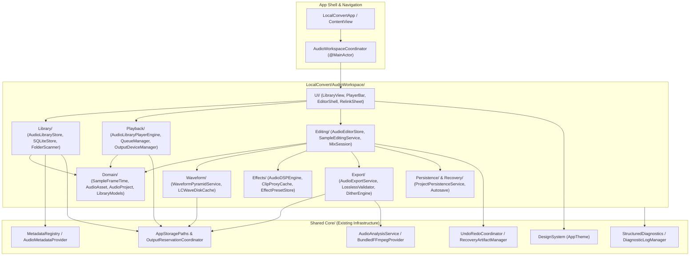
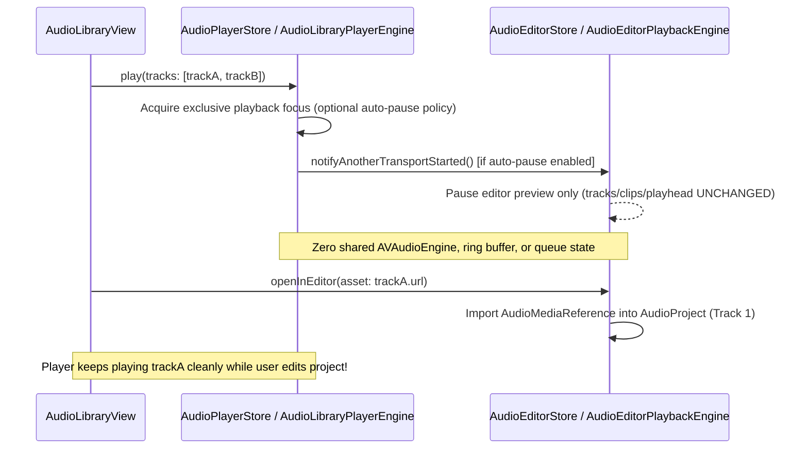

# Audio Workspace — Module Architecture & Repository Integration

**Document ID:** LC-AW-ARCH-002  
**Target Platform:** macOS 15.0+, Apple Silicon (`arm64`), Swift 6 (`SWIFT_STRICT_CONCURRENCY: complete`)  
**Phase Status:** Phase 61.1 Corrected Architecture Specification

---

## 1. Existing Repository & Infrastructure Audit

An actual inspection of the current repository shows substantial existing audio-editing and shared infrastructure already in place, alongside clear structural gaps and one tight coupling to remove before expanding into a full Audio Workspace.

### 1.1 Audio Engine & UI Subsystems

| Subsystem / File | What Already Exists | Reusable? | What Is Incomplete / Gap | Phase 62+ Disposition |
|---|---|---|---|---|
| [AudioEditorModels.swift](file:///Users/cancan/Desktop/LocalConvert/LocalConvert/Engines/AudioEditor/AudioEditorModels.swift) | `AudioMediaReference` (fingerprint + `bookmarkData` + `SourceStatus`), `ClipFadeCurve` (5 curves), `ClipFadeSpec`, `AudioEffectChainConfig`, `AudioClip`, `AudioTrack`, `AudioMarker`, `AudioEditorProject` (v2), `TimelineState`. | Partially | Positions & durations use `TimeInterval` (`Double`) instead of integer sample frames; no Library/Playlist/Queue/ExportConfig domain separation. | **Extend & Evolve** into `AudioWorkspace/Domain/` with `SampleFrameTime` (`Int64` frames + rate) and v2 -> v3 migration. |
| [PlaybackEngine.swift](file:///Users/cancan/Desktop/LocalConvert/LocalConvert/Engines/AudioEditor/PlaybackEngine.swift) | `AudioPlaybackEngine` (`@MainActor ObservableObject`) using `AVAudioEngine` + lock-protected `AudioRingBuffer`, live meters, loop config. | For Editor only | Hard-coupled to `AudioMixSession`; cannot act as a general Library Music Player (no track queue, gapless handoff, shuffle/repeat, speed, output device selector). | **Isolate** for timeline editor playback (`AudioEditorPlaybackEngine`); **Newly Implement** independent `AudioLibraryPlayerEngine`. |
| [WaveformRenderingService.swift](file:///Users/cancan/Desktop/LocalConvert/LocalConvert/Engines/AudioEditor/WaveformRenderingService.swift) | `actor`, 64 MB bounded LRU in-memory cache, `StereoWaveformData` (`framesPerBucket = 512`), `AVAudioFile` + FFmpeg proxy fallback. | Core pattern reusable | Single resolution (`512` frames/bucket) only; RAM-only cache (re-decodes after relaunch); no progressive streaming; stereo-only (`minL/maxL/minR/maxR`). | **Extend** into multi-resolution `.lcwave` peak pyramid engine (`WaveformPyramidService` + disk cache). |
| [AudioDSPEngine.swift](file:///Users/cancan/Desktop/LocalConvert/LocalConvert/Engines/AudioEditor/AudioDSPEngine.swift) & [AudioDSPModels.swift](file:///Users/cancan/Desktop/LocalConvert/LocalConvert/Engines/AudioEditor/AudioDSPModels.swift) | Double-precision RBJ biquad/parametric EQ, Accelerate/vDSP processing, dynamic/slot effect chain models. | Yes (High) | Needs unified sample-frame parameterization and test matrix expansion across non-48 kHz rates & multichannel layouts. | **Reuse & Extend** inside `AudioWorkspace/Effects/`. |
| [AudioEditingService.swift](file:///Users/cancan/Desktop/LocalConvert/LocalConvert/Engines/AudioEditor/AudioEditingService.swift) | Pure value-based clip split, trim, cut/copy/paste, mute/gain operations (`AudioClipboardItem`). | Concept & logic reusable | Uses `Double` (`eps = 0.0005` sec) comparisons; prone to sample boundary rounding drift across cumulative edits. | **Extend / Refactor** to operate on integer `SampleFrameTime` + `SampleFrameRange` in `AudioWorkspace/Editing/`. |
| [AudioMixingService.swift](file:///Users/cancan/Desktop/LocalConvert/LocalConvert/Engines/AudioEditor/AudioMixingService.swift) | `AudioGainAutomation`, `AudioEffectFilterBuilder`, `AudioMixSession`, `ClipProxyCache` + bundled FFmpeg bridge. | Yes (High) | Proxy generation and FFmpeg execution should share unified cancellation & `AppStoragePaths.audioEditorProxiesDirectory` hygiene. | **Reuse & Harden** in `AudioWorkspace/Effects/` & `Editing/`. |
| [AudioEffectPresetStore.swift](file:///Users/cancan/Desktop/LocalConvert/LocalConvert/Engines/AudioEditor/AudioEffectPresetStore.swift) | Preset storage at `AppStoragePaths.audioEditorPresetsFileURL`. | Yes (Full) | Already Phase 58 sandboxed. | **Reuse Without Duplication.** |
| [ProjectPersistenceService.swift](file:///Users/cancan/Desktop/LocalConvert/LocalConvert/Engines/AudioEditor/ProjectPersistenceService.swift) | `.lcproject` (v2) & `.lcprojpkg` (`Media/`), atomic writes, v1 -> v2 migration, `AudioAutosaveSnapshot` in `audioEditorRecoveryDirectory`. | Yes (High) | Needs v3 project schema support (`SampleFrameTime`), cross-Mac relink polish, and SQLite library linkage metadata if imported from library. | **Reuse & Extend** in `AudioWorkspace/Persistence/` & `Recovery/`. |
| [AudioExportService.swift](file:///Users/cancan/Desktop/LocalConvert/LocalConvert/Engines/AudioEditor/AudioExportService.swift) | `.wav, .mp3, .m4a, .flac, .aac, .aiff, .ogg, .opus, .alac` export, LUFS/true-peak preview, dithering option, stem cleanup, `AudioExportReport`. | Yes (High) | **Coupling & audit gaps:** calls `ConversionManager.reserveUniqueOutputURL` & `releaseReservedOutputURL`; stages preview CAFs in `FileManager.default.temporaryDirectory`; clamps `-ac` `1...2`; passes `-c:a libvorbis` for `.ogg` despite FFmpeg 9.0.2 shipping `vorbis`; validator omits explicit bit-depth verification. | **Extend & Decouple**: extract neutral `OutputReservationCoordinator` in `Core/FileManagement/`; align 3 export modes (`bitExactPassThrough`, `losslessFormatReRender`, `lossyFormatReRender`); fix `.ogg` & bit-depth checks. |
| [AudioEditorStore.swift](file:///Users/cancan/Desktop/LocalConvert/LocalConvert/Engines/AudioEditor/AudioEditorStore.swift) & [AudioEditorUndoCommands.swift](file:///Users/cancan/Desktop/LocalConvert/LocalConvert/Engines/AudioEditor/AudioEditorUndoCommands.swift) | `@MainActor` store, `UndoRedoCoordinator` rehydrator & focus integration, continuous-drag coalescing, autosave scheduling. | Yes (High) | Large (`1074` lines); mirrors `playbackEngine.objectWillChange`. Needs library handoff entrypoints without absorbing Library/Player state. | **Reuse for Editor**, keep `AudioLibraryStore` and `AudioPlayerStore` strictly separate. |
| `LocalConvert/Features/AudioEditor/*` (9 views) | `AudioEditorRootView` (hosted inside `AudioToolboxView.swift:172`), `MultitrackTimelineView`, `StereoWaveformClipView`, `TimeRulerView`, `TrackHeaderView`, `TransportBarView`, `AudioEditorInspectorView`, `AudioEffectChainEditorView`, `AudioEditorExportSheet`. | Yes (High) | Currently buried inside `AudioToolboxView` picker instead of dedicated Audio Workspace navigation shell; missing Audio Library Manager & Independent Player UI. | **Reuse & Move/Compose** inside `AudioWorkspace/UI/`. |
| `LocalConvert/Engines/AudioToolbox/*` | `AudioAnalysisService` (LUFS/true-peak), `AudioCodecCapability`, `SpotifyCompatibilityService`. | Yes (`AudioAnalysisService`, capabilities) | Toolbox batch UI belongs to Conversion/Toolbox tab. | **Reuse shared analysis services** without duplicating LUFS/probe code. |

### 1.2 Shared Application Infrastructure

| Component | Current Role | Reuse / Extension Plan |
|---|---|---|
| [AudioMetadataProvider.swift](file:///Users/cancan/Desktop/LocalConvert/LocalConvert/Core/Metadata/Providers/AudioMetadataProvider.swift) & `MetadataManager` | Reads 18 audio formats; writes tags in-place safely across 13 writable containers with explicit capability notes & undo support. | **Do NOT duplicate.** Library indexing & metadata editing call `AudioMetadataProvider` / `MetadataManager` (never direct FFmpeg tag duplication in Library). |
| [AppStoragePaths.swift](file:///Users/cancan/Desktop/LocalConvert/LocalConvert/Core/FileManagement/AppStoragePaths.swift) | Single source of truth for `Application Support`, `Caches`, `Logs`, `audioEditorRecoveryDirectory`, `audioEditorProxiesDirectory`, `audioEditorPresetsFileURL`, Phase 58/58.1 sandbox + `UserDefaults` isolation. | **Extend** with explicit properties: `audioLibraryDatabaseURL`, `audioWaveformCacheDirectory`, `audioExportStagingDirectory`, `audioPlayerStateURL`. |
| `OutputManager.swift` / `ConversionManager+OutputReservation.swift` | Collision-safe atomic URL reservation, source overwrite protection, & temp cleanup. | **Extract shared reservation primitive** (`OutputReservationCoordinator`) into `Core/FileManagement/` preserving all ConversionManager compatibility contracts so Audio Workspace exports never import `ConversionManager`. |
| [UndoRedoCoordinator.swift](file:///Users/cancan/Desktop/LocalConvert/LocalConvert/Core/UndoRedo/UndoRedoCoordinator.swift) & [RecoveryArtifactManager.swift](file:///Users/cancan/Desktop/LocalConvert/LocalConvert/Core/UndoRedo/RecoveryArtifactManager.swift) | Restart-persistent JSON undo journal + SHA-256 content-addressed artifact store. | **Reuse** existing `.audioEditor(projectID: UUID)` context + artifact manager without duplicating undo stacks. |
| [StructuredDiagnostics.swift](file:///Users/cancan/Desktop/LocalConvert/LocalConvert/Core/Diagnostics/StructuredDiagnostics.swift) | Redacted ring buffer (`maxEvents = 200`) + `DiagnosticLogManager` bridge (`ErrorDetailsFormatter.sanitize`). | **Extend** `DiagnosticCategory` with `.audioLibrary`, `.audioPlayer`, `.audioWaveform`, `.audioEditor` using privacy-redacted messages only. |
| `DesignSystem.swift` | Semantic tokens (`AppTheme.Colors`, `Spacing`, `Typography`, `AppWorkspaceSurface`, `OpaqueWindowChromeHost`). | **Reuse exclusively** across all Audio Workspace views for native LocalConvert visual cohesion. |
| `LocalConvertTestSupport/` (`TestSandbox`, `SyntheticMP4FixtureWriter`) | Isolated temporary sandboxes + QoS-safe async fixture writer pattern. | **Reuse** `TestSandbox` and mirror `SyntheticMP4FixtureWriter` with `SyntheticAudioFixtureWriter` (PCM/WAV/ALAC/FLAC test generator). |

---

## 2. Proposed Modular Architecture (`AudioWorkspace`)

Rather than bloating `AppState` or entangling Conversion Workspace queues, Audio Workspace sits in a self-contained vertical slice (`LocalConvert/AudioWorkspace/`) with unidirectional dependencies into shared `Core/` services and zero dependency on `ConversionManager` or `ConversionQueue`.

### Module Breakdown & Boundaries

| Folder | Public / Module Interface | Internal Services | Responsibility |
|---|---|---|---|
| `AudioWorkspace/Domain/` | `SampleRate`, `SampleFrameTime`, `SourceFrameTime`, `TimelineFrameTime`, `RenderFrameTime`, `FrameDelta`, `SampleFrameRange`, `AudioAsset`, `AudioMetadata`, `AudioLibrary`, `AudioCollection`, `AudioPlaylist`, `PlaybackQueue`, `PlaybackSession`, `WaveformPyramid`, `AudioProject`, `AudioTrack`, `AudioClip`, `AudioSelection`, `AudioEditOperation`, `AudioExportConfiguration`, `AudioRecoveryState` | Codable v1/v2/v3 migration, `Int128` rational rate math, & overflow validators | Pure `Sendable` value types; zero UI or framework side effects. |
| `AudioWorkspace/Library/` | `AudioLibraryStore` (`@MainActor ObservableObject`) | `SQLiteLibraryDatabase` (`actor`), `LibraryFolderScanner` (`actor`), `DuplicateDetector`, `MissingFileReconciler` | File/folder indexing, Option A external-content FTS5 search (+ `LIKE` fallback), playlists/smart collections, bookmark relinking, explicit tag-write bridging via `AudioMetadataProvider`. |
| `AudioWorkspace/Playback/` | `AudioPlayerStore` (`@MainActor ObservableObject`), `AudioLibraryPlayerEngine` | `PlaybackQueueController`, `GaplessAVAudioPlayerNodeHost`, `CoreAudioOutputDeviceMonitor` | Completely independent music & reference track player; never shares state with `AudioMixSession`. |
| `AudioWorkspace/Waveform/` | `WaveformPyramidService` (`actor`) | `LCWaveDiskCache` (`actor`), `AcceleratePeakExtractor` | Progressive streaming multi-resolution peak extraction (`vDSP`), bounded 64 MB RAM LRU + bounded 512 MB disk `.lcwave` cache. |
| `AudioWorkspace/Editing/` | `AudioEditorStore` (`@MainActor ObservableObject`), `SampleEditingService` | `AudioMixSession`, `AudioEditorPlaybackEngine` (`AVAudioEngine` + `AudioRingBuffer`), `AudioEditorUndoRehydrator` | Sample-frame edit graph, live timeline preview, selection analysis, continuous undo coalescing. |
| `AudioWorkspace/Effects/` | `AudioDSPEngine`, `AudioEffectPresetStore`, `ClipProxyCache` | `AudioFilterGraphBuilder`, `BiquadCoeffs` | RBJ EQ, dynamics, time/pitch, channel math shared identically between timeline preview and export. |
| `AudioWorkspace/Export/` | `AudioExportService` | `LosslessNativeExporter` (`AVAudioFile`/`ExtAudioFile`), `FFmpegLosslessBridge`, `TPDFDitherer`, `AudioExportValidator` | Multi-mode export (`BitExactPassThrough`, `LosslessFormatReRender`, `LossyFormatReRender`), LUFS/true-peak scan, atomic write via `OutputReservationCoordinator`, stem cleanup. |
| `AudioWorkspace/Persistence/` & `Recovery/` | `ProjectPersistenceService` | `AutosaveScheduler`, `MediaPackageAssembler` | `.lcproject` (v1/v2/v3) & `.lcprojpkg`, incremental autosave snapshots, crash recovery prompt, missing-asset bookmark resolution. |
| `AudioWorkspace/UI/` | `AudioWorkspaceRootView` (mode switcher / split shell) | `AudioLibraryView`, `AudioLibrarySidebarView`, `PersistentPlayerBarView`, `PlaybackQueuePopover`, `AudioEditorRootView` + subviews | Pure SwiftUI presentation styled with `DesignSystem`; decoupled state mutations safe from Phase 59 view-update warnings. |

---

## 3. Isolation & Dependency Rules

### 3.1 Decoupling Conversion Workspace from Audio Workspace
- **Rule 1:** `AudioWorkspace` MUST NOT reference `ConversionManager`, `ConversionQueue`, `FileListView`, or `DropZoneView`.
- **Rule 2:** Collision-safe destination reservation (`reserveOutputURL`, `reserveUniqueOutputURL`, `releaseReservedOutputURL`, `finalizeOutputFile`, `cleanStaleTemporaryFiles`) currently implemented inside [ConversionManager+OutputReservation.swift](file:///Users/cancan/Desktop/LocalConvert/LocalConvert/Core/Conversion/ConversionManager+OutputReservation.swift) MUST be extracted into a neutral `OutputReservationCoordinator` in `LocalConvert/Core/FileManagement/` (with thin forwarding static shims on `ConversionManager` so zero existing Conversion Workspace call sites break).
- **Rule 3:** `AppState` holds a lightweight lazy/injected reference `audioWorkspace: AudioWorkspaceCoordinator` (replacing the ad-hoc `AudioEditorStore` embedded in `AudioToolboxView`), exposing clean top-level navigation between Conversion tabs and Audio Workspace modes while forwarding cross-workspace actions ("Open in Audio Editor", "Add Converted Output to Audio Library") strictly via value-type `URL` / `FileFormat` messages.

#### 3.1.1 `OutputReservationCoordinator` Extraction & Compatibility Contract (12 Guarantees)
Extracting shared reservation logic from `ConversionManager+OutputReservation.swift` into `LocalConvert/Core/FileManagement/OutputReservationCoordinator.swift` MUST preserve 100% of existing Conversion Workspace semantics while decoupling Audio Workspace:

| # | Contract Guarantee | Exact Specification (Derived from `ConversionManager+OutputReservation.swift`) |
|---|---|---|
| **1** | **Unique filename generation** | Default candidate `<baseName>.<ext>` (with path-unsafe `/`, `:`, `..` sanitized in affixes and filenames); on conflict generates `<baseName> (1).<ext>`, `<baseName> (2).<ext>`, etc. Matching case-sensitivity per volume via `.volumeSupportsCaseSensitiveNamesKey` (`std.path` vs `.lowercased()`). |
| **2** | **Concurrent reservation atomicity** | Single lock-protected (`NSLock` / `OSAllocatedUnfairLock`) in-memory `reservedPaths: Set<String>` ensures two concurrent jobs/stems targeting `<dir>/song.wav` receive distinct paths (`song.wav` and `song (1).wav`), including under `.overwrite` policy inside the same concurrent batch (`allocateUniqueLocked`). |
| **3** | **Ownership & release** | Every caller acquiring a reservation releases its reservation key in a `defer { OutputReservationCoordinator.releaseReservedOutputURL(destURL) }` block (and batch/reset hooks clear via `clearReservedOutputURLs()`), guaranteeing a failed or finished job never permanently blocks future exports to that name. |
| **4** | **Successful conversion commit** | Temp staging output is committed to the reserved `finalURL` via `moveOrReplaceTempFile(_:to:policy:)`, returning the final written URL cleanly before releasing the reservation lock key. |
| **5** | **Failure cleanup** | On engine error before commit, the staged temp file (e.g., `.mix-*.caf`, `.enc-*`, `.partial`) is deleted via `defer`, partial already-written batch stems (`urls`) are removed, and the reservation key is released without leaving corrupt zero-byte final files. |
| **6** | **Cancellation cleanup** | On `CancellationError`, child FFmpeg processes terminate via `AsyncProcessRunner`, temp & partial multi-file stem outputs are deleted, and reserved keys are released. |
| **7** | **Post-reservation collision handling** | During commit (`moveOrReplaceTempFile`), if an external process created a file at `finalURL` *between* reservation and commit: under `.createUnique` or `.skip`, **refuse overwrite** and throw `ConversionError.outputFileAlreadyExists(finalURL)` (never silently clobber externally created files); under `.overwrite` (explicit non-source overwrite), replace safely. |
| **8** | **Destination & source protection** | Validate destination folder existence/writability (`OutputManager.isOutputDirectoryValid`); force `.createUnique` whenever candidate resolves to `sourceURL` (`matchesSource && policy != .overwrite`), force non-overwrite for video trim (`hasVideoTrim`), and explicitly reject overwriting any protected source asset path in `AudioExportService`. |
| **9** | **Atomic output commit** | When replacing an existing file under permitted `.overwrite`, use `FileManager.default.replaceItemAt(finalURL, withItemAt: tempURL)` first (falling back to remove+move only if cross-volume replace throws); for new destinations perform single-volume `moveItem(at: tempURL, to: finalURL)`. |
| **10** | **Stale reservation & temp cleanup** | Retain `cleanStaleTemporaryFiles(in:olderThan:)` behavior for `LocalConvert-*` and `LocalConvertAudio_*` artifacts older than `ageSeconds`, extended cleanly to `AppStoragePaths.audioExportStagingDirectory` temporary artifacts at startup without removing active valid files. |
| **11** | **Zero `ConversionManager` dependency** | `AudioExportService` (and any Audio Workspace service) imports/calls `OutputReservationCoordinator` directly; `ConversionManager` symbols are never referenced from `AudioWorkspace/`. |
| **12** | **Unchanged public & UI semantics** | `ConversionManager` retains thin forwarding shims (`reserveOutputURL`, `reserveUniqueOutputURL`, `reserveMultiPageOutputURL`, `releaseReservedOutputURL`, `finalizeOutputFile`, `uniqueOutputURL`, `multiPageOutputURL`, `cleanStaleTemporaryFiles`) with identical signatures, error types (`ConversionError`), Existing File Handling UI labels, and existing Conversion Workspace behavior. |

### 3.2 Strict Isolation Between Player and Waveform Editor

- `AudioLibraryPlayerEngine` owns its own `AVAudioEngine` + `AVAudioPlayerNode` + `AVAudioUnitTimePitch` (for rate control).
- `AudioEditorPlaybackEngine` (`PlaybackEngine.swift`) owns its own `AVAudioEngine` + `AudioRingBuffer` + `AudioMixSession`.
- Neither holds a reference to the other. An optional lightweight `PlaybackArbitrationCenter` (`@MainActor`) simply sends a pause notification when the other transport begins active playback so two songs never play simultaneously unless user disables auto-pause.

---

## 4. Concurrency, Error Handling, Cancellation & Resource Lifecycle

1. **Swift 6 Strict Concurrency (`SWIFT_STRICT_CONCURRENCY: complete`):**
   - Domain models, edit results, peak buckets, and diagnostics are value-type `Sendable`.
   - I/O-heavy components (`SQLiteLibraryDatabase`, `LibraryFolderScanner`, `WaveformPyramidService`, `LCWaveDiskCache`, `AudioSourceResolver`, `RecoveryArtifactManager`) are isolated `actor`s performing blocking file/SQLite/DSP work off `MainActor`.
   - Observable stores (`AudioLibraryStore`, `AudioPlayerStore`, `AudioEditorStore`) are `@MainActor` `ObservableObject`s. Following **Phase 59**, SwiftUI `List`/`Table` selection and picker bindings use local `@State` / structured `.onChange` or `.task` rather than mutating `@Published` synchronously inside view layout/update passes.
   - Real-time `AVAudioSourceNode` render callbacks lock-free or tiny `OSAllocatedUnfairLock` (`AudioRingBuffer`), never calling Swift async/allocating code or Objective-C runtime on the audio I/O thread.
   - Following **Phase 60**, async tests and utilities avoid `DispatchSemaphore.wait()` and untamed `Task.detached` priority inversions.

2. **Cancellation & Stale-Result Prevention:**
   - Library scans, waveform pyramid extraction, proxy rendering, and export all check `try Task.checkCancellation()`, tie long-running handles to stored `Task` references, and tag async UI completions with request/generation IDs (`let gen = ++scanGeneration`) to drop stale updates cleanly.
   - Cancelling an export kills any child `BundledFFmpegProvider` subprocess via `AsyncProcessRunner`, cleans `.partial` staging files, and releases reserved output URLs.

3. **Storage & Privacy Boundaries (`AppStoragePaths` + `StructuredDiagnostics`):**
   - Every Audio Workspace persistence URL resolves through `AppStoragePaths` (preserving Phase 58 / 58.1 sandbox and `UserDefaults` isolation):
     - `audioLibraryDatabaseURL`: `<Application Support>/AudioLibrary/library.sqlite` (with `-wal` / `-shm`)
     - `audioWaveformCacheDirectory`: `<Caches>/AudioWaveformCache/`
     - `audioEditorProxiesDirectory`: `<Caches>/AudioEditorProxies/`
     - `audioEditorRecoveryDirectory`: `<Application Support>/AudioEditorRecovery/`
     - `audioEditorPresetsFileURL`: `<Application Support>/AudioEditorPresets/effect-chain-presets.json`
     - `audioPlayerStateURL`: `<Application Support>/AudioLibrary/player-session.json`
     - `audioExportStagingDirectory`: `<Caches>/AudioExportStaging/` (cleaned on completion/cancel/startup)
   - All diagnostic events log through `StructuredDiagnostics.record(...)` with new `DiagnosticCategory` cases (`.audioLibrary`, `.audioPlayer`, `.audioWaveform`, `.audioEditor`) and redacted filenames/messages via `ErrorDetailsFormatter.sanitize(_:)`, never writing unredacted `.public` paths, artist/track tags, or lyrics to unified system logs.
