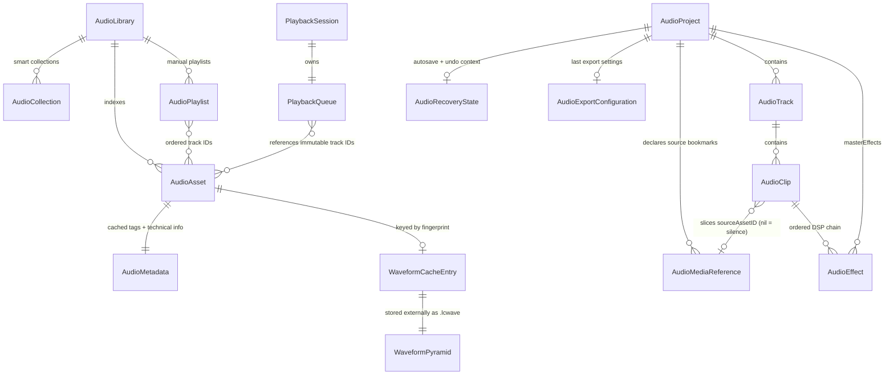

# Audio Workspace — Data Model, Sample-Frame Time & Persistence Specification

**Document ID:** LC-AW-MODEL-004  
**Phase Status:** Phase 61.1 Corrected Technical Specification

---

## 1. Entity Relationship Overview



---

## 2. Sample-Frame Mathematics & Coordinate Model (Source of Truth)

Currently in [AudioEditorModels.swift](file:///Users/cancan/Desktop/LocalConvert/LocalConvert/Engines/AudioEditor/AudioEditorModels.swift), `AudioClip.timelineStart`, `AudioClip.sourceStart`, `AudioClip.duration`, and `TimelineState` use floating-point `TimeInterval` (`Double`) with an ad-hoc `eps = 0.0005` s in [AudioEditingService.swift](file:///Users/cancan/Desktop/LocalConvert/LocalConvert/Engines/AudioEditor/AudioEditingService.swift). Binary floating-point arithmetic introduces cumulative sample-boundary drift (`0.1 + 0.2 != 0.3`) and rate-conversion ambiguity.

All Audio Workspace editing geometry uses **exact integer sample frames** paired with a **validated positive integer sample rate** and **exact 128-bit integer rational cross-rate arithmetic** — never floating-point `Double` arithmetic as the source of truth.

### 2.1 Domain Coordinate Spaces & Signedness Rules

A frame number alone is ambiguous without knowing which clock domain it addresses. Audio Workspace separates four distinct types:

| Type | Coordinate Meaning | Frame Sign Rule | Sample Rate Domain |
|---|---|---|---|
| `SourceFrameTime` | Offset inside an immutable `AudioMediaReference` stream | Must be `>= 0` (non-negative; rejected if `< 0`) | Source asset sample rate (`sourceRateHz`) |
| `TimelineFrameTime` | Absolute position on `AudioProject` timeline | Must be `>= 0` (timeline origin `0` is start of project; rejected if `< 0`) | Project sample rate (`projectRateHz`) |
| `RenderFrameTime` | Output frame offset within an export render job | Must be `>= 0` | Target export sample rate (`renderRateHz`) |
| `FrameDelta` | Signed relative frame offset/nudge (`+/-` shift) | Signed `Int64` (both negative and positive deltas valid) | Explicit `SampleRate` context |

`SampleFrameTime` is the underlying arithmetic value type backing `TimelineFrameTime`, `SourceFrameTime`, `RenderFrameTime`, and `FrameDelta`, parameterized or tagged by domain context in public APIs so source coordinates and timeline coordinates cannot be mixed accidentally.

### 2.2 `SampleRate`, Errors, and Exact Rational Arithmetic

```swift
struct SampleRate: Codable, Hashable, Comparable, Sendable {
    /// Allowed range covers standard & hi-res PCM rates cleanly (8_000...768_000 nominal, 1...768_000 mathematical floor).
    static let validRange: ClosedRange<Int32> = 1...768_000
    let hz: Int32

    init(_ hz: Int32) throws {
        guard Self.validRange.contains(hz) else {
            throw SampleFrameError.invalidSampleRate(hz)
        }
        self.hz = hz
    }
}

enum SampleFrameError: Error, LocalizedError, Equatable, Sendable {
    case invalidSampleRate(Int32)
    case negativeFrameNotAllowed(Int64)
    case integerOverflow
    case integerUnderflow
    case invalidRangeLength(Int64)
    case nonFiniteLegacySeconds(Double)
    case lossyBoundaryExceedsInt64
}
```

#### Core Arithmetic Rules (Zero `Double` in Frame Truth)
1. **Validation & Checked Overflow:**
   - Every addition/subtraction (`adding(delta:)`, `offset(by:)`, `endFrame`) uses Swift checked arithmetic (`addingReportingOverflow`, `subtractingReportingOverflow`) and throws `SampleFrameError.integerOverflow` or `.integerUnderflow` rather than trapping or wrapping silently.
   - Non-negative domains (`SourceFrameTime`, `TimelineFrameTime`, `RenderFrameTime`) throw `SampleFrameError.negativeFrameNotAllowed` if construction or checked offset yields `< 0`.
2. **Exact Cross-Rate Conversion (`Int128` Rational Math + Round-Half-Away-From-Zero):**
   - Notice Swift 6 / macOS 15+ provides native `Int128` (`UInt128`). Converting `frame` from `sourceRate` (`r_s`) to `targetRate` (`r_t`) evaluates the exact rational product `numerator = Int128(frame) * Int128(r_t)` divided by `denominator = Int128(r_s)`:
   - When `r_s == r_t`: zero arithmetic loss (`return self`).
   - Otherwise:
     - `let (quotient, remainder) = numerator.quotientAndRemainder(dividingBy: denominator)`
     - **Deterministic Rounding Policy — Round-Half-Away-From-Zero:**
       If `2 * abs(remainder) >= denominator`, increment magnitude away from zero (`quotient >= 0 && frame >= 0 ? quotient + 1 : quotient - 1`). Example: exact `.5` frame tie (`frame = 1` at `1000 Hz` -> `1500 Hz` = `1.5`) rounds deterministically to `2`; negative delta `-1.5` rounds deterministically to `-2`.
     - Verify `Int64(exactly: rounded)` succeeds; otherwise throw `SampleFrameError.integerOverflow` / `.integerUnderflow` (never saturate to `Int64.max` or wrap).
3. **Cross-Rate Comparison (`compare` / `<` / `==`):**
   - Equal duration instant check compares exact `Int128` cross-products without converting to `Double` and without prematurely rounding one operand onto the other:
     - `lhsProduct = Int128(lhs.frame) * Int128(rhs.sampleRate.hz)`
     - `rhsProduct = Int128(rhs.frame) * Int128(lhs.sampleRate.hz)`
     - `lhs` represents an earlier exact physical instant than `rhs` iff `lhsProduct < rhsProduct`; mathematically equal iff `lhsProduct == rhsProduct`.
     - For `Int64.max * 768_000` (`~7.08e24`), the maximum intermediate product requires `~83 bits`, which fits safely inside signed 128-bit `Int128` (`max ~1.70e38`) with zero overflow risk!

### 2.3 `SampleFrameRange` Invariants & Zero-Length Semantics

```swift
struct SampleFrameRange: Codable, Hashable, Sendable {
    let startFrame: Int64     // inclusive; must be >= 0
    let frameCount: Int64     // non-negative (>= 0)
    let sampleRate: SampleRate

    init(startFrame: Int64, frameCount: Int64, sampleRate: SampleRate) throws {
        guard startFrame >= 0 else { throw SampleFrameError.negativeFrameNotAllowed(startFrame) }
        guard frameCount >= 0 else { throw SampleFrameError.invalidRangeLength(frameCount) }
        let (end, overflow) = startFrame.addingReportingOverflow(frameCount)
        guard !overflow, end >= startFrame else { throw SampleFrameError.integerOverflow }
        self.startFrame = startFrame
        self.frameCount = frameCount
        self.sampleRate = sampleRate
    }

    var endFrame: Int64 { startFrame + frameCount } // exclusive, guaranteed non-overflowing
    var isEmpty: Bool { frameCount == 0 }
}
```

- **Exclusive End Interval (`[startFrame, endFrame)`):** A clip starting at `0` with `100` frames occupies frames `0...99` (`endFrame = 100`), matching C/AudioBuffer zero-indexed conventions cleanly. Splitting at frame `40` yields `[0, 40)` (`frameCount = 40`) and `[40, 100)` (`frameCount = 60`), satisfying `left.frameCount + right.frameCount == original.frameCount` (`100`).
- **Explicit Zero-Length (`frameCount == 0`) Semantics:**
  - `SampleFrameRange(..., frameCount: 0)` is **valid as a value** representing an empty selection point / cursor caret.
  - Structural edits (`cut`, `delete`, `trim`, `normalize`, `splitAtSelection`) treat `isEmpty == true` as a **safe no-op** (`changed = false`), avoiding empty zero-frame ghost clips on tracks.
  - Export range resolution rejects `isEmpty == true` with a typed user validation error (`"Selection or timeline range contains zero audio frames."`).

### 2.4 Source -> Timeline -> Render Coordinate Relationship
1. **Source Space (`SourceFrameTime` at `clip.sourceRateHz`):** Clip slice starts at `sourceStartFrame` in the underlying file. Note `clip.durationFrames` lives in project `TimelineFrameTime` space (`project.sampleRateHz`). When `stretch != 1.0` (`timeStretch`), source span consumed is converted rationally: `sourceSpanFrames = converted(durationFrames, from: projectRateHz, to: sourceRateHz) * stretchRational` (rounded cleanly at export/decode setup).
2. **Timeline Space (`TimelineFrameTime` at `project.sampleRateHz`):** Placement on track is `[timelineStartFrame, timelineStartFrame + durationFrames)`. Changing project sample rate recalculates timeline clip coordinates via exact `Int128` conversion (`SampleFrameError` thrown if any clip overflows `Int64`).
3. **Render / Export Space (`RenderFrameTime` at `export.sampleRateHz`):** Converting a timeline export range `[range.startFrame, range.endFrame)` to target `export.sampleRateHz` runs `convertChecked(to: export.sampleRate)` once on range bounds before sample rendering (`AVAudioConverter` handles continuous polyphase resampling of decoded PCM blocks).
4. **Derived UI Seconds Formatting:** `Double(frame) / Double(sampleRate.hz)` is used **only** for display (`mm:ss.mmm` ruler labels) and passing float pixel positions to `Canvas`.

### 2.5 Legacy `v1 / v2` `TimeInterval` -> `v3` Deterministic Migration
When loading existing `schemaVersion == 1` or `2` `.lcproject` documents from [ProjectPersistenceService.swift](file:///Users/cancan/Desktop/LocalConvert/LocalConvert/Engines/AudioEditor/ProjectPersistenceService.swift):
1. Validate legacy `project.sampleRate`: must be finite and within `SampleRate.validRange` after rounding to `Int32` (default `48_000` if omitted in v1). Reject NaN/Inf/out-of-range rates cleanly as corrupt project input.
2. Convert each `Double` timestamp/duration (`t`) deterministically:
   - Reject `NaN` or infinite values (`SampleFrameError.nonFiniteLegacySeconds`).
   - Clamp negative legacy noise (e.g. `-0.0`) only if `-0.0 == t` -> `0`; reject strictly negative `< 0.0` clip positions/durations.
   - Multiply `let exactFrames = (Decimal(t) * Decimal(sampleRate.hz))` or scaled exact rounding with **round-half-away-from-zero** (`NSDecimalRound(..., .plain)`), checking bounds `<= Double(Int64.max / 2)` before `Int64` construction (`lossyBoundaryExceedsInt64` on extreme floats).
   - Never overwrite legacy `.lcproject` files automatically on disk during migration; persist v3 format only on explicit user Save or new autosave snapshot.

---

## 3. Core Domain Model Definitions

### 3.1 Library & Metadata Models
- **`AudioAsset` (`Sendable`, `Identifiable`):** `id: UUID`, `canonicalPath: String`, `bookmarkData: Data?`, `displayFilename: String`, `fileExtension: String`, `formatRawValue: String`, `fileSizeBytes: Int64`, `modificationTime: TimeInterval`, `partialHashSHA256: String?`, `contentSHA256: String?`, `sampleRate: SampleRate`, `channelCount: Int`, `bitDepth: Int?`, `bitrateBps: Int?`, `frameCount: Int64`, `durationSeconds: Double` (derived cache for sort display), `isLosslessCodec: Bool`, `codecName: String`, `status: AssetAvailabilityStatus` (`ok`, `missing`, `modified`), `dateAdded: Date`, `dateModified: Date`, `playCount: Int`, `lastPlayedAt: Date?`, `isFavorite: Bool`, `rating: Int`.
- **`AudioMetadata` (`Sendable`, `Equatable`):** `title`, `artist`, `album`, `albumArtist`, `genre`, `year`, `trackNumber`, `trackTotal`, `discNumber`, `discTotal`, `composer`, `comment`, `lyrics`, `copyright`, `encoder`, `hasEmbeddedArtwork`, `artworkCacheKey: String?`, `metadataSource: MetadataOrigin` (`embeddedAndIndexed`, `libraryOnlyOverride`, `readOnlyTechnical`).
- **`AudioLibrary`:** Summary snapshot (`totalAssetCount`, `totalDurationSeconds`, `totalBytes`, `watchedRootFolders`, `schemaVersion`, `fts5Available`).
- **`AudioCollection` (Smart Collection):** Dynamic predicate saved as structured JSON (`id`, `name`, `iconName`, `filterSpec`, `sortField`, `sortAscending`).
- **`AudioPlaylist` (Manual Playlist):** User-ordered list (`id`, `name`, `description`, `createdAt`, `updatedAt`, `orderedAssetIDs: [UUID]`).

### 3.2 Independent Playback Models
- **`PlaybackQueue` (`Sendable`, `Equatable`):** `originalOrderIDs: [UUID]`, `activeOrderIDs: [UUID]`, `currentIndex: Int?`, `repeatMode: PlaybackRepeatMode` (`off`, `all`, `one`), `isShuffleEnabled: Bool`.
- **`PlaybackSession` (`Sendable`):** `activeAssetID: UUID?`, `playbackState: PlaybackTransportState` (`stopped`, `loading`, `playing`, `paused`, `error(String)`), `position: SourceFrameTime?`, `totalFrames: Int64`, `volume: Double`, `isMuted: Bool`, `preMuteVolume: Double`, `playbackRate: Double`, `outputDeviceUID: String?`, `outputDeviceName: String`.

### 3.3 Waveform Cache Models
- **`WaveformPyramid` (`Sendable`):** Multi-resolution levels (`framesPerBucket` `[64, 256, 1024, 4096, 16384]`), per-channel `(min, max, rms)` `Float32` triplets + `UInt8` clip mask. `bestLevel(forFramesPerPixel: Double)` picks the finest mip level whose `framesPerBucket <= framesPerPixel * 2.0`, capping draw complexity to `O(viewportPixels)`.
- **`WaveformCache` (`WaveformCacheEntry`):** `cacheKey`, `fileURL`, `byteSize`, `createdAt`, `lastAccessedAt`, `isComplete`.

### 3.4 Project, Editing, Effects, Export & Recovery Models
- **`AudioProject` (`Codable`, `Sendable`, versioned `schemaVersion = 3`):** `id`, `schemaVersion`, `name`, `sampleRate: SampleRate`, `tracks: [AudioTrack]`, `markers: [AudioMarker]` (`frame: Int64`), `mediaAssets: [AudioMediaReference]`, `masterEffects: [AudioEffect]`, `trackGroups: [AudioTrackGroup]`, `gridConfig`, `lastExportConfiguration: AudioExportConfiguration?`, `linkedLibraryAssetMap: [UUID: UUID]`.
- **`AudioTrack`:** `id`, `name`, `clips: [AudioClip]`, `volume`, `pan`, `isMuted`, `isSolo`, `isLocked`, `effectSlots: [AudioEffect]`, `groupID: UUID?`.
- **`AudioClip`:** `id`, `sourceAssetID: UUID?` (`nil` = generated silence), `name`, `timelineRange: SampleFrameRange` (at project `sampleRate`), `sourceStartFrame: Int64` (validated `>= 0`), `sourceRate: SampleRate`, `gainDB`, `isMuted`, `isLocked`, `isReversed`, `swapChannels`, `channelMode`, `fadeInFrames: ClipFadeSpecFrames?`, `fadeOutFrames: ClipFadeSpecFrames?`, `crossfadeCurve: ClipFadeCurve`, `effectSlots: [AudioEffect]`.
- **`AudioSelection` (`Sendable`, `Equatable`):** `trackIDs: Set<UUID>`, `range: SampleFrameRange?` (zero-length allowed for cursor), `selectedClipIDs: Set<UUID>`.
- **`AudioEditOperation`:** Value-enum for undoable non-destructive edit intents.
- **`AudioEffect`:** Typed effect slot (`AudioEffectSlot`) parameterized independently of sample timing floats.
- **`AudioExportConfiguration`:** Explicitly encodes `exportMode: AudioExportMode` (`bitExactPassThrough`, `losslessFormatReRender`, `lossyFormatReRender`), `scope`, `outputFormat`, `sampleRate: SampleRate`, `bitDepth: AudioExportBitDepth` (`int16`, `int24`, `float32`), `bitrateKbps`, `channelCount`, `preserveMetadata`, `loudnessNormalizeEnabled`, `targetLUFS`, `truePeakCeilingDBTP`, `ditheringPolicy` (`autoTPDFWhenDownquantizing`, `disabled`), `validateOutput`.
- **`AudioRecoveryState`:** Extends `AudioAutosaveSnapshot` with `projectID`, `savedAt`, `projectFileURLPath`, `sourceSchemaVersion`, `project: AudioProject`, `uncommittedUndoJournalID: UUID?`.

---

## 4. Database, Cache & Project File Persistence Specifications

### 4.1 Library Database (`SQLite3` WAL + Option A External-Content FTS5)

Stored at `AppStoragePaths.audioLibraryDatabaseURL` (`Application Support/.../AudioLibrary/library.sqlite`). Access is **strictly serialized** inside `actor SQLiteLibraryDatabase`. Zero user-supplied text is ever interpolated into SQL; all queries use `sqlite3_prepare_v2` + `sqlite3_bind_*` parameterized placeholders.

#### Required Connection Pragmas & Transaction Policy
On opening the connection:
```sql
PRAGMA journal_mode = WAL;
PRAGMA synchronous = NORMAL;
PRAGMA busy_timeout = 5000;
PRAGMA foreign_keys = ON;
```
All multi-statement mutations (`batchUpsertAssets`, `deleteAsset`, `reorderPlaylist`, `rebuildFTSIndex`) wrap inside explicit write transactions (`BEGIN IMMEDIATE TRANSACTION ... COMMIT`, with guaranteed `ROLLBACK` on thrown error).

#### Schema Strategy Justification: Option A (External-Content FTS5)
We choose **Option A (`content='assets', content_rowid='rowid'`)** over standalone FTS5 because LocalConvert libraries may index 25k–100k+ tracks; storing duplicate copies of every filename, artist, album, comment, and composer string in a standalone FTS table nearly doubles `.sqlite` disk footprint and creates split-brain drift risks. External-content FTS5 stores **only** the inverted search index in `assets_fts` backed by `assets`'s built-in SQLite 64-bit `rowid`, synchronized automatically and transactionally by SQL triggers.

*(Note: Previous draft erroneously listed `asset_id UNINDEXED` in `assets_fts`; removed below so every FTS column exists verbatim in `assets`, joining back via `assets.rowid = assets_fts.rowid`.)*

```sql
CREATE TABLE IF NOT EXISTS root_folders (
    id TEXT PRIMARY KEY,
    path TEXT NOT NULL UNIQUE,
    bookmark_data BLOB,
    last_scanned_at REAL,
    recursive INTEGER NOT NULL DEFAULT 1
);

CREATE TABLE IF NOT EXISTS assets (
    id TEXT PRIMARY KEY,
    canonical_path TEXT NOT NULL UNIQUE,
    bookmark_data BLOB,
    filename TEXT NOT NULL,
    file_extension TEXT NOT NULL,
    file_size INTEGER NOT NULL,
    mtime REAL NOT NULL,
    partial_sha256 TEXT,
    content_sha256 TEXT,
    sample_rate_hz INTEGER NOT NULL CHECK (sample_rate_hz BETWEEN 1 AND 768000),
    channel_count INTEGER NOT NULL CHECK (channel_count >= 1),
    bit_depth INTEGER,
    bitrate_bps INTEGER,
    frame_count INTEGER NOT NULL CHECK (frame_count >= 0),
    duration_sec REAL NOT NULL,
    is_lossless_codec INTEGER NOT NULL,
    codec_name TEXT NOT NULL,
    status TEXT NOT NULL DEFAULT 'ok' CHECK (status IN ('ok', 'missing', 'modified')),
    title TEXT,
    artist TEXT,
    album TEXT,
    album_artist TEXT,
    genre TEXT,
    year INTEGER,
    track_number TEXT,
    disc_number TEXT,
    composer TEXT,
    comment TEXT,
    metadata_origin TEXT NOT NULL DEFAULT 'embedded',
    artwork_hash TEXT,
    play_count INTEGER NOT NULL DEFAULT 0,
    last_played_at REAL,
    is_favorite INTEGER NOT NULL DEFAULT 0,
    rating INTEGER NOT NULL DEFAULT 0 CHECK (rating BETWEEN 0 AND 5),
    added_at REAL NOT NULL,
    updated_at REAL NOT NULL
);

CREATE VIRTUAL TABLE IF NOT EXISTS assets_fts USING fts5(
    filename,
    title,
    artist,
    album,
    album_artist,
    genre,
    composer,
    comment,
    content='assets',
    content_rowid='rowid',
    tokenize='unicode61 remove_diacritics 2'
);

-- External-content FTS5 synchronization triggers (exact SQLite FTS5 'delete' protocol):
CREATE TRIGGER IF NOT EXISTS assets_ai AFTER INSERT ON assets BEGIN
    INSERT INTO assets_fts(rowid, filename, title, artist, album, album_artist, genre, composer, comment)
    VALUES (new.rowid, new.filename, new.title, new.artist, new.album, new.album_artist, new.genre, new.composer, new.comment);
END;

CREATE TRIGGER IF NOT EXISTS assets_ad AFTER DELETE ON assets BEGIN
    INSERT INTO assets_fts(assets_fts, rowid, filename, title, artist, album, album_artist, genre, composer, comment)
    VALUES ('delete', old.rowid, old.filename, old.title, old.album, old.album_artist, old.genre, old.composer, old.comment);
END;

CREATE TRIGGER IF NOT EXISTS assets_au AFTER UPDATE OF filename, title, artist, album, album_artist, genre, composer, comment ON assets BEGIN
    INSERT INTO assets_fts(assets_fts, rowid, filename, title, artist, album, album_artist, genre, composer, comment)
    VALUES ('delete', old.rowid, old.filename, old.title, old.album, old.album_artist, old.genre, old.composer, old.comment);
    INSERT INTO assets_fts(rowid, filename, title, artist, album, album_artist, genre, composer, comment)
    VALUES (new.rowid, new.filename, new.title, new.artist, new.album, new.album_artist, new.genre, new.composer, new.comment);
END;

CREATE INDEX IF NOT EXISTS idx_assets_content_hash ON assets(content_sha256);
CREATE INDEX IF NOT EXISTS idx_assets_size_partial ON assets(file_size, partial_sha256);
CREATE INDEX IF NOT EXISTS idx_assets_artist_album ON assets(artist, album);

CREATE TABLE IF NOT EXISTS playlists (
    id TEXT PRIMARY KEY,
    name TEXT NOT NULL,
    created_at REAL NOT NULL,
    updated_at REAL NOT NULL
);

CREATE TABLE IF NOT EXISTS playlist_items (
    playlist_id TEXT NOT NULL REFERENCES playlists(id) ON DELETE CASCADE,
    position INTEGER NOT NULL,
    asset_id TEXT NOT NULL REFERENCES assets(id) ON DELETE CASCADE,
    PRIMARY KEY (playlist_id, position)
);

CREATE TABLE IF NOT EXISTS smart_collections (
    id TEXT PRIMARY KEY,
    name TEXT NOT NULL,
    predicate_json TEXT NOT NULL,
    created_at REAL NOT NULL
);
```

#### Runtime FTS5 Availability Probe & Parameterized Fallback
Do **not** blindly assume `fts5` is compiled/enabled in every runtime environment:
1. During database bootstrap (`PRAGMA user_version` setup), execute `SELECT sqlite_compileoption_used('ENABLE_FTS5');` (and verify creating/querying `assets_fts` succeeds; catch any error rather than aborting library startup).
2. Store `fts5Available: Bool` on `SQLiteLibraryDatabase`.
3. When `fts5Available == true`: search joins `SELECT a.* FROM assets a JOIN assets_fts f ON a.rowid = f.rowid WHERE assets_fts MATCH ? ORDER BY bm25(assets_fts)` (converting user query tokens into escaped FTS5 prefix terms `"token"*`, stripping special operator syntax safely so arbitrary punctuation never throws SQLite FTS syntax errors).
4. **Fallback when `fts5Available == false`:** Skip creating `assets_fts` + triggers cleanly (`AudioLibrary.fts5Available = false`) and run parameterized multi-column `LOWER(COALESCE(...)) LIKE ? ESCAPE '\'` queries (`%<escaped_term>%` bound via `sqlite3_bind_text`).

#### Initial Population, Rebuild, Migrations & Corruption Recovery
- **Initial Population / Post-Migration Rebuild:** Whenever `assets_fts` is freshly created over pre-existing `assets` rows or after repair, execute inside a transaction:
  ```sql
  INSERT INTO assets_fts(assets_fts) VALUES('rebuild');
  ```
- **Schema Versioning & Failed Migrations:** Query `PRAGMA user_version`. Each migration step (`0 -> 1`, `1 -> 2`, ...) executes inside a `BEGIN EXCLUSIVE` transaction updating `PRAGMA user_version` atomically on commit. Any SQL failure triggers immediate `ROLLBACK`, closes cleanly without partially altered schema, logs sanitized error to `StructuredDiagnostics(.audioLibrary, .internalError)`, and prevents silent data corruption.
- **Integrity Check & Recovery:**
  - Provide `verifyIntegrity()` running `PRAGMA quick_check` (fast startup/on-demand check) or full `PRAGMA integrity_check` + `INSERT INTO assets_fts(assets_fts) VALUES('integrity-check')` when FTS is enabled.
  - If only FTS index corruption is detected while base tables pass `integrity_check`: repair non-destructively via `INSERT INTO assets_fts(assets_fts) VALUES('rebuild')`.
  - If core SQLite file corruption (`SQLITE_CORRUPT` / non-`ok` `integrity_check`) is detected: close handle, quarantine corrupt file + `-wal`/`-shm` to `<Application Support>/AudioLibrary/Quarantine/<timestamp>-corrupt.sqlite`, initialize a clean empty DB (`library.sqlite`), surface non-destructive banner prompting folder rescan, and never delete user audio files.
- **Cascade Consistency:** Because `PRAGMA foreign_keys = ON` is mandatory per connection, deleting an asset from `assets` executes trigger `assets_ad` (removing FTS entry) AND `ON DELETE CASCADE` on `playlist_items` cleanly; playlists are re-compacted (`position = 0, 1, ...`) inside the same delete transaction. Smart Collections store predicate rules (`AudioCollection`), so asset deletions reflect dynamically on next query without dangling foreign keys.

### 4.2 External Binary `.lcwave` Peak Pyramid Format
Never embed raw waveform arrays in `.lcproject` or SQLite. Store compact little-endian `.lcwave` files in `AppStoragePaths.audioWaveformCacheDirectory/<cacheKey>.lcwave`:

| Offset / Section | Field | Description |
|---|---|---|
| `0x00` (8B) | Magic `"LCWAVE01"` | Format magic + version `1` |
| `0x08` (4B) | `sampleRateHz: UInt32` | Source sample rate |
| `0x0C` (4B) | `channelCount: UInt32` | Channel count (`1`, `2`, `6`, `8`...) |
| `0x10` (8B) | `totalSourceFrames: Int64` | Original source frame count |
| `0x18` (4B) | `levelCount: UInt32` | Number of mipmap levels (default `5`) |
| `0x1C` (`levelCount * 16B`) | Mip Table Entries | `(framesPerBucket: UInt32, bucketCount: UInt32, dataOffsetBytes: UInt64)` |
| Payload per level | Channel-bucket stream | For each channel `c`, bucket `i`: `(min: Float32, max: Float32, rms: Float32)` (`12B`) + packed clip flags `[UInt8]` |

**Cache Key & Invalidation:** `SHA256(canonicalPath + "|" + fileSize + "|" + Int64(mtime * 1000) + "|" + channelCount + "|" + v1)`. Any change to file size or modification time creates a cache miss cleanly without corrupting stale buffers; `.lcwave` writes execute via `.tmp` write + atomic rename (`replaceItemAt`).

### 4.3 Versioned Project Format & Cross-Mac Portability
Preserve full compatibility with [ProjectPersistenceService.swift](file:///Users/cancan/Desktop/LocalConvert/LocalConvert/Engines/AudioEditor/ProjectPersistenceService.swift):
- **Format Versions:**
  - `v1` & `v2`: Existing `Double` (`TimeInterval`) JSON projects already supported by `AudioEditorProject`.
  - `v3` (proposed Audio Workspace version): Stores `sampleRate: SampleRate` and integer sample-frame coordinates (`timelineRange`, `sourceStartFrame`, `sourceRate`, marker `frame`), plus `mediaAssets.contentSHA256` and `AudioExportConfiguration` (`exportMode`).
  - **Backward Migration (`v1 / v2 -> v3`):** Uses Section 2.5 exact `Decimal` half-away-from-zero conversion with finite/range guards, without altering existing `.lcproject` files on disk unless explicitly saved.
  - **Forward Guard:** Opening a project with `formatVersion > currentFormatVersion` throws a typed explanatory error without crashing or overwriting.
- **Portability Across Macs / Moved Source Files:**
  1. **Self-Contained Package (`.lcprojpkg`):** Copies source assets into `Media/` with relative paths (`"Media/<shortUUID>-<filename>"`).
  2. **Reference Project (`.lcproject`):** Stores canonical POSIX path, relative path from `.lcproject` directory, macOS `bookmarkData`, and `(fileSize, modificationTime, contentSHA256)`.
  3. **Resolution Priority on Open:** (1) Relative path from `.lcproject` parent folder -> (2) Exact POSIX path + fingerprint -> (3) Bookmark resolution + `contentSHA256` -> (4) Matching `contentSHA256` in SQLite Library -> (5) Mark `.missing` + surface `Relink Missing Files...` sheet.
