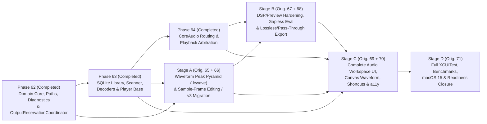

# Audio Workspace — Consolidated Implementation Roadmap

**Document ID:** LC-AW-ROAD-007 (Consolidated Revision)  
**Target Platform:** macOS 15.0+ (`arm64`), Swift `6.0` (`SWIFT_STRICT_CONCURRENCY: complete`), XcodeGen (`project.yml`)  
**Scope Status:** Phases 62–64 Completed; Original Phases 65–71 Consolidated into **Stages A–D** (Documentation Revision Only — Implementation Starts Only Upon Explicit User Approval)  
**Historical Reference:** For the pre-consolidation 10-phase mapping, requirement-preservation audit, and completed-phase naming reconciliations, see [AUDIO_WORKSPACE_ROADMAP_MIGRATION.md](file:///Users/cancan/Desktop/LocalConvert/docs/AUDIO_WORKSPACE_ROADMAP_MIGRATION.md).

---

## 1. Roadmap Overview & Dependency DAG

Following verified completion of **Phases 62, 63, and 64** (domain core, SQLite audio library & scanner, streaming decoders, independent player engine, queue & session persistence, initial Library/Player UI shell, CoreAudio output device routing, and bidirectional playback arbitration), the remaining seven phases (**Phases 65–71**) are consolidated into **four cohesive implementation stages (`Stage A` – `Stage D`)** while preserving every original technical requirement, bound, compatibility contract, acceptance criterion, and historical phase identifier.

### Enforced Stage Ordering Rules
1. **No Stage skips dependencies:** Stage A builds upon Phase 62 (`SampleFrameTime`, `AppStoragePaths`) and Phase 63 (`AudioAsset`). Stage B builds upon Stage A's `SampleFrameTime` editor graph and Phase 64's player/arbitration baselines. Stage C integrates completed Stage A (`WaveformPyramidService`), Stage B (`AudioDSPEngine` / `AudioExportService` 3-mode semantics), and Phases 63–64 (`AudioLibraryStore`, `PlaybackCoordinator`, `CoreAudioOutputDeviceMonitor`, `PlaybackArbitrationCenter`). Stage D begins only after Stages A, B, and C have passed their acceptance gates.
2. **Backend/UI boundary preserved:** Stages A and B contain zero UI redesigns (`WaveformRenderingService` retains a compatibility bridge until Stage C cutover). Stage C owns all SwiftUI/AppKit UI consolidation and Canvas replacement. Stage D owns independent end-to-end XCUITest, scale/memory benchmarks, regression, and release readiness closure.
3. **Conversion Workspace & User-Data Isolation:** Audio Workspace never couples to `ConversionManager`, `ConversionQueue`, `DropZoneView`, or `FileListView`. All tests execute strictly inside `TestSandbox` (`Phase 58`/`58.1` + `Phase 60` async QoS discipline) with zero host `UserDefaults` or `Application Support`/`Caches`/`Logs` mutations.

---

## 2. Completed Foundation Summary & Historical Reconciliations (Phases 62–64)

| Phase | Status & Report | Verified Modules Delivered | Discrepancy / Scope Notes vs. Phase 61.1 Spec |
|---|---|---|---|
| **Phase 62** | **Completed** (`READY FOR PHASE 63`) — [PHASE62_IMPLEMENTATION_REPORT.md](file:///Users/cancan/Desktop/LocalConvert/docs/PHASE62_IMPLEMENTATION_REPORT.md) | `AudioWorkspace/Domain/` (`SampleFrameTime.swift`, `AudioLibraryModels.swift`, `PlaybackModels.swift`), `OutputReservationCoordinator.swift` (12 compatibility guarantees + `ConversionManager` shims), `AppStoragePaths` Audio Workspace paths + `TestSandbox` redirection, `StructuredDiagnostics` audio redaction, `SyntheticAudioFixtureWriter.swift`, `Phase62AudioDomainFoundationTests` (`11/11` pass). | None (all planned deliverables completed). |
| **Phase 63** | **Completed** (`READY WITH DOCUMENTED LIMITATIONS`) — [PHASE63_IMPLEMENTATION_REPORT.md](file:///Users/cancan/Desktop/LocalConvert/docs/PHASE63_IMPLEMENTATION_REPORT.md) | `AudioLibraryDatabase.swift` (WAL, FK, `user_version = 1`, Option A external-content FTS5 + triggers + `LIKE` fallback + quarantine), `AudioLibraryScanner.swift`, `AudioMetadataExtractor.swift`, `AudioArtworkProvider.swift` (`<= 512 px`, `<= 15 MB` input, `16 MB` LRU + `NSCache`), `AudioLibrarySearchService.swift`, `AudioCollectionService.swift`, `AudioPlaylistService.swift`, `AudioLibraryIndexCoordinator.swift`, `AudioLibraryStore.swift`, `AudioPlaybackDecoder.swift`, `AudioLibraryPlayerEngine.swift`, `PlaybackQueueManager.swift`, `PlaybackStatePersistence.swift`, `PlaybackCoordinator.swift`, `AudioWorkspaceCoordinator.swift`, initial UI (`AudioWorkspaceRootView.swift`, `AudioLibrarySidebarView.swift`, `AudioLibraryTrackListView.swift`, `AudioPlayerBarView.swift`, `AudioPlaybackQueuePopover.swift`), `Phase63*` (`12/12` pass). | Actual filenames differ slightly (`AudioLibraryDatabase` vs `SQLiteLibraryDatabase`, `AudioLibraryScanner` vs `LibraryFolderScanner`, `PlaybackQueueManager` vs `PlaybackQueueController`). Delivered Player engine & initial Library/Player UI shell ahead of original Phase 64/69 schedule; `AudioPlaybackDecoder` streams FFmpeg directly instead of `ClipProxyCache`; **bookmark/SHA-256 missing-file relinker (`MissingFileReconciler`) and `DuplicateDetector` (exact/tag duplicates) were deferred and must be completed before/within Stage C**. 13 secondary codec formats & macOS 15 runtime remain unverified on hardware. |
| **Phase 64** | **Completed** (`READY WITH DOCUMENTED LIMITATIONS`) — [PHASE64_IMPLEMENTATION_REPORT.md](file:///Users/cancan/Desktop/LocalConvert/docs/PHASE64_IMPLEMENTATION_REPORT.md) | `CoreAudioOutputDeviceMonitor.swift` (`AudioOutputDevice`, `CoreAudioHALBackend`, `SystemCoreAudioHALBackend`, `startMonitoring`/`stopMonitoring`/`deinit` cleanup), `AVAudioEnginePlaybackTransport.setOutputDevice(deviceID:)` + safe graph reconfiguration, real `outputDeviceUID`/`outputDeviceName` persistence & fallback restore (no autoplay), `LocalConvert/Core/Audio/PlaybackArbitrationCenter.swift` bidirectional non-destructive pause hooks into `PlaybackCoordinator` & `Engines/AudioEditor/PlaybackEngine.swift`, plus `nonisolated` `AVAudioSourceNode` render-block fix in `PlaybackEngine.swift`, `Phase64AudioPlayerTests` (`6/6` pass). | **Gapless same-rate PCM pre-scheduling** was not implemented in `AudioLibraryPlayerEngine` (tracked into Stage B); **Output Device Picker UI** & **Auto-Pause Settings toggle** deferred to Stage C; hot-unplug & `setDeviceID` switching verified via mocks alongside read-only host HAL enumeration smoke test. |

---

## 3. STAGE A — Audio Foundation & Editing Core *(Consolidates Original Phases 65 + 66)*

### 3.1 Objective
Deliver the high-performance streaming `.lcwave` multi-resolution waveform peak pyramid engine and migrate the Audio Editor timeline/editing model and `.lcproject`/`.lcprojpkg` persistence from `Double` seconds to exact `Int64` `SampleFrameTime` (`schemaVersion = 3`), maintaining 100% legacy project, `UndoRedoCoordinator`, and Conversion Workspace compatibility.

### 3.2 Technical Scope

#### Track A1 — Multi-Resolution Peak Pyramid Waveform Engine *(Original Phase 65)*
- **Domain & Cache Infrastructure:**
  - Create `LocalConvert/AudioWorkspace/Domain/WaveformPyramid.swift` defining mipmap levels (`64`, `256`, `1024`, `4096`, `16384` frames/bucket), per-channel `(min, max, rms, clipped)` bucket storage, `bestLevel(forSamplesPerPixel:)` lookup, and progressive partial state flags.
  - Create `LCWaveDiskCache` (`actor`) in `LocalConvert/AudioWorkspace/Waveform/LCWaveDiskCache.swift`:
    - Little-endian binary serialization/deserialization stored in `AppStoragePaths.audioWaveformCacheDirectory/<cacheKey>.lcwave`.
    - Cache key incorporating canonical path, file size, modification time (`Int64(mtime * 1000)`), channel count, and format version (`SHA256(canonicalPath + "|" + fileSize + "|" + Int64(mtime * 1000) + "|" + channelCount + "|" + v1)`).
    - Atomic `.tmp` writes + rename (`replaceItemAt`), magic-header/checksum validation against truncated crash artifacts, and LRU disk eviction enforcing **maximum `512 MB`** total cache size.
- **Streaming Peak Extraction Service (`WaveformPyramidService` `actor`):**
  - Replace RAM-only single-resolution extraction (`StereoWaveformData`, `512` frames/bucket) with streaming chunk analysis enforcing two independent decoded-PCM input limits simultaneously:
    - **Maximum frame count per processing chunk:** `65,536` frames.
    - **Maximum aggregate decoded PCM input payload per chunk:** `256 KiB` (`262,144` bytes).
  - Calculate the permitted frame count dynamically from the actual channel count and decoded sample format (`bytesPerSample`, without assuming Float32 when a decoder outputs another format): `maxFrames = min(65_536, floor(262_144 / (channelCount * bytesPerSample)))`. For interleaved Float32 PCM (`chunkBytes = frameCount * channelCount * 4`), this yields:
    - Mono (1 ch): `65,536` frames (`256 KiB`)
    - Stereo (2 ch): `32,768` frames (`256 KiB`; sub-caps such as `16,384` frames / `128 KiB` also satisfy both limits)
    - 5.1 (6 ch): `10,922` frames (`255.98 KiB`)
    - 8 channels: `8,192` frames (`256 KiB`)
  - If the pipeline uses planar rather than interleaved buffers, sum all channel planes when enforcing the `256 KiB` aggregate PCM input limit.
  - **Explicit Memory Scope:** The `256 KiB` limit applies strictly to the aggregate decoded PCM input payload of an individual processing chunk; it does **not** bound waveform output mipmap buckets, the `64 MB` in-memory LRU cache, decoder-internal buffers, unrelated framework allocations, or total process memory. Any temporary per-chunk `vDSP` analysis scratch buffers are accounted for separately and reused across chunks.
  - Support native `AVAudioFile` reading and bundled FFmpeg streaming PCM pipes via `AsyncProcessRunner` for non-native containers (`ogg`, `opus`, `wv`, `ape`, etc.).
  - Compute per-channel `min`, `max`, `rms`, and `clipped` flags across all 5 mipmap levels (`64 / 256 / 1024 / 4096 / 16384`) using `Accelerate` (`vDSP_minv`, `vDSP_maxv`, `vDSP_rmsqv`), supporting mono, stereo, and multichannel (`> 2` ch, e.g., 5.1 and 8-channel) layouts.
  - Maintain **`64 MB` bounded in-memory LRU cache**, in-flight task deduplication per cache key, progressive partial availability callbacks for long files, and cooperative `Task.checkCancellation()`.
- **UI Bridge Requirement:** Keep `WaveformRenderingService.swift` (and `StereoWaveformData` APIs) compiling via compatibility bridge until Stage C Canvas cutover.

#### Track A2 — Sample-Accurate Non-Destructive Editing & v3 Migration *(Original Phase 66)*
- **v3 Schema & Legacy `v1 / v2 -> v3` Migration:**
  - Extend `LocalConvert/Engines/AudioEditor/AudioEditorModels.swift` (bridging to Phase 62 `AudioWorkspace/Domain/` types: `SampleRate`, `SampleFrameTime`, `SourceFrameTime`, `TimelineFrameTime`, `SampleFrameRange`, `AudioClip`, `AudioTrack`, `AudioProject`, `AudioExportConfiguration`, `AudioRecoveryState`).
  - Persist `schemaVersion = 3` projects with `SampleRate`, integer clip coordinates (`timelineRange`, `sourceStartFrame`, `sourceRate`), `ClipFadeSpecFrames`, marker `frame: Int64`, `mediaAssets.contentSHA256`, and `linkedLibraryAssetMap`.
  - Implement deterministic `v1 / v2 -> v3` migration using `Decimal` half-away-from-zero conversion with finite, non-negative, and `Int64` overflow rejection guards (`NaN`, `+Inf`, negative start/duration rejected cleanly). **Never** overwrite legacy `.lcproject` files on disk during decode; save v3 only on explicit user Save or new autosave snapshot. Preserve backward-compatible computed `TimeInterval` accessors for callers/tests until cutover.
- **Sample-Frame Editing & Mix Math:**
  - Refactor `AudioEditingService.swift` (`SampleEditingService`) so all operations execute in checked integer sample frames: **Cut, Copy, Paste, Delete, Ripple Delete, Trim, Split, Join (sample-adjacent heal), Insert Silence, Gain, Fade (`ClipFadeSpecFrames`), and Channel operations (Original/Mono/Stereo/Swap)**. Zero-length `SampleFrameRange` selections act strictly as safe no-ops (`changed = false`).
  - Migrate `AudioGainAutomation` in `AudioMixingService.swift` to sample-frame evaluation.
  - Strengthen `ProjectPersistenceService.swift` cross-Mac relinking via relative paths inside `.lcprojpkg`, sibling folder scan fallback, `bookmarkData`, and `contentSHA256` verification.
  - Preserve full `UndoRedoCoordinator` context isolation (`.audioEditor(projectID:)`) and restart journal rehydration in `AudioEditorStore.swift` / `AudioEditorUndoCommands.swift`.

### 3.3 Dependencies, Parallelization & Shared-File Risks
- **External Dependencies:** Stage A requires completed Phases 62–63.
- **Internal Parallelization:**
  - **Parallelizable Track A1 (Waveform):** `WaveformPyramid.swift`, `LCWaveDiskCache.swift`, `WaveformPyramidService.swift`, and `Phase65WaveformPyramidTests.swift` have zero dependency on v3 project editing and can proceed in parallel with Track A2.
  - **Parallelizable Track A2 (Sample Editing & v3):** `AudioEditorModels.swift`, `AudioEditingService.swift`, `AudioMixingService.swift`, `ProjectPersistenceService.swift`, `AudioEditorStore.swift`, `AudioEditorUndoCommands.swift`, and `Phase66SampleEditingAndMigrationTests.swift`.
  - **Shared-File Collision Risk:** Do **not** allow parallel edits to `LocalConvert.xcodeproj/project.pbxproj` or `AudioEditorModels.swift`; run `xcodegen generate` once after both tracks finish creating files, and serialize any edits touching `AudioEditorModels.swift` or `WaveformRenderingService.swift`.
- **Integration Checkpoint:** Reconcile `WaveformRenderingService` compatibility bridge with `AudioEditorModels` computed `TimeInterval` helpers, run full Audio Editor regressions + Phase 62/63/64 suites before declaring Stage A complete.

### 3.4 Files Created / Modified
- **Created:**
  - `LocalConvert/AudioWorkspace/Domain/WaveformPyramid.swift`
  - `LocalConvert/AudioWorkspace/Waveform/LCWaveDiskCache.swift`
  - `LocalConvert/AudioWorkspace/Waveform/WaveformPyramidService.swift`
  - `LocalConvertTests/Phase65WaveformPyramidTests.swift`
  - `LocalConvertTests/Phase66SampleEditingAndMigrationTests.swift`
- **Modified:**
  - `LocalConvert/Engines/AudioEditor/WaveformRenderingService.swift` (compatibility bridge retained until Stage C)
  - `LocalConvert/Engines/AudioEditor/AudioEditorModels.swift`
  - `LocalConvert/Engines/AudioEditor/AudioEditingService.swift`
  - `LocalConvert/Engines/AudioEditor/AudioMixingService.swift` (`AudioGainAutomation`)
  - `LocalConvert/Engines/AudioEditor/ProjectPersistenceService.swift`
  - `LocalConvert/Engines/AudioEditor/AudioEditorStore.swift`
  - `LocalConvert/Engines/AudioEditor/AudioEditorUndoCommands.swift`
  - `project.yml` / `LocalConvert.xcodeproj` (`xcodegen generate`)

### 3.5 Tests & Acceptance Criteria
- **Required Validation (`Phase65WaveformPyramidTests` & `Phase66SampleEditingAndMigrationTests` + Existing Suites):**
  - Peak math parity on synthetic sine, impulse, and clipped WAV fixtures at `64`, `256`, `1024`, `4096`, `16384` buckets.
  - Mono, stereo, 5.1 (6-channel), and 8-channel extraction & `.lcwave` binary round-trip.
  - **Chunk Frame & PCM Payload Boundary Tests:** Exact-boundary and one-frame-over-boundary verification for Mono Float32 (`65,536` frames / `256 KiB`), Stereo Float32 (`<= 32,768` frames / `<= 256 KiB`), 5.1 Float32 (`10,922` frames / `255.98 KiB`), 8-channel Float32 (`8,192` frames / `256 KiB`), at least one non-Float32 decoder output format (if supported by the actual pipeline), and both interleaved and planar buffer layouts (wherever supported), proving both that chunk frame count never exceeds `65,536` and aggregate decoded PCM input payload never exceeds `256 KiB` (`262,144` bytes).
  - Cache-key invalidation on `fileSize` / `mtime` changes; corrupt `.lcwave` recovery; task cancellation & deduplication; `64 MB` RAM LRU & `512 MB` disk eviction bounds; multi-minute high-rate bounded-memory stress test.
  - `1,000`-cycle split/join sample-conservation proof (`totalFrames == initialFrames`, zero drift).
  - Deterministic `v1` and `v2` `.lcproject` fixture migration (`NaN`/`+Inf`/negative/overflow rejection; disk fixture untouched on load); `.lcprojpkg` + relative-path + `contentSHA256` cross-Mac relink; `UndoRedoCoordinator` journal round-trip.
  - Existing regressions pass: `AudioEditorCoreTests`, `AudioTimelineTests`, `AudioEditorPerformanceTests`, `Phase62`, `Phase63`, `Phase64`.
- **Explicit Exclusions:** **Zero UI / SwiftUI Canvas redesign in Stage A.**

---

## 4. STAGE B — Audio Processing & Export Engine *(Consolidates Original Phases 67 + 68 + Gapless Evaluation)*

### 4.1 Objective
Align real-time preview DSP/timeline playback with Stage A's `SampleFrameTime` model for offline render parity, harden all three export modes (`BitExactPassThrough`, `LosslessFormatReRender`, `LossyFormatReRender`) including `.ogg`/`.alac`/dither/bit-depth validation fixes, and evaluate/validate gapless same-rate playback handoff in `AudioLibraryPlayerEngine`.

### 4.2 Technical Scope

#### Track B1 — DSP, Proxy Cache, Sample-Frame Preview & Gapless Playback *(Original Phase 67 + Phase 64 Deferred Gapless Check)*
- Harden `AudioDSPEngine.swift` across multi-rate (`44.1 / 48 / 88.2 / 96 / 192 kHz`) and multichannel layouts, peak/LUFS normalize apply helpers, EQ, fades, compressor/limiter, noise gate/reduction, reverse, and time-stretch/pitch processing.
- Correct `ClipProxyCache` invalidation keys and storage under `AppStoragePaths.audioEditorProxiesDirectory` (inside `AudioMixingService.swift`).
- Refactor `AudioPlaybackEngine` timeline streaming loop & seek markers (`LocalConvert/Engines/AudioEditor/PlaybackEngine.swift`) to exact `SampleFrameTime` synchronization with **zero audio-thread allocations** (`AudioRingBuffer` lock safety and `nonisolated` render closure preserved).
- Preserve sandboxed `AudioEffectPresetStore.swift` integration (`AppStoragePaths.audioEditorPresetsFileURL`).
- **Explicit Deferred Gapless Evaluation (`AudioLibraryPlayerEngine.swift`):** Evaluate and implement/verify gapless same-rate, same-channel-layout track transition support in `AudioLibraryPlayerEngine` / `PlaybackCoordinator` (pre-scheduling the next `DecodedPCMChunk` / `AVAudioFile` segment seamlessly behind active tail buffers, while keeping safe format-switch handoff for cross-rate transitions and marking status honestly if rate changes require reconfigure).

#### Track B2 — Lossless & Lossy Export Pipeline Hardening *(Original Phase 68)*
- Implement and harden all three `AudioExportMode` paths cleanly inside `LocalConvert/Engines/AudioEditor/AudioExportService.swift`:
  1. **`BitExactPassThrough`:** Single-source unedited matching-rate/depth PCM (`WAV`/`AIFF`) copied without Float32 decode/DSP/quantization, preserving exact **audio payload SHA-256** (while documenting container tag/chunk independence). Reject pass-through when edits, gain `!= 0 dB`, fades, overlaps, DSP, SRC, channel mapping, or dithering are active.
  2. **`LosslessFormatReRender`:** Float32 DSP mixdown rendered cleanly to lossless codecs (`WAV` 16/24/32f, `AIFF` 16/24, `ALAC` `.m4a` 16/24, `FLAC` 16/24, `CAF`).
  3. **`LossyFormatReRender`:** Re-rendered to `MP3` (`libmp3lame`), `AAC` (`.m4a`), `Opus` (`.opus`), and fixed `Ogg Vorbis` (`.ogg`).
- **Phase 61.1 Codec & Safety Fixes in `AudioExportService.swift`:**
  - Fix `.ogg` encoder discrepancy (`AudioExportService.swift:502`): replace nonexistent `-c:a libvorbis` with verified native FFmpeg `vorbis` encoder (or document quality validation bounds).
  - Enact strict **TPDF dithering rules**: enable triangular HP dither (`aresample=dither_method=triangular_hp:osf=s16` / native equivalent) on 16-bit down-quantization for PCM, `FLAC`, **and `.alac`**; **strictly forbid** dithering on `32-bit float` and `BitExactPassThrough`.
  - Address/validate explicit multichannel export bounds rather than silently clamping `-ac` to `1...2` without validation error or explicit downmix policy.
  - Reject `.ape` (decode-only) before execution; block any export path targeting source files; stage intermediates solely in `AppStoragePaths.audioExportStagingDirectory` via `OutputReservationCoordinator` (zero `ConversionManager` dependency); delete temp/partial stems on error or `CancellationError` and release reservations in `defer`.
  - Extend post-export validation (`validateExportedFile` / `AudioExportReport`) to verify output bit depth (`bits_per_raw_sample` / `sample_fmt` / native `AVAudioFile.fileFormat`), codec name, sample rate, channel count, and duration parity.

### 4.3 Dependencies, Parallelization & Shared-File Risks
- **External Dependencies:** Stage B **depends on Stage A** (`SampleFrameTime` editor timeline/project schema v3 and `AudioGainAutomation`).
- **Internal Parallelization & Collision Control:**
  - `AudioDSPEngine.swift` + `PlaybackEngine.swift` (Track B1 preview/DSP) and `AudioExportService.swift` codec validation (Track B2) can develop in parallel **only if** shared `AudioDSPModels` / `AudioExportConfiguration` / `AudioMixingService` filter signatures are frozen first.
  - **Shared-File Collision Risk:** `AudioMixingService.swift` (`ClipProxyCache` + `AudioEffectFilterBuilder` + `AudioMixSession`) is shared by both live preview (Track B1) and offline export (Track B2), and `AudioExportService.swift` depends directly on `AudioDSPEngine` / `AudioMixingService` for parity. **Do not split `AudioMixingService.swift` edits across concurrent agents.** Track B1 Gapless Player enhancement (`AudioLibraryPlayerEngine.swift` + `PlaybackCoordinator.swift`) touches separate files from `AudioExportService.swift` and can run independently.
- **Integration Checkpoint:** Execute real preview-vs-offline render parity comparisons (`AudioExportService` calling hardened `AudioDSPEngine` / `AudioMixSession`) before declaring Stage B complete.

### 4.4 Files Created / Modified
- **Created:**
  - `LocalConvertTests/Phase67AudioEffectsAndPreviewTests.swift`
  - `LocalConvertTests/Phase68LosslessExportTests.swift`
- **Modified:**
  - `LocalConvert/Engines/AudioEditor/AudioDSPEngine.swift`
  - `LocalConvert/Engines/AudioEditor/AudioMixingService.swift` (`ClipProxyCache` + filter graph)
  - `LocalConvert/Engines/AudioEditor/PlaybackEngine.swift`
  - `LocalConvert/Engines/AudioEditor/AudioExportService.swift`
  - `LocalConvert/AudioWorkspace/Playback/AudioLibraryPlayerEngine.swift` & `PlaybackCoordinator.swift` (gapless same-rate evaluation/implementation)
  - `LocalConvert.xcodeproj` (`xcodegen generate`)

### 4.5 Tests & Acceptance Criteria
- **Required Validation (`Phase67AudioEffectsAndPreviewTests`, `Phase68LosslessExportTests` + Existing Suites):**
  - Preview vs. offline render parity (`SNR` / peak difference within Float32 tolerance) across EQ, fades, compressor, reverse, and time-stretch.
  - Multi-rate (`44.1 / 48 / 96 kHz`) & multichannel DSP verification; proxy cache LRU eviction/invalidation; seek & loop-boundary continuity with zero audio-thread priority inversions.
  - Gapless same-rate handoff test (`MockRoutingPlaybackTransport` scheduled buffer continuity + sample-rate switch clean reconfigure fallback).
  - End-to-end export + `ffprobe`/`AVAudioFile` verification matrix: `WAV` (`16/24/32f`), `AIFF` (`16/24`), `ALAC` `.m4a` (`16/24`), `FLAC` (`16/24`), `MP3`, `AAC`, `Opus`, and `Ogg Vorbis`; `BitExactPassThrough` WAV audio-payload SHA-256 identity + unchanged source SHA-256; TPDF dither applied for 16-bit re-render (`WAV`/`FLAC`/`ALAC`) and omitted on `32f`/pass-through; true-peak ceiling enforcement (`-1.0 dBTP`); `.ape` encode validation rejection; mid-export cancellation staging cleanup + reservation release (`0` temp leaks).
  - Existing regressions pass: `AudioDSPTests`, `AudioChainPresetPersistenceTests`, `AudioExportProTests`, `AudioEditorExportAcceptanceTests`.
- **Explicit Exclusions:** **Zero SwiftUI/AppKit UI redesign in Stage B.**

---

## 5. STAGE C — Complete Audio Workspace UI *(Consolidates Original Phases 69 + 70)*

### 5.1 Objective
Deliver a cohesive, modular, accessible native macOS Audio Workspace uniting the Library Manager (including deferred missing-file relink & duplicate hygiene), Persistent Player & CoreAudio Output Device selector, and upgraded multi-resolution SwiftUI `Canvas` Waveform Editor under `DesignSystem` without duplicating `AudioEditorRootView` or triggering Phase 59 SwiftUI state-update warnings.

### 5.2 Technical Scope

#### Track C1 — Workspace Shell, Complete Library Manager UI & Player Controls *(Original Phase 69 + Phase 63/64 Deferred UI)*
- **Workspace Shell Integration (`AppState`, `ContentView`, `AudioWorkspaceRootView`):**
  - Evolve `AudioWorkspaceRootView.swift` into the unified multi-mode shell (**`[Library]`**, **`[Waveform Editor]`**, **`[Audio Tools]`** mode switcher cleanly embedding existing `AudioEditorRootView` without duplicating editor hosts — refactoring `AudioToolboxView.swift` embedding cleanly while preserving Conversion tabs untouched).
  - Preserve Phase 59 local `@State` / `.onChange` / async `.task` discipline (zero synchronous `@Published` mutations during view layout/update passes).
- **Library Manager Completion (Closing Phase 63 Deferred Gaps):**
  - Upgrade modular Library subviews (`AudioLibrarySidebarView.swift`, `AudioLibraryTrackListView.swift`, new `AudioLibraryInspectorView.swift` & `LibraryMissingRelinkSheet.swift` — keeping view files small and single-purpose):
    - **Sidebar:** Library (`All Tracks`, `Recently Added`, `Recently Played`, `Favorites`, `Lossless & Hi-Res`), Hygiene (`Missing Files` count badge, `Duplicates` view backed by exact binary hash + optional `(Title, Artist, Duration ±1s)` audio/tag duplicate detection via `DuplicateDetector`), Watched Folders (last scan + `Rescan`), Playlists, Smart Collections (`+ New Collection`).
    - **Track Table, Drag/Drop & Context Menus:** Search field (`Search title, artist, album, codec...` FTS5), filter pills (`All`, `Lossless`, `Hi-Res`), multi-selection, drag files/folders to Library/Playlist and drag tracks to Waveform Editor, context menu (`Play Now`, `Play Next`, `Add to Queue`, `Add to Playlist >`, `Open in Waveform Editor`, `Inspect / Edit Metadata...`, `Reveal in Finder`, `Remove from Library` labeled non-destructive, `Relink Missing File...` bookmark + SHA-256 matcher via `MissingFileReconciler`).
    - **Metadata Origin Inspector (`300pt` collapsible, `⌘I`):** Album artwork, read-only technical stream specs, explicit **Metadata Origin badge** (`Embedded Tags` vs `Library DB Only`), and clear separation between `Save Tags to File` (`MetadataManager` + undo on writable formats) vs `Save Library Notes` (DB-only on WAV/ADTS/etc.).
- **Player Bar, Output Device Picker & Arbitration Preference:**
  - Upgrade `AudioPlayerBarView.swift` & `AudioPlaybackQueuePopover.swift` (and compact persistent bar behavior across Audio Workspace views; optional 44pt mini-pill during background playback across tabs).
  - Add **`AudioOutputDevicePicker` popover** wired cleanly to Phase 64 `CoreAudioOutputDeviceMonitor` (`System Default`, connected DACs/headphones with sample rate readout, live update on device hot-plug).
  - Expose user-configurable **auto-pause arbitration toggle** (default enabled) wired cleanly to `PlaybackArbitrationCenter.shared.setAutoPauseEnabled(_:)` persisted in `AppSettings`.

#### Track C2 — Multi-Resolution Waveform Canvas UI, Shortcuts, Export Sheet & Accessibility *(Original Phase 70)*
- **Waveform Canvas Cutover (`LocalConvert/Features/AudioEditor/`):**
  - Upgrade `StereoWaveformClipView.swift` and `MultitrackTimelineView.swift` to consume Stage A `WaveformPyramidService` mip levels via `SwiftUI.Canvas`:
    - Dynamic zoom-aware `WaveformPyramid.bestLevel` selection targeting **`<= viewportWidth * 2` drawn buckets**.
    - True multichannel lanes (Mono 1, Stereo L/R, expandable/collapsible `> 2` ch lanes).
    - Clipped sample highlights, fade-in/out gain curves, overlap crossfades, loop/selection highlights, and progressive coarse rendering as analysis streams.
    - Isolate the 60 Hz playhead cursor into a separate lightweight overlay view/layer so playhead motion **does not re-rasterize static clip Canvas geometry**.
    - Retire legacy RAM-only `StereoWaveformData` UI calls smoothly after cutover.
- **Editor Shortcuts, Export Sheet & Recovery UX (`AudioEditorRootView`, `TransportBarView`, `TrackHeaderView`, `AudioEditorExportSheet`):**
  - First-responder-safe keyboard shortcuts (never firing when `NSTextField` / search / rename field has focus): `Space` (Play/Pause), `⌘E` / `B` (Split), `⌘T` (Trim), `Delete` / `⌫` (`⌥⌫` Ripple Delete), `⌘+` / `⌘-` / `⌘0` (Zoom In / Out / Fit), `⌘F` (Search/Find), `⌘I` (Inspector), `⌘→` / `⌘←` (Next/Prev track in Player mode), `←` / `→` (`⇧←`/`⇧→` nudge in Editor mode), `⌘Z` / `⇧⌘Z` (`UndoRedoCoordinator`).
  - Upgrade `AudioEditorExportSheet.swift` with explicit **3-mode signal-preservation explanation banners** (*"Original audio copied without signal modification"*, *"Edited audio rendered to a lossless format"*, *"Edited audio rendered to a lossy format"*), capability-filtered format/bit-depth pickers (disallowing `.ape`; aligning `.ogg` Vorbis if Stage B enabled; gating TPDF dither cleanly for 16-bit vs 32f/Pass-Through), pre-export LUFS/True Peak preview, and progress/cancel controls.
  - Surface autosave recovery banner and missing-file relink triggers cleanly in `AudioEditorRootView`.
- **VoiceOver & Accessibility:**
  - Standardize `audioworkspace.*` accessibility identifiers, `.accessibilityLabel`, `.accessibilityHint`, and `.accessibilityValue` across every Library, Sidebar, Inspector, Player, Queue, Device Picker, Transport, Track Header, Canvas, and Export control; ensure color-coded states (Clipping Red, Missing Amber, Lossless Teal, Solo Amber) pair color with SF Symbols or text.

### 5.3 Dependencies, Parallelization & Shared-File Risks
- **External Dependencies:** Stage C requires **Stage A** (`WaveformPyramidService`, `AudioEditorModels` v3), **Stage B** (`AudioDSPEngine` / `AudioExportService` 3 modes), and **Phases 63–64** (`AudioWorkspaceCoordinator`, `AudioLibraryStore`, `PlaybackCoordinator`, `CoreAudioOutputDeviceMonitor`, `PlaybackArbitrationCenter`).
- **Internal Parallelization & Modularity Discipline:**
  - Keep UI files small and modular (`<= 300–450` lines per view): split inspector, relink sheet, device picker, canvas renderer, and export controls into focused files—**never** collapse Library, Player, and Editor UI into one monolithic SwiftUI file.
  - **Parallelizable Track C1 (`AudioWorkspace/Library` hygiene + `AudioWorkspace/UI`):** Missing/duplicate services (`MissingFileReconciler`, `DuplicateDetector`), `AudioLibraryInspectorView`, `LibraryMissingRelinkSheet`, `AudioOutputDevicePicker`, and arbitration settings toggle.
  - **Parallelizable Track C2 (`Features/AudioEditor`):** Canvas pyramid renderer (`StereoWaveformClipView`, `MultitrackTimelineView`), `AudioEditorExportSheet`, and `TransportBarView` / shortcut responder isolation.
  - **Shared-File Collision Risks:** Serialize edits to `AudioWorkspaceRootView.swift` (composes Track C1 + Track C2 modes), `AppState.swift`, `AudioToolboxView.swift` (editor extraction), and `AppSettings.swift` (auto-pause toggle) at an explicit integration step after Track C1 & C2 view modules build independently.
- **Integration Checkpoint:** Wire `Library -> Open in Waveform Editor` and drag-drop handoff inside `AudioWorkspaceRootView`, wire global shortcuts cleanly across mode changes, and execute hosting view tests (`Phase59` + Stage C suites) + existing `Phase57UITests`.

### 5.4 Files Created / Modified
- **Created:**
  - `LocalConvert/AudioWorkspace/Library/MissingFileReconciler.swift`
  - `LocalConvert/AudioWorkspace/Library/DuplicateDetector.swift`
  - `LocalConvert/AudioWorkspace/UI/AudioLibraryInspectorView.swift`
  - `LocalConvert/AudioWorkspace/UI/LibraryMissingRelinkSheet.swift`
  - `LocalConvert/AudioWorkspace/UI/AudioOutputDevicePicker.swift`
  - `LocalConvertTests/Phase69AudioWorkspaceUIStateTests.swift`
  - `LocalConvertTests/Phase70WaveformUIAndAccessibilityTests.swift`
- **Modified:**
  - `LocalConvert/AudioWorkspace/UI/AudioWorkspaceRootView.swift` (segmented `[Library | Waveform Editor | Audio Tools]` shell hosting `AudioEditorRootView`)
  - `LocalConvert/AudioWorkspace/UI/AudioLibrarySidebarView.swift` & `AudioLibraryTrackListView.swift` (or modular split + Hygiene/Duplicates/Drag-Drop)
  - `LocalConvert/AudioWorkspace/UI/AudioPlayerBarView.swift` & `AudioPlaybackQueuePopover.swift` (`AudioOutputDevicePicker`, Save Queue as Playlist, mini format badge)
  - `LocalConvert/AudioWorkspace/Library/AudioLibraryStore.swift` & `AudioWorkspace/Integration/AudioWorkspaceCoordinator.swift`
  - `LocalConvert/Features/AudioToolbox/AudioToolboxView.swift` & `LocalConvert/Core/Settings/AppSettings.swift` (arbitration toggle preference)
  - `LocalConvert/Features/AudioEditor/StereoWaveformClipView.swift`, `MultitrackTimelineView.swift`, `AudioEditorRootView.swift`, `TransportBarView.swift`, `TrackHeaderView.swift`, `AudioEditorExportSheet.swift`
  - `project.yml` / `LocalConvert.xcodeproj` (`xcodegen generate`)

### 5.5 Tests & Acceptance Criteria
- **Required Validation (`Phase69AudioWorkspaceUIStateTests`, `Phase70WaveformUIAndAccessibilityTests`, `Phase59SwiftUIStateUpdateTests`, `Phase57UITests`):**
  - SwiftUI `NSHostingView` state-binding tests verifying **0 `Publishing changes from within view updates`** warnings across Library browsing, FTS5 search, Player bar transport, Queue popover, Output device picker, and Canvas zooming.
  - Library duplicate/relink UI & service flow tests; auto-pause settings persistence check.
  - Waveform Canvas mip-level selection verification confirming drawn buckets **`<= viewportWidth * 2`** at min (`2 px/s`) and max (`20,000 px/s`) zoom.
  - Export sheet 3-mode banner text & bit-depth/codec/dither picker state matrix (`WAV`/`AIFF`/`FLAC`/`ALAC` vs `MP3`/`AAC`/`Opus`/`Ogg` vs `.ape` absent).
  - First-responder shortcut isolation verification (`Space` / `B` / `Delete` ignored while `NSTextField` editing is active).
  - Automated check confirming presence of required `audioworkspace.*` identifiers and VoiceOver labels/values.
  - Existing `Phase57UITests` (`6/6`) and `Phase59SwiftUIStateUpdateTests` (`3/3`) pass cleanly; Conversion Workspace unaffected.

---

## 6. STAGE D — Final QA, Performance & Release Readiness *(Preserves Original Phase 71 Gate)*

### 6.1 Objective
Execute independent end-to-end XCUITest user journeys, empirical scale/memory/latency benchmarks against original proposed targets without threshold manipulation, live multi-device CoreAudio / macOS 15 compatibility verification (where runtime environments exist), full repository regression, and final release readiness closure.

### 6.2 Technical Scope
- **Full XCUITest Suite (`LocalConvertUITests/AudioWorkspaceUITests.swift`):**
  - Follow **Phase 57.1** synchronous `setUpWithError`/`tearDownWithError`, **Phase 58/58.1** `TestSandbox` (`--uitesting` sandbox isolation), and **Phase 60** `SyntheticAudioFixtureWriter` (zero QoS priority inversions).
  - Cover all end-to-end journeys: Conversion <-> Audio Workspace (`⌘9`) navigation; Library folder import & incremental scan; FTS5 search, Smart Collection & Playlist create/play/delete; Player transport (`Play/Pause`, scrub, `Next/Prev`, `Shuffle`, `Repeat`, Volume/Mute, Queue popover, Output Device picker); `Open in Waveform Editor`, range selection, split/fade/normalize, Undo/Redo (`⌘Z`/`⇧⌘Z`), 3-mode Export Sheet non-destructive write in sandbox; Missing File banner & Relink sheet open/cancel flow.
- **Scale, Memory & Latency Benchmark Suite (`LocalConvertTests/Phase71AudioWorkspacePerformanceTests.swift`):**
  - **Must compare measured results transparently against existing Phase 61.1 unmeasured targets (`AUDIO_WORKSPACE_TEST_STRATEGY.md`) — never silently relax or edit target thresholds if missed; document deviations explicitly:**
    1. *Library Indexing:* `10,000`-row seeded SQLite DB + `500` real synthetic mixed audio files (`<= 15 s` header+tag scan target for `10,000` mixed tracks, `0` UI hangs).
    2. *Library FTS5 Search:* multi-field + prefix query over `25,000` indexed tracks (`<= 25 ms` target).
    3. *Player First-Audio & Seek Latency:* native `AVAudioFile` (`<= 100 ms`), FFmpeg stream (`<= 400 ms`), seek resume (`<= 30 ms` target).
    4. *Waveform First Render & Cache Hit:* `5-min` vs **`2-hour` (`96 kHz` / 24-bit stereo WAV ~4.1 GB PCM)** progressive coarse bins (`<= 150 ms`) and `.lcwave` cache hit (`<= 20 ms`).
    5. *Waveform Peak RAM & Eviction:* Mach `task_vm_info` non-volatile internal delta during 2-hour WAV streaming (`<= 120 MB` delta ceiling, `64 MB` RAM LRU, `512 MB` disk cap, `50+` asset cache eviction).
    6. *Waveform Zoom / Pan & Long-Duration Stability:* zoom sweep (`2 px/s <-> 20,000 px/s`, `>= 60 fps` / `<= 16 ms` draw target) and sustained playback/editing stress checks (`192 kHz` 6-channel WAV decode).
    7. *Export Throughput:* offline `24-bit` WAV/ALAC/FLAC (`>= 10x` dry PCM / `>= 4x` EQ+Dynamics real-time target).
- **Platform, Hardware & Preservation Closure:**
  - Execute full `LocalConvertTests` (`XCTest` + `Swift Testing`) sequentially (`-test-timeouts-enabled YES -default-test-execution-time-allowance 60 -maximum-test-execution-time-allowance 60`).
  - Execute `Phase57UITests` + `AudioWorkspaceUITests` sequentially.
  - Verify clean & incremental `arm64` builds (`0` compiler/`minos` warnings; `Copy Bundled Binaries` skipped incrementally) and `./scripts/verify-dependencies.sh`.
  - Verify `UserDefaults.standard` plist SHA-256 parity and `0 / 0 / 0` diff across user `Application Support`, `Logs`, and `Caches`.
  - **Hardware / OS Verification Gate:** Where a macOS `15.0` VM/host or physical multi-DAC USB/Bluetooth hardware is available, execute targeted smoke checks covering `setDeviceID(_:)`, hot-unplug, and gapless transitions; otherwise classify those runtime items explicitly as unverified environmental gaps.
  - **Release Protection:** Do **not** alter `/Applications/LocalConvert.app`, code-signing identity, version numbers, or distribution packaging unless separately authorized.

### 6.3 Deliverables & Acceptance Criteria
- **Created:** `LocalConvertUITests/AudioWorkspaceUITests.swift`, `LocalConvertTests/Phase71AudioWorkspacePerformanceTests.swift`, `docs/PHASE71_FINAL_READINESS_REPORT.md` (or Stage D Closure Report).
- **Acceptance Gate:** `0` failing tests (any env-gated skips like `LOCALCONVERT_RAW_SAMPLES_DIR` / `LOCALCONVERT_AUDIO_SAMPLES_DIR` documented honestly), `0` Swift 6 warnings, `0` SwiftUI view-update warnings, `0` QoS inversions, `0` temp/staging/sandbox leaks, `0` user-data changes, and empirical benchmark table with exact measured metrics vs. original targets.

---

## 7. Consolidated Risk Register & Deferred Items

### 7.1 Technical Risks Across Stages A–D
| Risk | Stage | Mitigation |
| --- | --- | --- |
| Corrupted partial `.lcwave` files on mid-write crash | Stage A | `.tmp` write + atomic `replaceItemAt` + magic header/size/version verification; delete corrupt cache & recompute safely |
| Memory spike on multi-hour `96 kHz` WAV or `192 kHz` 6-ch files | Stage A / D | Enforce dual decoded-PCM input chunk caps (`<= 65,536` frames AND `<= 256 KiB` aggregate payload across all channels/planes via `min(65_536, floor(262_144 / (channelCount * bytesPerSample)))`) + reused `vDSP` scratch buffers + Mach `task_vm_info` check in Stage D |
| Breaking `.lcproject` v1/v2 loaders or existing `AudioTimelineTests` | Stage A | Non-destructive `v1/v2 -> v3` decode with `Decimal` rounding + kept derived `TimeInterval` properties until cutover |
| Shared `AudioMixingService.swift` collision between Preview & Export | Stage B | Freeze filter/session API contract before parallel B1/B2 edits; verify real SNR/peak render parity |
| ALAC / FLAC bit-depth or `.ogg` FFmpeg encoder mismatch | Stage B | Align `.ogg` to bundled FFmpeg `vorbis`; enforce `-sample_fmt` + 16-bit TPDF dither (omitted for `32f` & `BitExactPassThrough`) + `ffprobe`/`AVAudioFile` output audit |
| Live CoreAudio multi-device quirks (`setDeviceID` / AirPlay / Bluetooth rate changes) | Stage B / C / D | Pre-validated graph pause/reconfigure/resume (`Phase 64`), `.AVAudioEngineConfigurationChange` safe pause, physical hardware test pass when hardware available |
| Monolithic SwiftUI view bloat or Phase 59 view-update warnings | Stage C | Strict single-purpose view files, local `@State`/async `.onChange` mirrors, `NSHostingView` assertions + `Phase59SwiftUIStateUpdateTests` |
| Long-file synthetic fixture generation triggering 60s XCUITest timeout | Stage D | Deterministic fast streaming `SyntheticAudioFixtureWriter` (pre-seeded sandbox where needed) + `-test-timeouts-enabled YES` |

### 7.2 Deferred Capabilities (Preserved From Product Specification & Phase 64)
- **Evaluated Inside Stage B:** Gapless same-rate PCM pre-scheduling in `AudioLibraryPlayerEngine` (documented as deferred in `PHASE64_IMPLEMENTATION_REPORT.md` — must be evaluated/verified rather than assumed complete).
- **Moved Explicitly into Stage C:**
  - `MissingFileReconciler` (bookmark + partial/content SHA-256 relink) & `LibraryMissingRelinkSheet`.
  - `DuplicateDetector` (exact binary size/hash + normalized `(Title, Artist, Duration ±1s)` audio/tag duplicate grouping).
  - `AudioLibraryInspectorView` (`Embedded Tags` vs `Library DB Only` badge + `MetadataManager` explicit write-back split).
  - `AudioOutputDevicePicker` UI in player bar & user preference toggle for `PlaybackArbitrationCenter` auto-pause.
- **Out of Scope for Initial Audio Workspace Series (Post-Stage D / v2):** MIDI sequencing, AUv3/VST3 plugin hosting, multi-input live hardware recording, cloud sync, online metadata/lyrics/artwork lookups, and silent destructive "Replace Original" workflows.

---

## 8. Requirement Traceability Matrix (Original Phases 65–71 → Stages A–D)

| Orig. Phase | Original Substantive Requirement | Consolidated Stage | Verification Evidence / Tests |
|---|---|---|---|
| **65** | `WaveformPyramid` domain model + 5 mip levels (`64`, `256`, `1024`, `4096`, `16384`) | Stage A | `Phase65WaveformPyramidTests` |
| **65** | `LCWaveDiskCache` actor, little-endian `.lcwave` binary format, `path+size+mtime+channels` key & invalidation | Stage A | `Phase65WaveformPyramidTests` |
| **65** | Atomic `.tmp` write, magic header corruption safety, `512 MB` disk cap & `64 MB` RAM LRU eviction | Stage A | `Phase65WaveformPyramidTests` |
| **65** | Dual-bounded streaming PCM input chunks (`<= 65,536` frames AND `<= 256 KiB` aggregate decoded PCM input payload across all channels/planes via `min(65_536, floor(262_144 / (channelCount * bytesPerSample)))`; excludes output buckets, `64 MB` RAM LRU, and decoder-internal buffers) via `AVAudioFile` + FFmpeg `AsyncProcessRunner`, `Accelerate`/`vDSP` (`min`, `max`, `rms`, `clipped`), multichannel (mono/stereo/5.1/8-ch), progressive partial callbacks, task dedup & cancel | Stage A | `Phase65WaveformPyramidTests` (incl. boundary & 1-frame-over tests) |
| **65** | Temporary `WaveformRenderingService` compatibility bridge (no Canvas UI yet) | Stage A | `AudioEditorExportAcceptanceTests` |
| **66** | Project schema `v3` (`Int64` `SampleFrameTime`, `SampleFrameRange`, `ClipFadeSpecFrames`, markers, `contentSHA256`) | Stage A | `Phase66SampleEditingAndMigrationTests` |
| **66** | Deterministic `v1/v2 -> v3` `Decimal` half-away-from-zero migration with `NaN`/`+Inf`/negative/overflow guards (non-destructive on load) | Stage A | `Phase66SampleEditingAndMigrationTests` |
| **66** | Sample-frame Cut, Copy, Paste, Delete, Ripple Delete, Trim, Split, Join, Insert Silence, Gain, Fade, Channel ops, zero-length no-op semantics | Stage A | `Phase66SampleEditingAndMigrationTests` (`1,000`-cycle conservation) |
| **66** | `AudioGainAutomation` frame evaluation & `.lcprojpkg` / relative-path / `contentSHA256` cross-Mac relinking | Stage A | `Phase66SampleEditingAndMigrationTests` |
| **66** | `UndoRedoCoordinator` context isolation & restart journal rehydration + existing editor tests | Stage A | `Phase66`, `AudioEditorCoreTests`, `AudioTimelineTests`, `AudioEditorPerformanceTests` |
| **67** | `AudioDSPEngine` multi-rate (`44.1/48/96 kHz`) & multichannel hardening; Peak/LUFS normalize apply helpers | Stage B | `Phase67AudioEffectsAndPreviewTests`, `AudioDSPTests` |
| **67** | `ClipProxyCache` invalidation keys & `AppStoragePaths.audioEditorProxiesDirectory` hygiene | Stage B | `Phase67AudioEffectsAndPreviewTests` |
| **67** | `PlaybackEngine.swift` timeline/seek markers aligned to `SampleFrameTime` with zero audio-thread allocations + preview vs. offline parity (`EQ`, fades, compressor, reverse, time-stretch) | Stage B | `Phase67AudioEffectsAndPreviewTests` |
| **67** | Sandboxed `AudioEffectPresetStore` preservation | Stage B | `AudioChainPresetPersistenceTests` |
| **64 -> B** | **Deferred Gapless Same-Rate Playback** evaluation & same-rate buffer handoff verification | Stage B | `Phase67` / Player gapless tests |
| **68** | `AudioExportMode` 3-path separation (`BitExactPassThrough` WAV/AIFF payload SHA-256 identity, `LosslessFormatReRender`, `LossyFormatReRender`) | Stage B | `Phase68LosslessExportTests` |
| **68** | Stage previews/mixdowns under `AppStoragePaths.audioExportStagingDirectory` via `OutputReservationCoordinator` (zero `ConversionManager`, atomic cleanup on cancel/error) | Stage B | `Phase68LosslessExportTests` |
| **68** | Codec & TPDF dither fixes: `.ogg` native `vorbis` fix, 16-bit TPDF dither on PCM/FLAC/ALAC, **strictly forbidden** on `32f` & `BitExactPassThrough`, channel-count validation, `.ape` rejection, `validateExportedFile` bit-depth + codec verification | Stage B | `Phase68LosslessExportTests`, `AudioExportProTests`, `AudioEditorExportAcceptanceTests` |
| **69** | Unified `AudioWorkspaceRootView` (`[Library | Waveform Editor | Audio Tools]`), non-duplicated `AudioEditorRootView` extraction from `AudioToolboxView`, untouched Conversion Workspace | Stage C | `Phase69AudioWorkspaceUIStateTests`, `Phase57UITests` |
| **63/69** | Complete Library UI & deferred Hygiene: `AudioLibraryView`/table/sidebar, FTS5 search, playlists/collections, drag-drop, context menus, `AudioLibraryInspectorView` (Embedded vs DB badge + `MetadataManager` split), `DuplicateDetector`, `MissingFileReconciler` + `LibraryMissingRelinkSheet` | Stage C | `Phase69AudioWorkspaceUIStateTests` |
| **64/69** | `PersistentPlayerBarView` / `AudioPlayerBarView` + `PlaybackQueuePopover` + **`AudioOutputDevicePicker`** (`CoreAudioOutputDeviceMonitor`) + **auto-pause arbitration toggle** (`AppSettings`) | Stage C | `Phase69AudioWorkspaceUIStateTests`, `Phase59SwiftUIStateUpdateTests` |
| **70** | `StereoWaveformClipView` & `MultitrackTimelineView` Canvas pyramid cutover (`bestLevel`, `<= viewportWidth * 2` buckets, multichannel lanes, clipping/fades, separate 60 Hz playhead layer, smooth zoom/scroll) | Stage C | `Phase70WaveformUIAndAccessibilityTests` |
| **70** | First-responder-safe keyboard shortcuts (`Space`, `⌘E`/`B`, `⌘T`, `Delete`/`⌥Delete`, `⌘+`/`⌘-`/`⌘0`, `⌘F`, `⌘I`, `←`/`→`, `⌘Z`/`⇧⌘Z`), 3-mode `AudioEditorExportSheet` explanations + pickers, autosave recovery & relink banners | Stage C | `Phase70WaveformUIAndAccessibilityTests` |
| **69/70** | Consistent `audioworkspace.*` accessibility identifiers + VoiceOver labels/hints/values + color+icon pairing | Stage C | `Phase70WaveformUIAndAccessibilityTests` |
| **71** | `AudioWorkspaceUITests` (`LocalConvertUITests` full E2E journeys with Phase 57.1/58/60 hygiene) | Stage D | `AudioWorkspaceUITests` + `Phase57UITests` |
| **71** | Scale, RAM (`task_vm_info`), FPS & latency benchmarks (`10,000`-row scan, `25,000`-row FTS5, `2-hr` 96 kHz WAV streaming, `192 kHz` 6-ch decode, export throughput) vs Phase 61.1 targets | Stage D | `Phase71AudioWorkspacePerformanceTests` |
| **71** | Full `LocalConvertTests` regression, clean/incremental `arm64` builds, `verify-dependencies.sh`, `UserDefaults`/user-data `0/0/0` preservation, macOS 15 runtime & hardware device notes, final readiness report | Stage D | Full Stage D Gate + Readiness Report |
