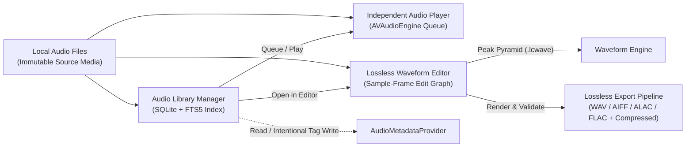

# Audio Workspace — Product Specification

**Document ID:** LC-AW-PROD-001  
**Target Platform:** macOS 15.0+ (Apple Silicon `arm64`), Swift 6, Offline-First Desktop Application  
**Phase Status:** Phase 61.1 Corrected Product Specification (Read-Only Spec; Implementation Not Yet Started)

---

## 1. Product Vision & Identity

**Audio Workspace** is a first-class macOS-native audio suite inside LocalConvert combining three tightly integrated but architecturally independent pillars:

1. **Audio Library Manager** — Indexed, offline collection management for individual tracks and large multi-terabyte local folders without forcing file moves or copies.
2. **Independent Audio Player** — Dedicated, low-latency, queue-driven music and reference player completely isolated from the multitrack editor's timeline and mute/solo routing.
3. **Lossless Waveform Editor** — Non-destructive, sample-frame-accurate stereo/multitrack waveform editor with multi-resolution peak pyramid rendering, real-time native preview, project recovery, and verified lossless export.

### Design Identity & Boundaries
- **Not a thin FFmpeg wrapper:** Playback, peak extraction, waveform zooming, sample-accurate editing, DSP filtering (`Accelerate`/`vDSP`), and PCM/ALAC/WAV/AIFF rendering execute natively via Apple frameworks (`AVAudioEngine`, `AVAudioFile`, `AudioToolbox`, `CoreAudio`, `Accelerate`). Bundled FFmpeg 9.0.2 (`LGPLv3+`, static `arm64`) is reserved strictly for codecs/containers macOS does not natively encode or tag in-place (notably FLAC, Ogg/Vorbis, Opus, LAME MP3 encoding, WavPack/TTA/APE decoding, and Vorbis/ID3 metadata muxing).
- **Zero interference with Conversion Workspace:** Audio Workspace has its own domain state, storage paths, player engine, and UI surface. Adding files to the Audio Library or editing a project never mutates `ConversionManager`, `ConversionQueue`, or user Conversion preferences.
- **Offline-first & privacy-by-design:** Zero network requests, zero telemetry, zero remote artwork/lyrics lookups, and redacted diagnostic logging (`StructuredDiagnostics`).

---

## 2. Functional Capabilities

### 2.1 Pillar A — Audio Library Manager

#### File & Folder Ingestion
- **Individual & folder import:** Drag-and-drop or open panel for single audio files, folders, and Finder aliases/bookmarks.
- **Recursive folder scanning:** Asynchronous directory enumeration with cancellation support, ignoring hidden/system temp artifacts (`.DS_Store`, `*.tmp`) and deduplicating symlinks by canonical resolved path.
- **Non-copying library organization:** Importing tracks indexes files **in place** without copying audio into an internal container or altering folder hierarchy. Security-scoped/NSBookmark records (`AudioMediaReference.bookmarkData`) plus size/mtime/partial-content-hash fingerprints track moved or renamed files.

#### Indexing, Search, Sort & Filter
- **Persistent library database:** SQLite3 (system `libsqlite3`, WAL mode) with an FTS5 virtual table indexing filename, title, artist, album artist, album, genre, composer, comment, codec, sample rate, channel count, and bit depth.
- **Sort & filter:** Instant sorting by Title, Artist, Album, Track #, Duration, Sample Rate, Bit Depth, Codec, Bitrate, Date Added, Last Played, and Play Count; facet filters for Lossless vs Lossy, Hi-Res (> 48 kHz or >= 24-bit), Missing Files, and Duplicates.
- **Logical vs Physical Separation:**
  - *Physical organization:* Owned by the user's filesystem (unchanged unless the user explicitly chooses a future "Export/Consolidate" action).
  - *Logical organization:* Playlists (manual ordered tracks), Smart Collections (saved query predicates, e.g., `Lossless AND SampleRate >= 96000`), Recent Imports, and Recently Played.

#### Metadata Separation: Embedded Source Tags vs Library Database Metadata
Audio formats differ sharply in writable tag and artwork support (verified against [AudioMetadataProvider.swift](file:///Users/cancan/Desktop/LocalConvert/LocalConvert/Core/Metadata/Providers/AudioMetadataProvider.swift)):

| Metadata Domain | Storage Location | Examples | Write Semantics |
|---|---|---|---|
| **Embedded Audio Tags** | Inside source file container | Title, Artist, Album, Album Artist, Genre, Year, Track/Disc #, Composer, Comment, Lyrics, Cover Artwork | Written **only** on explicit user "Apply Metadata to File" action via atomic temp-write/stream-copy (`MetadataManager` + undo support). |
| **Container-Constrained Fallback** | LocalConvert Library SQLite DB only | Tags/artwork on read-only formats (`.aac`, `.ac3`, `.eac3`, `.dts`, `.au`) or unsupported artwork containers (`.ogg`, `.opus`, `.aiff`, `.wav`, `.caf`, `.wv`, `.mka`) | Stored cleanly in the library database without modifying the read-only source or silently dropping user annotations; clearly surfaced in Inspector badge ("Library-only metadata for WAV/ADTS"). |
| **Library Operational State** | LocalConvert Library SQLite DB only | Date Added, Play Count, Last Played, User Rating/Favorite, Playlist membership, Missing status, Peak Cache key | Never written to source audio files. |

#### Library Hygiene & External File Mutations
- **Duplicate detection:** Two-tier detection:
  1. *Exact binary duplicate:* Matching file size + partial header/tail hash + full SHA-256 verification.
  2. *Audio/tag duplicate:* Optional heuristic surfacing matching normalized `(Title, Artist, Duration ±1s)` entries across different codecs (e.g., FLAC + MP3 copy).
- **Missing, moved, or externally edited file handling:**
  - Periodic/manual rescan and FSEvents/bookmark resolution mark inaccessible tracks as `.missing` (grayed row badge, preserved playlist references and metadata, never auto-deleted).
  - Moved/renamed files on the same APFS/HFS+ volume are resolved automatically via bookmark data + SHA-256 confirmation and updated to `.ok`.
  - Externally modified files (`size` or `mtime` changed) invalidate stale `.lcwave` waveform peak caches and re-index technical properties automatically.
- **Finder reveal & manual rescan:** Context-menu `Reveal in Finder` (`NSWorkspace.shared.activateFileViewerSelecting`), `Relink File...`, and incremental `Rescan Library Folder`.

---

### 2.2 Pillar B — Independent Audio Player

#### Isolation Requirement
The Audio Library Player runs an independent playback engine (`AudioLibraryPlayerEngine`) completely decoupled from `AudioEditorStore` and `AudioMixSession`. Playing tracks in the library never mutates editor timeline clips, playhead position, mute/solo states, or project `isDirty` flags. When one playback transport starts actively outputting audio, user preference can optionally pause the other to avoid cacophony, without sharing any mutable state.

#### Playback Capabilities
- **Transport:** Play, Pause, Stop, Seek forward/backward (`±5s`, `±15s`), scrubbed timeline seek with sample-accurate frame offset, Previous track (restarts track if `elapsed > 3.0s`, otherwise goes to previous), Next track.
- **Queue & Ordering:** Ordered Up Next queue (append, play next, reorder, remove, clear), playlist/collection playback, Repeat modes (`Off`, `Repeat All`, `Repeat One`), and deterministic Fisher-Yates `Shuffle` preserving unshuffled order snapshot for toggling back.
- **Telemetry & Controls:** Current time / remaining time / total duration (`SampleFrameTime` formatted as `mm:ss` or `mm:ss.mmm`), normalized progress slider, linear/perceptual volume control (`0%...100%`), Mute toggle restoring previous volume, and Rate control (`0.5x`–`2.0x` via `AVAudioUnitTimePitch` when pitch-preserved or variable-rate enabled).
- **Track & Format Readout:** Real-time display of active Codec, Container, Sample Rate (e.g., `96.0 kHz`), Bit Depth (`24-bit`), Channels (`2 ch Stereo`), Bitrate, and Output Device sample rate indicator.
- **Background Playback & State Persistence:** Continues playback seamlessly when switching between Audio Library, Waveform Editor, or Conversion Workspace tabs (unless explicitly stopped or replaced by editor preview). Saves active queue IDs, current track ID, repeat/shuffle flags, volume, and mute state cleanly (sandboxed under `AppStoragePaths` in tests).
- **Gapless Playback Feasibility:**
  - *Same sample rate & channel layout (e.g., 44.1 kHz stereo album):* Achievable with zero sample gap by pre-scheduling the next `AVAudioFile` segment onto `AVAudioPlayerNode` (`scheduleSegment(..., completionCallbackType: .dataRendered)`) behind the active buffer.
  - *Sample-rate/channel transitions (e.g., 44.1 kHz -> 96 kHz):* Reconfigures `AVAudioEngine` mixer input format or uses `AVAudioMixerNode` sample-rate conversion (`AUConverter`), with a documented sub-10ms format handoff vs bit-exact rate switch option.
- **Audio Output Device Handling:** Supported via macOS `CoreAudio` (`AudioObjectGetPropertyData` / `kAudioHardwarePropertyDevices` + `AVAudioEngine.outputNode.auAudioUnit.setDeviceID(_:)`) when users select a specific DAC/headphone device; defaults safely to System Default Output with live device-disconnect fallback.

---

### 2.3 Pillar C — Waveform Engine

The Waveform Engine is a dedicated subsystem serving both the Waveform Editor (editable multitrack clips) and Library/Player preview (single-file overview).

- **Multi-Resolution Peak Pyramid (`.lcwave`):** Never decodes an entire multi-hour file into RAM to paint a timeline. Instead, streams audio in bounded chunks (`<= 64 KB–256 KB` buffers) and computes multi-resolution `(min, max, rms, clippedFlag)` buckets across mipmap levels (e.g., `64`, `256`, `1024`, `4096`, `16384` frames/bucket) using `Accelerate` (`vDSP_minv`, `vDSP_maxv`, `vDSP_rmsqv`).
- **Disk & Memory Cache:**
  - External binary `.lcwave` cache files in `AppStoragePaths.cachesDirectory/AudioWaveformCache/`, keyed by `(canonicalPathHash or contentSHA256, fileSize, modificationTime, channelCount, formatVersion)`.
  - Bounded in-memory LRU cache (`64 MB` ceiling, extending the pattern already established in [WaveformRenderingService.swift](file:///Users/cancan/Desktop/LocalConvert/LocalConvert/Engines/AudioEditor/WaveformRenderingService.swift)).
  - Stale caches evicted when source `fileSize` or `modificationTime` changes or total cache disk budget (default `512 MB` configurable) is exceeded.
- **Progressive Rendering & Zoom:** Renders coarse overview mipmap levels immediately as background analysis streams in chunks, enabling responsive scrolling and zooming (`2 px/sec` whole-song overview down to `20,000+ px/sec` sample-level view) while playback or editing is active.
- **Channel & Region Display:** True per-channel lanes for Mono (1 lane), Stereo (L/R lanes), and Multichannel (> 2 channels collapsed/expandable lanes with channel labels), plus clip boundaries, fade curves, crossfade overlays, loop ranges, selection highlights, clip indicators (`clippedFlag`), and 60 Hz playhead tracking without re-rasterizing the waveform geometry.
- **Cancellation & Lifecycle:** Deduplicated `inFlight` tasks keyed by asset fingerprint; immediate cooperative `Task.checkCancellation()` on tab exit, file removal, or zoom-window reprioritization.

---

### 2.4 Pillar D — Lossless (Non-Destructive) Waveform Editor

#### Sample-Frame Truth vs Edit Graph vs DSP Reality
To prevent floating-point rounding drift and ambiguity between non-destructive project editing and signal processing:
1. **Immutable Original Source:** Source media files are **never** mutated by timeline edits, undo/redo, preview playback, or autosave.
2. **Sample-Frame Source of Truth (`Int64` + Validated `SampleRate`):** All timeline clip coordinates (`TimelineFrameTime >= 0`), source in/out offsets (`SourceFrameTime >= 0`), selection ranges (`SampleFrameRange` with inclusive `startFrame`, non-negative `frameCount`, checked exclusive `endFrame`), split points, markers, and crossfades are stored in integer frames and converted across rates using exact `Int128` rational arithmetic with deterministic round-half-away-from-zero ties and checked overflow (never silent wrap or saturation). Floating-point `TimeInterval` values serve only as derived display strings (`hh:mm:ss.mmm`).
3. **Non-Destructive Edit Graph:** Edits (`AudioEditOperation`) modify project metadata, clip slices, fades, and DSP chain slots inside `.lcproject` (`schemaVersion = 3`) without rewriting source audio files.
4. **Edit Classification vs Signal Modification:** Editing operations fall strictly into two classes:
   - *Structural-only operations on single matching-rate uncompressed PCM / stream-copy segments* (whole-clip trim/cut/join with `0 dB` unity gain, zero fades, zero overlaps, zero reverse/channel swap, zero EQ/effects, matching sample rate and bit depth): eligible for **Bit-Exact Pass-Through** if routed to a direct pass-through exporter (planned enhancement; not yet implemented in current `AudioExportService`).
   - *Signal-modifying operations* (gain `!= 0 dB`, fade-in/out, overlap crossfades, multitrack mix summing, normalization, RBJ EQ, HPF/LPF, compressor, limiter, noise gate/NR, reverse, channel downmix/upmix/swap, time-stretch, pitch shift, sample-rate conversion, or bit-depth quantization): execute in IEEE Float PCM and yield a **Lossless-Format Re-Render** (when exported to WAV/AIFF/FLAC/ALAC) or **Lossy-Format Re-Render** (when exported to MP3/AAC/Opus/Ogg).

#### Editing Operations Scope
- **Timeline & Selection:** Sample-frame range selection (including zero-length caret selection), playhead scrub, grid snapping, zoom to fit/selection, markers.
- **Clipboard & Structural:** Cut, Copy, Paste (on single or multiple tracks with ripple/overwrite option), Delete (clear vs ripple delete), Trim to Selection, Trim clip edges, Split at playhead/selection, Join/Heal contiguous same-source sample-adjacent clips, Insert Silence (`sourceAssetID == nil`), Duplicate clip.
- **Gain, Fades & Channel Ops:** Per-clip Gain (dB), Fade-In & Fade-Out with 5 curves (`Linear`, `Equal Power`, `Exponential`, `Logarithmic`, `S-Curve` — already verified in [AudioEditorModels.swift](file:///Users/cancan/Desktop/LocalConvert/LocalConvert/Engines/AudioEditor/AudioEditorModels.swift)), automatic overlap crossfades, Peak Normalize / Loudness Normalize (target dBFS or LUFS via explicit preview/apply), Reverse, Channel Mode (`Original`, `Mono Downmix`, `Stereo Upmix`), Swap L/R Channels.
- **Effects Chain:** Parametric/RBJ Biquad EQ, High-Pass / Low-Pass filters, Dynamics Compressor, Limiter, Noise Gate, Noise Reduction, Pitch Shift, Time Stretch (reusing and hardening `AudioDSPEngine` and `AudioEffectPresetStore`), plus Master Bus effects and per-track Volume/Pan/Mute/Solo/Track Groups.
- **Undo / Redo & History:** Full integration with `UndoRedoCoordinator` (`OperationContext.audioEditor(projectID)`), surviving app restarts via JSON snapshot journal, coalescing continuous drag/slider adjustments (gain, fades, EQ knobs) into single undo steps.
- **Preview vs Render:** Real-time `AVAudioEngine` preview evaluates the non-destructive mix graph + native `Accelerate` DSP in streaming blocks; final export renders deterministically offline to isolated temp staging and atomically commits to a collision-safe destination via `OutputReservationCoordinator`.

---

### 2.5 Pillar E — Export Semantics & Codec Scope

#### Mandatory Export Mode & Lossless Terminology Distinction
Audio Workspace explicitly separates three fundamentally distinct export semantics in specs, APIs (`AudioExportMode`), and UI labels (never calling edited output "lossless" in the sense of bit-identical to source):

1. **A. Lossless Codec / Container** — A storage representation (`WAV`, `AIFF`, `CAF`, `ALAC`, `FLAC`) capable of reconstructing the exact PCM samples given to the encoder within its supported bit depth (`16/24-bit` integer or `32-bit` float for WAV/CAF/AIFF), without perceptual psychoacoustic loss.
2. **B. Bit-Exact Pass-Through** — Copying the original encoded bitstream or uncompressed PCM payload **without** decode -> DSP -> re-encode, gain scaling, resampling, channel conversion, or quantization. Payload SHA-256 parity applies **strictly to the audio payload**; rewriting container metadata chunks/tags alters container file bytes and is never mislabeled as whole-file binary identity.
3. **C. Lossless-Format Re-Render** — Rendering an edited timeline (fades, gain, EQ, mixing, normalization, SRC, dithering) into a lossless codec (`WAV`, `AIFF`, `FLAC`, `ALAC`). The *output container/codec* is lossless, while the *audio sample values* intentionally reflect the user's edits and Float32 DSP processing.

| Export Mode | Operations Permitted | Audio Payload Behavior | Output Formats | UI Badge / Description |
|---|---|---|---|---|
| **Bit-Exact Pass-Through** *(Phase 68 enhancement)* | Single-source clip with unedited audio signal (trim at exact packet/PCM boundaries where container allows, or full track remux, `0 dB` gain, no fades/FX/SRC/dither) | Original PCM or encoded audio payload preserved bit-for-bit | Same format as source (`WAV`/`AIFF`/stream-copyable containers) | *"Original audio copied without signal modification"* |
| **Lossless-Format Re-Render** | Any clip/multitrack edit, fades, EQ, dynamics, normalize, SRC, channel mapping | Re-rendered in Float32 DSP -> quantized cleanly to target PCM/FLAC/ALAC | `WAV` (16/24/32f), `AIFF` (16/24), `ALAC` (16/24), `FLAC` (16/24), `CAF` | *"Edited audio rendered to a lossless format"* |
| **Lossy-Format Re-Render** | Any edit or stream | Re-rendered -> psychoacoustic lossy encoder | `MP3` (`libmp3lame`), `AAC` (`.m4a`), `Opus` (`.opus`), `Ogg Vorbis` *(pending codec alignment)* | *"Edited audio rendered to a lossy format"* |

#### Verified Codec Scope Summary (Full 11-Column Verification in `AUDIO_WORKSPACE_TECHNOLOGY_EVALUATION.md`)
- **Export targets verified end-to-end in current `AudioExportService` tests (`VERIFIED IN REPOSITORY`):** `.wav` (16/24-bit), `.aiff` (16-bit), `.flac` (24-bit), `.mp3` (`libmp3lame`), `.m4a` (`aac`).
- **Present in repository/bundled FFmpeg 9.0.2, pending Audio Workspace verification (`FFMPEG CAPABILITY — APP PATH UNVERIFIED`):** `.alac` (`.m4a`/16-24 bit), `.opus` (`libopus`), 32-bit float `WAV`, `16-bit` explicit FLAC, `.wv` decode.
- **Discrepancy identified in audit:** `AudioExportService.swift:502` currently passes `-c:a libvorbis` for `.ogg`, whereas bundled FFmpeg 9.0.2 exposes native `vorbis` (not `libvorbis`), and `AudioExportService` currently clamps export channels to `1...2`. Both require explicit handling in Phase 68.
- **Encode explicitly `UNSUPPORTED`:** Monkey's Audio `.ape` (`D.AI.S` decode-only in bundled FFmpeg 9.0.2; never listed as an export format).

#### Export Quality, Dithering & Safety Guarantees
- **PCM Bit Depth & Float32 Handling:** `32-bit float` WAV preserves full dynamic range (> 144 dB, headroom above 0 dBFS). `24-bit` and `16-bit` integer formats clip if signal exceeds `0 dBFS` unless ceiling protection / normalization is applied. `FLAC` and `ALAC` are integer lossless codecs (max `24-bit` in Audio Workspace; never claim `32-bit float` FLAC/ALAC).
- **TPDF Dithering Rules:**
  - *Applied:* Automatically enabled (user-togglable) with triangular PDF high-pass dither (`aresample=dither_method=triangular_hp:osf=s16` for 16-bit PCM/FLAC/ALAC; equivalent native dither) whenever reducing precision from Float32 mixdown or 24-bit source down to `16-bit` integer PCM.
  - *Forbidden:* Never applied during **Bit-Exact Pass-Through**, when exporting **`32-bit float`**, or when copying exact same-rate/same-bit-depth unedited integer PCM (`16 -> 16`, `24 -> 24`) without Float32 DSP changes.
- **Sample-Rate & Channel-Layout Conversion:** Handled cleanly via `AVAudioConverter` / FFmpeg `aresample` only when project/clip rates or channel counts differ from target output configuration; downmix/upmix coefficients documented and explicit (`0.5*(L+R)` / ITU).
- **Clipping & True-Peak Protection:** Pre-export analysis reports peak dBFS, EBU R128 integrated LUFS, and oversampled True Peak (`dBTP`); warns visibly on clipping and offers optional true-peak ceiling limiter (`-1.0 dBTP` default when Loudness Normalization is enabled).
- **Metadata vs Payload Separation & Overwrite Protection:** Destination URLs resolve through neutral `OutputReservationCoordinator` (extracted from `ConversionManager`), validating destination writability, rejecting protected source file paths, staging atomically in isolated `AppStoragePaths.audioExportStagingDirectory`, and deleting partial/stem files on error or cancellation. Post-export validation (`AudioExportReport`) verifies non-zero file size, codec name, sample rate, requested bit depth, channel count, and duration parity.

---

## 3. Non-Goals & Deferred Capabilities (Initial Audio Workspace Releases)

- No MIDI sequencing, virtual instruments (AUv3/VST3 plugin hosting), or multi-input live hardware recording studio in the initial roadmap (focused on library, playback, and waveform/DSP editing).
- No network streaming, cloud sync, AcousticID/MusicBrainz lookups, or online cover-art scraping (preserves LocalConvert's strict offline privacy boundary).
- No destructive default source-overwrite mode; any future "Replace Original File" workflow must require explicit confirmation and pre-staged recovery backup (`RecoveryArtifactManager`).
- No conversion queue coupling: Audio Workspace batch stem/project exports track progress locally inside Audio Workspace without hijacking `ConversionQueue`.
