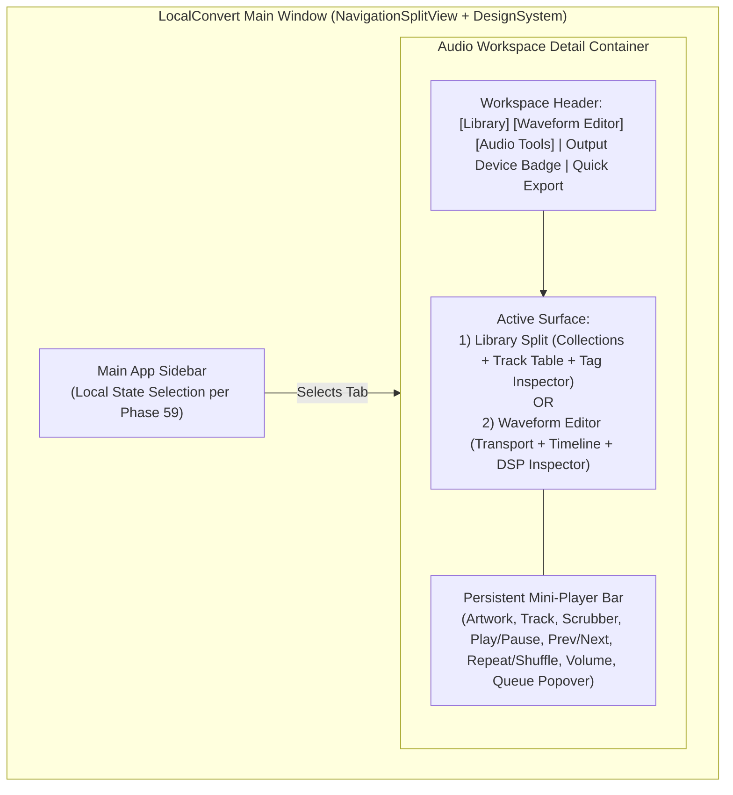
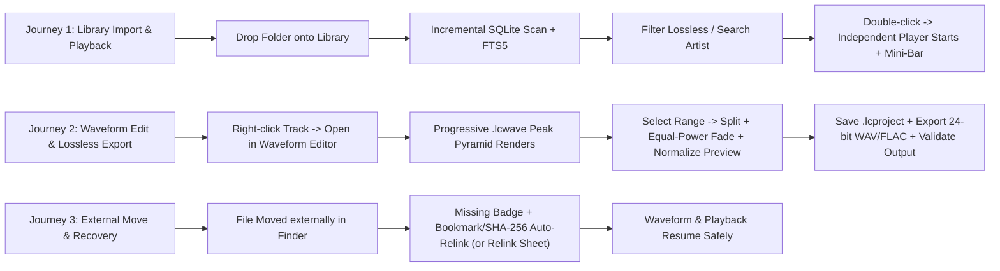

# Audio Workspace — UX & Information Architecture Specification

**Document ID:** LC-AW-UX-005  
**Target Platform:** macOS 15.0+ SwiftUI + AppKit (`DesignSystem` tokens)  
**Phase Status:** Phase 61.1 Corrected UX Specification

---

## 1. Navigation & Workspace Shell Integration

Currently, `AudioEditorRootView` is nested inside `AudioToolboxView` ([AudioToolboxView.swift:172](file:///Users/cancan/Desktop/LocalConvert/LocalConvert/Features/AudioToolbox/AudioToolboxView.swift#L172)). Promoting **Audio Workspace** into a cohesive primary workspace gives the Library Manager, Player, and Waveform Editor first-class screen real estate while keeping Conversion Workspace tabs (`Convert`, `Jobs`, `PDF Toolbox`, `Image Toolbox`, `Metadata`, `Presets`, `History`, `Settings`) untouched.

### 1.1 Main App Sidebar Structure
In `AppNavigationTab`:
- Keep Conversion Workspace & Utilities grouped naturally in the primary `NavigationSplitView` sidebar (`Convert`, `Jobs`, `PDF Toolbox`, `Audio Workspace` [replacing/evolving or coexisting cleanly with `Audio Toolbox` segmented mode], `Image Toolbox`, `Metadata`, `Presets`, `History`, `Settings`).
- Inside **Audio Workspace**, a lightweight segmented header switches between:
  1. **Library** (Collection Manager + Folder Scanner + Playlists + Tag Inspector)
  2. **Waveform Editor** (Multitrack Sample-Accurate Timeline + DSP Inspector + Export)
  3. **Batch Audio Toolbox** (retaining existing batch analyze / Spotify compatibility / batch audio FX utilities cleanly)
- A **Persistent Player Dock** spans the bottom of Audio Workspace (and optionally docks compactly across LocalConvert tabs while background playback is active), keeping Queue & Output Device controls one click away without intruding on editor or converter controls.

---

## 2. Screen-by-Screen Layout Specifications

### 2.1 Library View (Three-Region Layout)
Using `AppTheme.Colors`, `AppTheme.Spacing`, and `AppWorkspaceSurface`:

1. **Left Library Sidebar (`minWidth: 190, maxWidth: 240`):**
   - **Library:** `All Tracks`, `Recently Added`, `Recently Played`, `Favorites`, `Lossless & Hi-Res`.
   - **Health & Hygiene:** `Missing Files` (badge count if `> 0`), `Duplicates` (grouped disclosure badge).
   - **Watched Folders:** List of indexed root directories with last-scan timestamps & inline `Rescan` icon.
   - **Smart Collections** & **Playlists** (`+ New Playlist`, `+ New Smart Collection`).
2. **Center Search Bar & Track Table (`Table` / SwiftUI virtualized rows):**
   - **Toolbar Row:** Search field (`Search title, artist, album, codec...` via SQLite FTS5), filter pills (`All`, `Lossless`, `Hi-Res`), `+ Import Files / Folders` menu, sort indicator.
   - **Table Columns:** `Status/Playing Indicator`, `Title`, `Artist`, `Album`, `Time`, `Format` (`FLAC 24/96`, `ALAC`, `WAV`, `MP3 320`), `Bitrate / Sample Rate`, `Date Added`, `Plays`.
   - **Multi-Selection & Drag-and-Drop:** Supports dropping audio files/folders directly onto the track table or onto a Playlist row; dragging tracks directly onto the Waveform Editor tab or Timeline.
   - **Context Menu (Right-Click):** `Play Now`, `Play Next`, `Add to Queue`, `Add to Playlist >`, `Open in Waveform Editor`, `Inspect / Edit Metadata...`, `Reveal in Finder`, `Remove from Library` (explicitly labeled *"Does not delete file from disk"*), `Relink Missing File...` (when status is `.missing`).
3. **Collapsible Right Library Inspector (`300pt`, closed by default unless opened or inspecting metadata):**
   - Displays embedded Album Artwork, Read-Only Technical Details (Sample Rate, Bit Depth, Channels, Codec, True Size, SHA-256 prefix), Metadata Origin badge (`Embedded Tags` vs `Library DB Only`), and editable Tag fields with explicit `Save Tags to File` / `Save Library Notes` separation.

### 2.2 Persistent Audio Player & Queue UI
- **Persistent Bar (`height: 64pt`, docked below active Audio Workspace view; compact `44pt` pill when user switches to non-Audio tabs during active background playback):**
  - **Left:** `40x40` cover artwork thumbnail, Track Title (`lineLimit(1)`), Artist + Album subtitle, Format pill (`24-bit / 96 kHz FLAC`).
  - **Center:** `Previous`, `Play/Pause` (`Space` when Player focused), `Next`, `Shuffle`, `Repeat (Off/All/One)` + Scrubbable timeline slider with monospace elapsed / total timestamps (`AudioEditorTime` `tabularNums`) + subtle background waveform strip preview.
  - **Right:** Playback Speed selector (`1.0x`), Mute toggle + Volume slider, Audio Output Device picker popover (`System Default`, connected DACs/headphones), and `Up Next Queue` toggle button.
- **Queue Popover (`width: 360, maxHeight: 440`):**
  - Drag-to-reorder upcoming tracks, click to jump, swipe/button to remove, `Clear Queue`, `Save Queue as Playlist...`.

### 2.3 Waveform Editor View
Reuses and upgrades existing components in `LocalConvert/Features/AudioEditor/`:
- **Top Project & Editing Toolbar (`ProjectToolbar`):**
  - Project: `New`, `Open...`, `Save` (`⌘S`), `Save As...`, `Save Self-Contained Package...`, Autosave status indicator (`Saved` / `Unsaved edits`).
  - Edit Tools: `Undo` (`⌘Z`), `Redo` (`⇧⌘Z` — routed via `UndoRedoCoordinator`), `Cut` (`⌘X`), `Copy` (`⌘C`), `Paste` (`⌘V`), `Split at Playhead` (`B` / `⌘E`), `Trim to Selection` (`⌘T`), `Silence`, `Fade In`, `Fade Out`, `Gain / Normalize`, `Export Mixdown...` (`⇧⌘E`).
  - Banners (preserved from `AudioEditorRootView`): Recoverable Autosave prompt (`Recover` / `Dismiss`), Missing Source Audio warning (`Relink Missing Files...`).
- **Transport Strip (`TransportBarView`):** Play/Pause (`Space` when Editor focused), Stop, Return to Zero, Loop Selection toggle, Scrubbable Playhead Readout (`hh:mm:ss.mmm` + optional `Frame: <N>` toggle), Peak Level Meters (`L / R`), Zoom Controls (`-`, Slider, `+`, `Fit Project`, `Zoom to Selection`).
- **Main Multitrack Canvas (`MultitrackTimelineView` + `TimeRulerView`):**
  - **Track Headers (`180pt` fixed left):** Track Name, `Mute`, `Solo`, `Lock`, `Volume` fader, `Pan` dial, Track Group badge.
  - **Ruler (`TimeRulerView`):** Adaptive major/minor time ticks + vertical marker flags + loop range bracket.
  - **Waveform Canvas (`StereoWaveformClipView` upgraded to `Canvas` Pyramid Renderer):** True stereo/multichannel lanes drawn cleanly from `WaveformPyramid` mipmap bins matching pixel scale; draws clip body, fade-in/out gain envelope curves, overlap crossfades, selection highlight tint, and red clipping ticks without heavy SwiftUI subview trees.
- **Collapsible Right Editor Inspector (`300pt`, `AudioEditorInspectorView`):**
  - Tabbed compact inspector: `Clip` (Timeline Start Frame, Duration, Source Offset, Gain dB, Reverse, Swap L/R, Channel Mode, Fade In/Out Curve + Duration), `Effects` (`AudioEffectChainEditorView` — EQ, Compressor, Limiter, Gate, Time/Pitch, Presets), `Stats` (Selected range Peak dB, RMS dB, Clipped sample count, FFT spectrum).

### 2.4 Project Workspace & Export Sheet
- **New / Open / Save / Save As:** Uses `AppStoragePaths` safe defaults and native macOS `NSOpenPanel` / `NSSavePanel` supporting `.lcproject` and `.lcprojpkg`.
- **Autosave & Crash Recovery:** Background debounced autosave (never blocking typing or dragging) writes to `audioEditorRecoveryDirectory`; on next launch if an uncleaned autosave exists, displays non-modal top recovery banner in `AudioEditorRootView`.
- **Export Sheet (`AudioEditorExportSheet`):**
  - **Explicit Signal-Preservation Mode Banner (Correction C):** Always displays which of the three distinct audio-pipeline semantics applies to the active export configuration (never implying FLAC/ALAC re-rendering is bit-identical to edited/processed samples):
    1. *Original audio copied without signal modification* (**Bit-Exact Pass-Through** — enabled only when a single-source unedited segment matches format/rate/bit depth; note container metadata rewrites modify container bytes, not audio payload).
    2. *Edited audio rendered to a lossless format* (**Lossless-Format Re-Render** — `WAV`, `AIFF`, `ALAC`, `FLAC`, `CAF`; reflects fades, gain, EQ, mixing, normalization, SRC, and dithering inside a lossless codec).
    3. *Edited audio rendered to a lossy format* (**Lossy-Format Re-Render** — `MP3`, `AAC (.m4a)`, `Opus`, `Ogg Vorbis` when verified codec alignment completes).
  - **Format & Quality Controls:** Scope (`Entire Project`, `Selected Range`, `Selected Track`, `Selected Clips`, `All Stems`), Format (capability-filtered; `APE` never offered as export target; `Ogg Vorbis` enabled only after replacing `-c:a libvorbis` discrepancy in Phase 68), Sample Rate, Bit Depth (explicitly filtered to container limits: `16 / 24 / 32-float` for `WAV`/`CAF`, `16 / 24` for `FLAC`/`ALAC`), TPDF Dithering toggle (active only when quantizing down to `16-bit`, disabled cleanly for `32-float` and Bit-Exact Pass-Through), Loudness Normalization (`LUFS` + True Peak `-1.0 dBTP` ceiling), `Run Pre-Export Analysis` preview button, Progress bar + `Cancel Export`.

---

## 3. Control Hierarchy: Persistent vs Secondary

| Priority Tier | Controls | Placement |
|---|---|---|
| **Always Visible (Primary)** | Library search box, Play/Pause, Prev/Next, Progress scrubber, Volume, Editor Split/Trim/Undo/Redo/Export buttons, Track Mute/Solo | Top mode bar, Toolbar, Persistent Player Bar, Track Header |
| **Contextual / Inspector** | EQ/Compressor knobs, Fade curve pickers, Channel swap/reverse, Raw metadata fields, Library technical specs, Audio Output Device picker | Collapsible Right Inspector (`⌘I`) & Header Popovers |
| **Action / Modal Sheets** | Export settings + LUFS preview, Smart Collection rule builder, Missing File Relinker (`Relink Missing Files...`), Confirm Clear Library | Native Sheets (`.sheet`) & Context Menus |

---

## 4. Keyboard Shortcuts & Accessibility Plan

### Standard macOS Shortcuts
| Context | Shortcut | Action |
|---|---|---|
| **Global Audio Workspace** | `⌘F` | Focus Library search (in Library mode) or Find Clip/Marker |
| **Global Audio Workspace** | `⌘I` | Toggle Right Inspector panel |
| **Active Transport (Player or Editor)** | `Space` | Play / Pause (only when a text field is NOT first responder) |
| **Player Mode** | `⌘→` / `⌘←` | Next / Previous track |
| **Editor Mode** | `←` / `→` | Seek/Nudge backward/forward; `⇧←`/`⇧→` fine nudge |
| **Editor Mode** | `B` or `⌘E` | Split clip at playhead |
| **Editor Mode** | `⌘T` | Trim clip to selection |
| **Editor Mode** | `Delete` / `⌫` | Delete selection / selected clip (`⌥⌫` Ripple Delete) |
| **Editor Mode** | `⌘Z` / `⇧⌘Z` | Global Undo / Redo via `UndoRedoCoordinator` |
| **Editor Mode** | `⌘+` / `⌘-` / `⌘0` | Zoom In / Zoom Out / Fit Project |
| **Project** | `⌘S` / `⇧⌘S` / `⇧⌘E` | Save / Save As / Export Audio |

### Accessibility & VoiceOver Compliance
- Every clickable toolbar icon, sidebar item, player transport button, scrubber slider, track header toggle (`Mute`/`Solo`/`Lock`), and export control exposes explicit `.accessibilityLabel(...)`, `.accessibilityHint(...)`, `.accessibilityValue(...)`, and stable deterministic `.accessibilityIdentifier("audioworkspace.<section>.<control>")` so both VoiceOver users and XCUITest (`Phase 71`) interact reliably without `AppKit` hit-test hacks.
- All color-coded states (Clipping Red, Missing Amber, Lossless Badge Teal, Active Solo Amber) pair color with iconography (`SF Symbols`) or text labels (never color alone).

---

## 5. Primary End-to-End User Journeys

