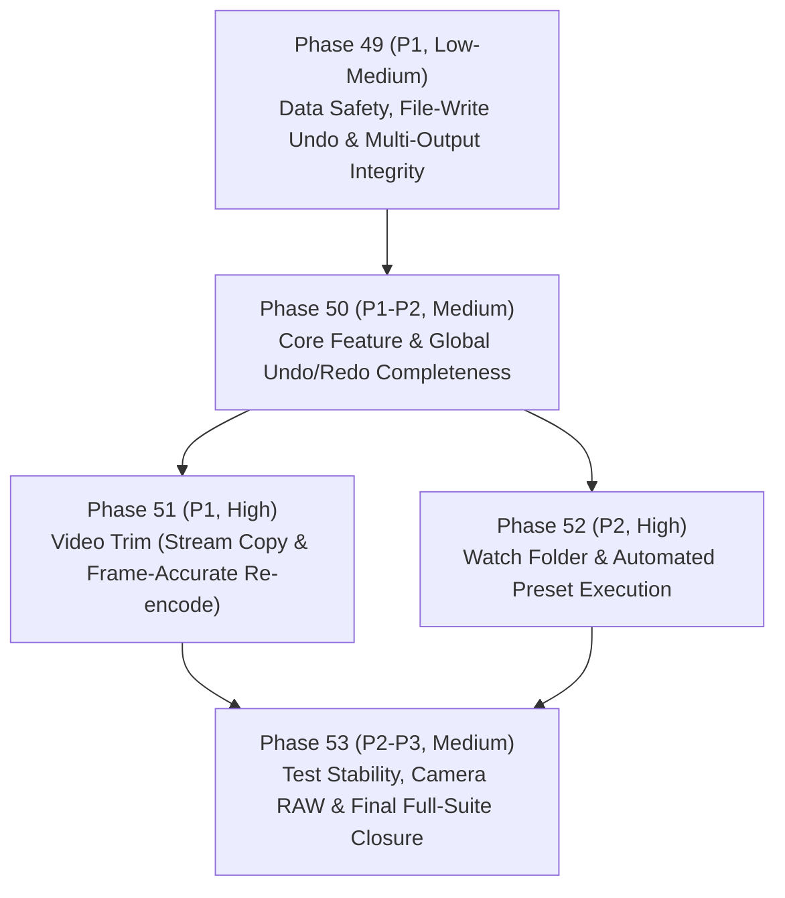

# LocalConvert — Phase 48: Integrated Gap Analysis & Final Development Roadmap

**Date:** 2026-11-21  
**Repository:** `/Users/cancan/Desktop/LocalConvert/` (`RighteousLife/LocalConvert`)  
**Target Platform:** macOS 15.0+, Apple Silicon (`arm64`), Swift 6.0 (`SWIFT_STRICT_CONCURRENCY: complete`)  
**App Version:** `1.0.0` (`MARKETING_VERSION: "1.0.0"`)

---

## Part I — Integrated Gap Analysis

Every gap and risk below was verified directly from the current Swift source code during the Phase 48 audit and prioritized according to:
1. Data loss and file safety
2. Risk of producing incomplete or unexpected output
3. Completion of core existing features
4. Architectural dependencies
5. User experience impact
6. Performance and concurrency reliability
7. Maintenance cost
8. Feasibility of new features (Video Trim and Watch Folder)

---

### GAP-01 (`P1`, Complexity: `Low`) — Multi-Output Conversion Jobs Record Only the First File in `OutputCreationUndoCommand`
- **Related Feature:** Global Undo/Redo (`OutputCreationUndoCommand`) & `ConversionQueue`
- **Current Status:** `PARTIALLY_IMPLEMENTED`
- **Evidence:**
  - `LocalConvert/Core/ConversionQueue/ConversionQueue.swift:200–204, 265–291`
  - `LocalConvert/Core/Conversion/ConversionEngine.swift:584–595` (`ConversionResult.allOutputURLs`)
- **Technical Explanation:** `ConversionResult` stores primary `outputURL` plus `additionalOutputURLs: [URL]` (`var allOutputURLs: [URL] { [outputURL] + additionalOutputURLs }`). Multi-output workflows—including PDF Split (`splitEveryPage`, `splitEveryN`, `splitRanges`, `splitBookmarks`), PDF-to-Images (`performPDFToImages`), Vision OCR with `.txt` sidecar, Audio multi-segment extraction (`executeMultiSegmentExtraction`), and Image Toolbox multi-size batch export (`ImageProcessingService.processToFile`)—populate `additionalOutputURLs`. However, `ConversionQueue.handleJobCompletion` passes only `outputURL: result.outputURL` to `recordOutputUndoIfSafe` and `batchCompletedOutputURLs`.
- **User Experience Impact:** Pressing `Cmd+Z` after any multi-output conversion removes only the first generated file while leaving all remaining split pages, extracted segments, `.txt` sidecar, or multi-size exports on disk. Additionally, `AfterConversionAction.revealInFinder` selects only the first output file.
- **Technical Risk:** Orphaned output files on disk after an Undo operation that reports `"Undone"` in `EditingHistoryView`.
- **Dependencies:** None (`OutputCreationUndoCommand` at `AppUndoCommands.swift:142–201` already accepts `outputURLs: [URL]`).
- **Recommended Solution:** Update `ConversionQueue.handleJobCompletion` and `recordOutputUndoIfSafe` to pass `outputURLs: result.allOutputURLs` (filtering out any URL matching `job.inputURLs`) and append `contentsOf: result.allOutputURLs` to `batchCompletedOutputURLs`.

---

### GAP-02 (`P1`, Complexity: `Medium`) — Top-Level `Metadata` Tab & `Audio Toolbox → Tags` Overwrite Source Media In-Place Without `"Save Copy..."` or Disk-Level Undo Backup
- **Related Feature:** Metadata Editor (`MetadataManager`, `MetadataView`, `AudioToolboxView.embeddedMetadataSection`) & Global Undo/Redo
- **Current Status:** `PARTIALLY_IMPLEMENTED`
- **Evidence:**
  - `LocalConvert/Core/Metadata/MetadataManager.swift:173–218` (`MetadataManager.save()`)
  - `LocalConvert/Core/UndoRedo/OperationContext.swift:164` (`UndoOperationType.metadataSaveToDisk`, currently unused)
  - Contrast with `LocalConvert/Features/ImageToolbox/ImageToolboxView.swift:848–873` (`saveMetadataInPlaceOrCopy`)
- **Technical Explanation:** While `ImageToolboxView` offers `"Save Copy..."` (default non-destructive copy) alongside `"Save In-Place"` and stages the pre-write file into `RecoveryArtifactManager.shared.stageFileByCopying(from:)` wrapped in `ImageFileWriteUndoCommand`, `MetadataManager.save()` always overwrites `activeURL` in place via `SafeMetadataWriter.performSafeWrite(on: url)` and records no disk-level undo command. Pressing `Cmd+Z` after saving in the `Metadata` tab only reverts the in-memory `MetadataDocument` via `MetadataSnapshotUndoCommand`, leaving the modified file on disk.
- **User Experience Impact:** Users editing tags in the `Metadata` tab or `Audio Toolbox → Tags & Cover Art` modify their source file in place by default and cannot undo the disk write via `Cmd+Z`.
- **Technical Risk:** Violates the core workspace rule that metadata editing must not overwrite source media by default without rollback/undo protection.
- **Dependencies:** `RecoveryArtifactManager` and `ImageFileWriteUndoCommand` (generalizable to `FileWriteUndoCommand(context:operationType:...)`).
- **Recommended Solution:**
  1. Add `"Save Copy..."` (collision-safe `_tagged` copy or `NSSavePanel`) as the primary non-destructive action alongside `"Save In-Place"` in `MetadataView` and `AudioToolboxView.embeddedMetadataSection`.
  2. Before writing in `MetadataManager.save(to:)`, stage the target file (if existing) via `RecoveryArtifactManager.shared.stageFileByCopying(from:)` and record a disk-level undo command (`.metadataSaveToDisk` in `.metadata` / `.audioToolbox` context) that restores or removes the written file and reloads `MetadataManager`.

---

### GAP-03 (`P1`, Complexity: `Low`) — `ImageBatchRenameView` Leaves `AppState.droppedFiles` Pointing at Old URLs and Its Inline Undo Button Bypasses `UndoRedoCoordinator`
- **Related Feature:** Image Toolbox Safe Batch Rename (`ImageBatchRenameView`, `BatchRenameUndoCommand`)
- **Current Status:** `PARTIALLY_IMPLEMENTED`
- **Evidence:**
  - `LocalConvert/Features/ImageToolbox/ImageConvertUtilitiesViews.swift:378–408`
  - `LocalConvert/Core/UndoRedo/AppUndoCommands.swift:206–301` (`BatchRenameUndoCommand`)
- **Technical Explanation:** When `"Apply Safe Rename"` executes `ImageBatchRenameService.executePlan(plan)`, files are moved on disk (`move.from -> move.to`) and `BatchRenameUndoCommand` is recorded in `UndoRedoCoordinator`. However:
  1. `AppState.droppedFiles` and `ImageToolboxStore.configsByURL` still reference the old `move.from` URLs, which no longer exist on disk.
  2. Clicking the inline `"Undo Last Rename"` button (`ImageConvertUtilitiesViews.swift:399–407`) calls `ImageBatchRenameService.undo(manifest)` directly on disk without calling `UndoRedoCoordinator.shared.undo(in: .imageToolbox)`, leaving `BatchRenameUndoCommand` at the top of the coordinator's undo stack in a stale state.
- **User Experience Impact:** After batch-renaming loaded images in Image Toolbox, selecting or exporting those images fails with `"file not found"` because the queue still points to the old filenames; clicking `"Undo Last Rename"` and later pressing `Cmd+Z` triggers a stale-entry error.
- **Technical Risk:** State desynchronization between disk, `AppState.droppedFiles`, `ImageToolboxStore`, and `UndoRedoCoordinator`.
- **Dependencies:** `AppState`, `ImageToolboxStore`, `BatchRenameUndoCommand`.
- **Recommended Solution:**
  1. Add an `onURLsRenamed: @MainActor ([(from: URL, to: URL)]) -> Void` callback on `BatchRenameUndoCommand` (invoked on initial apply, `undo()`, and `redo()`) that updates matching URLs in `AppState.droppedFiles` and migrates per-URL entries in `ImageToolboxStore`.
  2. Route the inline `"Undo Last Rename"` button through `await UndoRedoCoordinator.shared.undo(in: .imageToolbox)` so inline and `Cmd+Z` undo share a single source of truth.

---

### GAP-04 (`P1`, Complexity: `Low`) — Per-File `targetFormat` in `ImageToolboxView` Is Not Connected to `ImageToolboxStore` or Global Undo/Redo
- **Related Feature:** Image Toolbox Pro & Global Undo/Redo
- **Current Status:** `PARTIALLY_IMPLEMENTED`
- **Evidence:**
  - `LocalConvert/Features/ImageToolbox/ImageToolboxView.swift:12, 386, 489, 624–630, 1015`
  - `LocalConvert/Core/UndoRedo/ImageToolboxUndoCommands.swift:8–12, 239, 271–279`
- **Technical Explanation:** `ImageToolboxStore` already defines `@Published var targetFormatByURL: [URL: FileFormat] = [:]` (line 239), `targetFormat(for:fallback:)` (line 271), and `setTargetFormat(_:for:)` (line 276), but `ImageToolboxView` binds its format pickers to view-local `@State private var targetFormat: FileFormat = .jxl` (line 12), overwrites `targetFormat` when `loadPrimaryDetails()` runs, and never records an undo command when `targetFormat` changes.
- **User Experience Impact:** Switching between two images in Image Toolbox loses each file's chosen output format, and pressing `Cmd+Z` after changing the output format in Image Toolbox does not undo the format change.
- **Technical Risk:** Incomplete fulfillment of the Phase 43/46 per-file Image Toolbox Undo/Redo contract.
- **Dependencies:** `ImageToolboxStore`, `ImageConfigUndoCommand`.
- **Recommended Solution:** Include optional `targetFormat: FileFormat?` in `ImageConfigUndoCommand.Payload` (backward-compatible `decodeIfPresent`), bind `ImageToolboxView`'s output format pickers to `appState.imageToolboxStore.targetFormatBinding(for: primaryURL, defaultFormat: defaultTargetFormat(for: primaryURL))`, and record an `.outputFormatChange` command in `ImageToolboxStore`.

---

### GAP-05 (`P1`, Complexity: `Low`) — Exporting Animated GIF / APNG / WebP / JXL from `Image Toolbox Pro` Drops Animation Frames
- **Related Feature:** Image Toolbox Pro (`Convert & Codec` / animated image handling)
- **Current Status:** `PARTIALLY_IMPLEMENTED`
- **Evidence:**
  - `LocalConvert/Engines/Image/ImageConversionEngine.swift:146–157, 250–277`
  - `LocalConvert/Engines/Image/ImageProcessingService.swift:199, 249, 842–988`
- **Technical Explanation:** When `options.customOptions["image_toolbox"] == "true"`, `ImageConversionEngine.convert` returns early at line 148 via `ImageProcessingService.processToFile`, bypassing `ImageConversionEngine.convertAnimatedIfApplicable` (line 257). `ImageProcessingService` decodes only frame 0 (`decodeAllFrames: false`), turning multi-frame animations into static single-frame outputs even when `!config.hasPixelEdits`.
- **User Experience Impact:** An animated GIF, APNG, WebP, or JXL converted in the `Convert` tab preserves all frames, but the exact same file exported from `Image Toolbox Pro` (with no crop/resize/filter edits) loses its animation.
- **Technical Risk:** Silent loss of animation frames on Image Toolbox export.
- **Dependencies:** `ImageConversionEngine.convertAnimatedIfApplicable`, `JPEGXLCodec.decode(..., decodeAllFrames: true)`, `JPEGXLCodec.encodeAnimated`.
- **Recommended Solution:** In `ImageConversionEngine.convert` (or at the top of `ImageProcessingService.processToFile`), when `!toolboxConfig.hasPixelEdits && !toolboxConfig.exportMultipleSizes`, check if the input has multiple frames (`frameCount > 1`) and route animated container pairs (`.gif`, `.apng`, `.webp`, `.jxl`) through the multi-frame animated transcode pipeline (or surface a clear warning banner when pixel edits are applied to an animated source).

---

### GAP-06 (`P2`, Complexity: `Low`) — `VideoMetadataProvider.readMetadata` Calls `process.waitUntilExit()` Before Draining `stdout` Pipe
- **Related Feature:** Video Metadata Inspection (`VideoMetadataProvider`)
- **Current Status:** `IMPLEMENTED` (with subprocess pipe-deadlock risk)
- **Evidence:** `LocalConvert/Core/Metadata/Providers/VideoMetadataProvider.swift:95–112`
- **Technical Explanation:** `VideoMetadataProvider.readMetadata` spawns `ffprobe -v error -show_format -show_streams -of json` and calls `process.waitUntilExit()` (line 110) before `let data = pipe.fileHandleForReading.readDataToEndOfFile()` (line 111). If `ffprobe` writes >64 KB to the macOS pipe buffer (e.g., MKV/MP4 files with many streams or embedded chapter/tag dictionaries), `ffprobe` blocks waiting for the pipe reader while `waitUntilExit()` blocks waiting for `ffprobe` to exit.
- **User Experience Impact:** Opening a metadata-heavy video file in the `Metadata` tab can hang the metadata load indefinitely.
- **Technical Risk:** Pipe buffer deadlock and un-cancellable synchronous blocking inside an `async` method.
- **Dependencies:** `AsyncProcessRunner` (`ConversionManager.swift:32–80`).
- **Recommended Solution:** Replace lines 96–112 of `VideoMetadataProvider.swift` with `let output = try await AsyncProcessRunner.run(process)`.

---

### GAP-07 (`P2`, Complexity: `Low`) — `UI_ONLY` Settings in `SettingsView` (`rememberLastUsedOptions` and `verboseLogging` / `DiagnosticLogManager`)
- **Related Feature:** Settings (`ConversionDefaultsSettingsSection`, `PrivacyDiagnosticsSettingsSection`)
- **Current Status:** `UI_ONLY`
- **Evidence:**
  - `LocalConvert/Core/Settings/AppSettings.swift:281–305, 570–571, 615–616`
  - `LocalConvert/Features/Home/SettingsView.swift:286, 531–545`
- **Technical Explanation:**
  1. `AppSettings.shared.rememberLastUsedOptions` is toggled in `SettingsView.swift:286` (`"Remember last used options for formats"`), but no code in `AppState`, `DroppedFile`, or `FileOptionsView` ever reads `rememberLastUsedOptions` or persists per-format last-used `ConversionOptions`.
  2. `AppSettings.shared.verboseLogging` is toggled in `SettingsView.swift:531` (`"Enable Verbose Diagnostic Logging"`), and `DiagnosticLogManager` opens/clears `~/Library/Logs/LocalConvert/`, but no code reads `verboseLogging` or writes diagnostic log files to `~/Library/Logs/LocalConvert/`.
- **User Experience Impact:** Toggling either setting has zero effect; clicking `"Open Diagnostic Logs Folder"` opens an empty `~/Library/Logs/LocalConvert/` folder even after conversions and errors occur.
- **Technical Risk:** User-visible controls that do not perform their stated function.
- **Dependencies:** `AppSettings`, `AppState`, `DiagnosticLogManager`.
- **Recommended Solution:**
  1. Wire `rememberLastUsedOptions` in `AppState`: when `rememberLastUsedOptions == true`, cache the last-used `ConversionOptions` per output `FileFormat` (and apply it when a user selects that output format in `updateOutputFormat`), or bypass `recentOutputFormats` pre-selection when disabled.
  2. Wire `DiagnosticLogManager.appendLog(category:level:message:)` (writing sanitized, home-path-redacted entries to `~/Library/Logs/LocalConvert/localconvert.log` when `AppSettings.shared.verboseLogging == true` or when a conversion fails).

---

### GAP-08 (`P2`, Complexity: `Low`) — Audio Editor `AudioMarker` Timeline Markers Lack UI & Store Mutation Methods
- **Related Feature:** Audio Editor 2.0 (`TimeRulerView`, `AudioEditorStore`, `AudioEditorModels`)
- **Current Status:** `PARTIALLY_IMPLEMENTED`
- **Evidence:**
  - `LocalConvert/Engines/AudioEditor/AudioEditorModels.swift:250–254, 264`
  - `LocalConvert/Features/AudioEditor/TimeRulerView.swift:62–75`
- **Technical Explanation:** `AudioMarker` is defined in the v1/v2 `.lcproject` schema and drawn on `TimeRulerView`, but no `AudioEditorStore` or `AudioEditingService` functions or toolbar/context-menu actions exist to add a marker at the playhead (`M`), rename, jump to, or delete markers.
- **User Experience Impact:** Users cannot place or manage markers on the Audio Editor timeline despite the ruler rendering support.
- **Technical Risk:** Dead model/view code path.
- **Dependencies:** `AudioEditorStore`, `AudioEditingService`, `AudioEditorRootView` / `TimeRulerView`.
- **Recommended Solution:** Add `addMarkerAtPlayhead(name:)`, `renameMarker(id:name:)`, and `deleteMarker(id:)` to `AudioEditingService` and `AudioEditorStore` (recorded via `performMutation`), plus an `"Add Marker"` button/menu in `AudioEditorRootView` and click-to-seek / context-menu delete on `TimeRulerView`.

---

### GAP-09 (`P2`, Complexity: `Medium`) — Non-Editor `AudioToolboxView` Sections Lack Long-Lived Store Persistence & Config Undo, and Secondary Utilities Skip Undo Recording
- **Related Feature:** Audio Toolbox (`Quick Trim`, `Merge`, `Effects`, `Spotify Compatibility`), Image Toolbox (`Duplicate Finder`), Presets (`resetToDefaults`), Convert Tab (per-file option changes)
- **Current Status:** `PARTIALLY_IMPLEMENTED`
- **Evidence:**
  - `LocalConvert/Features/AudioToolbox/AudioToolboxView.swift:49–68`
  - `LocalConvert/Features/AudioToolbox/SpotifyCompatibilityView.swift:895–954`
  - `LocalConvert/Features/ImageToolbox/ImageConvertUtilitiesViews.swift:548–554`
  - `LocalConvert/Core/Presets/PresetManager.swift:107–111`
  - `LocalConvert/Features/Conversion/ImageOptimizationView.swift:399–444`
- **Technical Explanation:**
  1. `AudioToolboxView` keeps `config`, `targetFormat`, `trimStart`, `trimEnd`, and `orderedMergeIDs` in view-local `@State`, losing state on tab switch and leaving `.audioToolboxConfig` / `.audioToolboxSegmentEdit` unimplemented.
  2. `SpotifyCompatibilityView.runNormalizeEligible()` creates normalized output files without recording `OutputCreationUndoCommand`.
  3. `ImageDuplicateFinderView.moveSelectedToTrash()` moves files to Trash without removing them from `AppState.droppedFiles` or recording an undo entry.
  4. `PresetManager.resetToDefaults()` does not call `recordPresetUndo(type: .presetReset, ...)`.
  5. `ImageOptimizationSectionView.applyModeChange` uses `0.95` for `.maximum` and `500 KB / 0.55` for `.smallFile`, diverging from `ConversionPreset.maximumQuality` (`1.0`) and `.smallFile` (`1 MB / 0.50`).
- **User Experience Impact:** Switching tabs resets Audio Toolbox settings; undoing Spotify normalization or Preset Reset is unavailable; selecting `Optimization Mode → Maximum Quality` unexpectedly flips `Smart Preset` to `Custom`.
- **Technical Risk:** Inconsistent Undo/Redo and tab-state behavior across modules.
- **Dependencies:** `UndoRedoCoordinator`, `AppState`.
- **Recommended Solution:** Host `AudioToolboxStore` on `AppState`, align `ImageOptimizationSectionView` mode values with `ConversionPreset`, record `OutputCreationUndoCommand` in `SpotifyCompatibilityView`, record `PresetStoreUndoCommand` in `PresetManager.resetToDefaults()`, and remove trashed URLs from `AppState.droppedFiles` in `ImageDuplicateFinderView`.

---

### GAP-10 (`P1`, Complexity: `High`) — Video Trim Is Not Implemented
- **Related Feature:** Video Conversion & Trimming (`MediaConversionEngine`, `BaseFFmpegProvider`, `FileOptionsView` / `FileRowView`)
- **Current Status:** `NOT_IMPLEMENTED`
- **Evidence:** `LocalConvert/Engines/Media/BaseFFmpegProvider.swift:213–284` (no `-ss`/`-to` arguments for video conversion; no video preview/trim UI in `LocalConvert/Features/`).
- **Technical Explanation:** Video Trim was planned in early architecture docs (`docs/PRESET_ARCHITECTURE.md:7`) and skipped during Phases 20–47. All underlying FFmpeg/FFprobe execution, hardware `h264_videotoolbox` encoding, stream copy validation (`canStreamCopy`), multi-audio/subtitle mapping (`subtitleArguments`), cancellation (`AsyncProcessRunner`), and atomic output reservation (`OutputReservationRegistry`) already exist.
- **User Experience Impact:** Users can trim audio tracks in `Audio Toolbox`, but cannot trim video files (either losslessly via Stream Copy or frame-accurately via re-encoding) before converting or exporting to MP4/MOV/MKV/WebM/GIF/APNG.
- **Technical Risk:** Keyframe misalignment in Stream Copy mode if `-avoid_negative_ts make_zero` is omitted; inaccurate progress percentage if FFmpeg `out_time_us` is divided by full source duration instead of trimmed segment duration (`end - start`).
- **Dependencies:** `BundledFFmpegProvider`, `BaseFFmpegProvider`, `MediaProbe`, `ConversionOptions`, `FileRowView`, `FileOptionsView`.
- **Recommended Solution:** Implement Phase 51 (detailed in Part II below).

---

### GAP-11 (`P2`, Complexity: `High`) — Watch Folder / Automatic Conversion Is Not Implemented
- **Related Feature:** Watch Folder Automation (`PresetExecutor`, `ConversionQueue`, `AppLifecycleManager`)
- **Current Status:** `NOT_IMPLEMENTED` (only prerequisite `PresetExecutor.execute(...)` exists at `LocalConvert/Core/Presets/PresetExecutor.swift:20–115`).
- **Technical Explanation:** No directory watcher (`FSEventStream` / `DispatchSourceFileSystemObject`), file write-completion stability detector, infinite-loop guard (when output folder equals watched folder), persistent Watch Folder configuration store, or Watch Folder UI exists.
- **User Experience Impact:** Users cannot configure automated background folder conversion using their saved presets.
- **Technical Risk:** Converting partially written files (e.g., large video downloads or file copies in progress) or re-triggering on LocalConvert's own output files if output is written into the watched directory.
- **Dependencies:** `PresetExecutor`, `PresetManager`, `ConversionQueue`, `OutputReservationRegistry`, `AppLifecycleManager`.
- **Recommended Solution:** Implement Phase 52 (detailed in Part II below).

---

### GAP-12 (`P2`, Complexity: `Low`) — `Phase422ClosureTests` Shared-Host Mach VM Measurement Sensitivity & Post-47.1.4 Full `603`-Test Regression Verification
- **Related Feature:** Test Architecture & Release Verification (`Phase422ClosureTests.swift`, `Phase47LifecycleAndUXTests.swift`)
- **Current Status:** `PARTIALLY_IMPLEMENTED`
- **Evidence:**
  - `LocalConvertTests/Phase422ClosureTests.swift:250–355`
  - `docs/PHASE46_FINAL_REPORT.md` §12.2 & `docs/PHASE47_FINAL_REPORT.md` §16, §25
- **Technical Explanation:**
  1. The post-47.1.4 theme synchronization fix added a 13th test to `Phase47LifecycleAndUXTests.swift`, bringing the repository total from `602` to `603` `@Test` declarations across `77` suites; only a focused `21/21` run was executed after that addition.
  2. `Phase422ClosureTests.largeImageMemoryStabilityAndDiagnostics()` asserts on single-category Mach VM (`nonVolatileInternalMB` and `footprintMB`) deltas (`<= +150 MB`) that can fluctuate when the macOS kernel reclassifies purgeable/IOSurface pages late inside a 77-suite shared `xctest` process.
- **Recommended Solution:** Stabilize `Phase422ClosureTests` memory sampling (draining autoreleasepools and accounting for purgeable reclassification without loosening the 150 MB leak bound), clean untracked root `.trace` / `debug-deployment` artifacts, add `*.trace` and `debug-deployment/` to `.gitignore`, and execute the full quiescent `603`+ test suite.

---

### Explicit Non-Goals & Low-ROI Refactoring to Avoid
1. **Do NOT create a separate 10th top-level `Video Toolbox` sidebar tab for Video Trim:** Adding a top-level tab for a single operation would fragment the 9-tab navigation (`⌘1`–`⌘8`, `⌘,`) and duplicate `Convert`'s format picker, Smart Presets, and queue UI. Integrating Video Trim into `Convert` (`FileRowView` + `FileOptionsView` + `VideoTrimSheetView`) reuses 100% of existing queue, preset, history, and undo infrastructure.
2. **Do NOT rewrite `AudioClip.effects` (`AudioEffectChainConfig`) to remove legacy FFmpeg proxy pitch/time-stretch:** `AudioClip.effectSlots` handles real-time/offline DSP (`EQ`, `Compressor`, `Limiter`, `Gate`, `Spectral NR`, `Delay`, `Reverb`), while `AudioClip.effects` cleanly handles `pitchSemitones` and `timeStretch` via `ClipProxyCache`. Refactoring pitch/time-stretch out of `ClipProxyCache` is high-risk and low-ROI.
3. **Do NOT bundle external C/Java CLI tools (such as `veraPDF` or `qpdf`) for PDF/A preflight or PDF linearization:** Bundling a JVM or additional GPL binaries would bloat the app bundle and complicate licensing/signing; the existing honest UI disclosures in `PDFArchivalView` and `PDFCompressOptionsView` are accurate and appropriate.

---

## Part II — Final Development Roadmap (Phases 49–53)

---

### Phase 49 — Data Safety, File-Write Undo & Multi-Output Integrity
- **Objective:** Close all `P1` file-safety, multi-output Undo/Redo, subprocess pipe-draining, and file-rename state synchronization defects before adding new features.
- **Priority:** `P1 — High`
- **Estimated Complexity:** `Medium`
- **Dependencies:** Existing `UndoRedoCoordinator`, `RecoveryArtifactManager`, `ConversionQueue`, `MetadataManager`, `VideoMetadataProvider`.
- **Scope & Sub-Tasks:**
  1. **Multi-Output `OutputCreationUndoCommand` (`GAP-01`):** Update `ConversionQueue.handleJobCompletion` and `recordOutputUndoIfSafe` (`ConversionQueue.swift:202–203, 265–291`) to record `result.allOutputURLs` (`[outputURL] + additionalOutputURLs`, excluding any protected source URLs) and append all generated URLs to `batchCompletedOutputURLs`.
  2. **Non-Destructive Metadata Copy & Disk-Level Metadata Undo (`GAP-02`):**
     - Add `"Save Copy..."` alongside `"Save In-Place"` in `MetadataView` and `AudioToolboxView.embeddedMetadataSection`.
     - In `MetadataManager.save(to:)`, stage any existing target file into `RecoveryArtifactManager.shared.stageFileByCopying(from:)` prior to `provider.writeMetadata` and record a disk-level undo command (`UndoOperationType.metadataSaveToDisk`) that restores the exact pre-write file bytes on `Cmd+Z` and reloads `MetadataManager`.
  3. **`ImageBatchRenameView` Queue & Undo Synchronization (`GAP-03`):**
     - Update `BatchRenameUndoCommand` (`AppUndoCommands.swift:206–301`) to invoke a `@MainActor` URL-remapping hook on apply, `undo()`, and `redo()` that updates matching URLs in `AppState.droppedFiles` and `ImageToolboxStore`.
     - Route the inline `"Undo Last Rename"` button in `ImageBatchRenameView` (`ImageConvertUtilitiesViews.swift:399–407`) through `UndoRedoCoordinator.shared.undo(in: .imageToolbox)`.
  4. **Animated Image Preservation in `Image Toolbox Pro` (`GAP-05`):**
     - When exporting an animated `.gif`, `.apng`, `.webp`, or `.jxl` (`frameCount > 1`) from `Image Toolbox Pro` without pixel/geometry edits (`!config.hasPixelEdits && !config.exportMultipleSizes`), route through the multi-frame animation pipeline (`convertAnimatedIfApplicable`) instead of single-frame `CGImage` decode; display an explicit warning banner in `ImageToolboxView` when pixel/geometry edits will flatten an animated source to frame 0.
  5. **Subprocess Pipe-Drain Fix in `VideoMetadataProvider` (`GAP-06`):**
     - Replace `process.waitUntilExit()` + `pipe.fileHandleForReading.readDataToEndOfFile()` in `VideoMetadataProvider.readMetadata` (`VideoMetadataProvider.swift:96–112`) with `AsyncProcessRunner.run(process)`.
- **Acceptance Criteria (Measurable):**
  1. Undoing (`Cmd+Z`) a multi-output job (3-page PDF Split, 2-segment Audio extraction, OCR with `.txt` sidecar, 3-size Image batch export) stages/removes **100% of generated output files** (`result.allOutputURLs`) and Redo (`Shift+Cmd+Z`) restores all of them while source SHA-256 hashes remain unchanged.
  2. Saving metadata in `MetadataView` or `AudioToolboxView` supports non-destructive `"Save Copy..."`, and pressing `Cmd+Z` after an in-place or copy save restores the exact pre-save file bytes on disk (verified by SHA-256).
  3. Applying `"Apply Safe Rename"` in `ImageBatchRenameView` updates `AppState.droppedFiles` URLs immediately, and both the inline `"Undo Last Rename"` button and `Cmd+Z` revert the rename cleanly with zero stale entries in `UndoRedoCoordinator`.
  4. Exporting a 3-frame animated GIF or animated JXL in `Image Toolbox Pro` (with no pixel edits) to `.jxl`, `.gif`, or `.apng` preserves `frameCount == 3`.
  5. `VideoMetadataProvider.readMetadata` uses `AsyncProcessRunner.run(process)` with zero raw `waitUntilExit()` calls before pipe draining.
- **Required Automated Tests:**
  - `Phase49DataSafetyAndUndoTests.swift` covering multi-output `OutputCreationUndoCommand` undo/redo, `MetadataManager` disk-level undo/redo & SHA-256 restoration, `ImageBatchRenameView` `AppState.droppedFiles` synchronization, animated JXL/GIF export through `ImageToolbox`, and `VideoMetadataProvider` large-tag probing.
- **Manual Verification Requirements:**
  - In `Metadata` tab, edit an MP3/JPEG title, click `"Save Copy..."` and `"Save In-Place"`, then press `Cmd+Z` and verify the file on disk reverts in Finder.
- **Completion Conditions:** All Phase 49 tests pass with `0` regressions and `0` Swift 6 compiler warnings.

---

### Phase 50 — Core Feature & Global Undo/Redo Completeness
- **Objective:** Close remaining `P1`/`P2` feature completeness gaps across Image Toolbox per-file `targetFormat` Undo/Redo, `SettingsView` `UI_ONLY` toggles, Audio Editor timeline markers, `AudioToolboxStore` tab persistence, and Smart Preset / `ImageOptimizationMode` alignment.
- **Priority:** `P1 / P2`
- **Estimated Complexity:** `Medium`
- **Dependencies:** Phase 49.
- **Scope & Sub-Tasks:**
  1. **Per-File `targetFormat` Undo/Redo & Persistence in `ImageToolboxStore` (`GAP-04`):**
     - Bind `ImageToolboxView`'s output format pickers (`ImageToolboxView.swift:386, 489`) to `appState.imageToolboxStore.targetFormat(for: primaryURL, fallback:)` instead of view-local `@State`.
     - Extend `ImageConfigUndoCommand.Payload` (with backward-compatible `decodeIfPresent`) or add `ImageTargetFormatUndoCommand` so per-file output format changes in Image Toolbox are isolated per URL, undoable/redoable via `Cmd+Z` / `Shift+Cmd+Z`, and survive restart.
  2. **Wire `UI_ONLY` Settings (`rememberLastUsedOptions` & `verboseLogging` / `DiagnosticLogManager`) (`GAP-07`):**
     - Implement per-format last-used `ConversionOptions` persistence gated by `AppSettings.shared.rememberLastUsedOptions` in `AppState.updateOutputFormat` / `updateOptions`.
     - Implement privacy-sanitized file logging in `DiagnosticLogManager` (`~/Library/Logs/LocalConvert/localconvert.log`) gated by `AppSettings.shared.verboseLogging` (and error events) using `ErrorDetailsFormatter.sanitizePaths`.
  3. **Audio Editor Timeline Markers UI & Store Actions (`GAP-08`):**
     - Add `addMarker(at:name:)`, `renameMarker(id:name:)`, and `deleteMarker(id:)` to `AudioEditingService` and `AudioEditorStore` (with Undo/Redo support).
     - Add `"Add Marker (M)"` to `AudioEditorRootView` toolbar / `AudioEditorKeyMonitor` and marker click-to-seek + context-menu rename/delete on `TimeRulerView`.
  4. **`AudioToolboxStore` Persistence & Secondary Undo Closures (`GAP-09`):**
     - Move `AudioToolboxView`'s non-editor state (`config`, `targetFormat`, `trimStart`, `trimEnd`, `orderedMergeIDs`) into an `@MainActor final class AudioToolboxStore: ObservableObject` hosted on `AppState` with undoable config mutations (`.audioToolboxConfig`, `.audioToolboxSegmentEdit`).
     - Record `OutputCreationUndoCommand` in `SpotifyCompatibilityView.runNormalizeEligible()`, record `PresetStoreUndoCommand` (`.presetReset`) in `PresetManager.resetToDefaults()`, and remove trashed files from `AppState.droppedFiles` in `ImageDuplicateFinderView.moveSelectedToTrash()`.
     - Align `ImageOptimizationSectionView.applyModeChange` (`.maximum` and `.smallFile`) with `ConversionPreset.maximumQuality` and `.smallFile` (`GAP-09` / `P2-05`).
- **Acceptance Criteria (Measurable):**
  1. Switching between two images in `Image Toolbox` preserves each image's distinct `targetFormat` (e.g., Image A = `.jxl`, Image B = `.webp`), and pressing `Cmd+Z` / `Shift+Cmd+Z` undoes and redoes `targetFormat` changes per file and across journal rehydration.
  2. When `rememberLastUsedOptions == true`, configuring custom options for `.webp` and adding a new file targeting `.webp` restores those options; when `false`, factory default options are used.
  3. When `verboseLogging == true`, running a conversion writes sanitized log entries into `~/Library/Logs/LocalConvert/localconvert.log`, and `DiagnosticLogManager.clearDiagnosticLogs()` empties the directory.
  4. Pressing `M` or clicking `"Add Marker"` in Audio Editor 2.0 adds an `AudioMarker` at `timeline.playheadTime`, renders it on `TimeRulerView`, persists it in v2 `.lcproject`, and supports `Cmd+Z` / `Shift+Cmd+Z`.
  5. Switching top-level tabs away from `Audio Toolbox` and back preserves `Quick Trim`, `Merge Audio`, and `Adjust & Effects` settings; selecting `Optimization Mode → Maximum Quality` or `Small File` in `FileOptionsView` synchronizes cleanly with `Smart Preset`.
- **Required Automated Tests:**
  - `Phase50CompletenessAndUndoTests.swift` testing per-file `targetFormat` Undo/Redo + restart rehydration, `rememberLastUsedOptions`, `DiagnosticLogManager` log file writing/sanitization/clearing, `AudioMarker` CRUD + undo + persistence, `AudioToolboxStore` tab survival + config undo, `SpotifyCompatibilityView` output undo, and `PresetManager.resetToDefaults()` undo.
- **Manual Verification Requirements:**
  - Verify marker creation/click-to-seek on `TimeRulerView` and per-image `targetFormat` switching in `ImageToolboxView`.
- **Completion Conditions:** All Phase 50 tests pass with `0` regressions and `0` Swift 6 warnings.

---

### Phase 51 — Video Trim (Stream Copy & Frame-Accurate Re-encode)
- **Objective:** Deliver non-destructive Video Trim with interactive video preview, timeline scrubbing, and user-selectable **Fast Stream Copy** (keyframe-snapped, lossless) and **Frame-Accurate Re-encode** modes integrated directly into LocalConvert's video conversion workflow.
- **Priority:** `P1 — High`
- **Estimated Complexity:** `High`
- **Dependencies:** Phase 49 (for multi-output/undo pipeline) and existing `BundledFFmpegProvider`, `BaseFFmpegProvider`, `MediaProbe`, `ConversionOptions`, `FileRowView`, `FileOptionsView`.
- **Scope & Sub-Tasks:**
  1. **Models & `ConversionOptions` Extension (`ConversionEngine.swift`, `MediaModels.swift`):**
     - Add `VideoTrimMode: String, Codable, Sendable, CaseIterable` (`.frameAccurate = "Frame-Accurate (Re-encode)"`, `.streamCopy = "Fast Stream Copy (Keyframe)"`).
     - Add `videoTrimStart: Double?`, `videoTrimEnd: Double?`, and `videoTrimMode: VideoTrimMode` (or typed helpers backed by `ConversionOptions`) with validation (`0 <= start < end <= duration`, minimum trim span `0.1s`).
     - Ensure `ConversionOptions.hasVideoTrim` is preserved across format switches (just like image `resizeMode`/`cropMode`) and cleared when switching to non-video/non-audio inputs.
  2. **FFmpeg Video Trim Pipeline (`BaseFFmpegProvider.swift`):**
     - **Stream Copy Trim (`videoTrimMode == .streamCopy` and container-compatible codecs):**
       - Build arguments: `["-y", "-ss", formattedStart, "-to", formattedEnd, "-i", inputURL.path, "-progress", "pipe:1", "-nostats"]` + metadata args + `subtitleArguments(for: outputFormat, inputInfo: inputInfo, isStreamCopy: true)` + `["-c", "copy", "-avoid_negative_ts", "make_zero"]` (+ `["-movflags", "+faststart"]` for `.mp4`/`.mov`/`.m4v`).
       - Update `canStreamCopy(inputInfo:targetFormat:options:)` to discriminate between stream-copy trim and re-encode trim.
     - **Frame-Accurate Re-encode Trim (`videoTrimMode == .frameAccurate` or format transcode / `.gif` / `.apng`):**
       - Place accurate `-ss <start> -to <end>` with `-i <input>` and existing `videoEncodingArguments(for:options:duration: trimmedDuration)` + `audioEncodingArgumentsForVideo` + `subtitleArguments(for: outputFormat, inputInfo: inputInfo, isStreamCopy: false)` (or audio extraction args when target is `.audio`, or palette filter when target is `.gif`/`.apng`).
       - Pass `trimmedDuration = max(0.1, end - start)` into `videoEncodingArguments` (so target-file-size bitrate math uses the trimmed duration!) and into the `out_time_us=` progress loop (so progress reaches `100%` at the end of the trimmed clip).
  3. **Video Preview & Thumbnail Filmstrip Service (`LocalConvert/Engines/Media/VideoPreviewService.swift`):**
     - Extract filmstrip thumbnails and frame rate/duration using `AVAssetImageGenerator` for native Apple containers (`.mp4`, `.mov`, `.m4v`) with automatic fallback to `BundledFFmpegProvider` single-frame extraction (`ffmpeg -ss <t> -i <in> -frames:v 1 -vf scale=240:-1 -f image2pipe -vcodec png -`) for `.mkv`, `.webm`, `.avi`, `.flv`, `.wmv`, `.ts` containers.
  4. **Interactive `VideoTrimSheetView` & `FileRowView` / `FileOptionsView` Integration (`LocalConvert/Features/Conversion/VideoTrimSheetView.swift`):**
     - Add a `"Trim Video..."` button and active trim badge (e.g., `00:05.0 → 00:18.5 (13.5s)`) in `FileRowView` (for video inputs) and in `FileOptionsView`.
     - Build `VideoTrimSheetView` with:
       - Video preview player (`AVPlayer` for native formats; live scrubbed frame preview via `VideoPreviewService` for non-AVFoundation containers).
       - Filmstrip timeline with draggable `In` (start) and `Out` (end) handles and playhead scrubber.
       - Fine adjustment controls: `-1s`, `-1 frame`, `+1 frame`, `+1s`, `Set In at Playhead (I)`, `Set Out at Playhead (O)`, `Play Selection` loop, and numeric `Start` / `End` time fields.
       - Mode picker (`Frame-Accurate (Re-encode)` vs. `Fast Stream Copy (Keyframe)`) with automatic container compatibility check and keyframe-accuracy info banner when `Stream Copy` is selected.
- **First-Release (v1) vs. Future (v2) Scope Boundary:**
  - **Included in v1:** Single start/end range trim per video job, Stream Copy and Frame-Accurate modes, automatic multi-audio and compatible text subtitle preservation (via existing `subtitleArguments`), target-file-size bitrate scaling to trimmed duration, video-to-audio and video-to-GIF/APNG trimmed extraction, progress normalization, cancellation cleanup, and `OutputCreationUndoCommand`.
  - **Deferred to v2:** Multi-segment video splicing/concatenation, per-track audio/subtitle stream selection checkboxes, and external `.srt` burn-in.
- **Acceptance Criteria (Measurable):**
  1. **Frame-Accurate Re-encode Trim:** Trimming a `10.0s` `30 fps` MP4 from `2.00s` to `5.50s` (`3.50s` target) produces a valid MP4 verified by `MediaProbe` with duration within `3.50s ± 0.08s` (`<= 2 frames`), intact video and audio streams, and monotonic progress reaching `1.0`.
  2. **Stream Copy Trim:** Trimming an H.264+AAC MP4 in `Fast Stream Copy` mode executes `-c copy -avoid_negative_ts make_zero` without re-encoding, preserves all audio and `mov_text` subtitle streams, and leaves the source file SHA-256 unchanged.
  3. **Target File Size + Trim:** Trimming a `20.0s` video to a `5.0s` segment with `targetFileSizeMB = 1.0` calculates video bitrate against `5.0s` (not `20.0s`).
  4. **Cross-Container & GIF/Audio Support:** Trimming an `.mkv` or `.webm` video works when outputting `.mp4`, `.mkv`, `.gif`, or `.mp3` (`Audio Only`).
  5. **Cancellation & Undo:** Mid-flight cancellation terminates the `ffmpeg` child process via `AsyncProcessRunner` and removes `LocalConvert-Media-<UUID>` temp directories; completed trimmed outputs undo/redo cleanly via `OutputCreationUndoCommand`.
- **Required Automated Tests:**
  - `VideoTrimTests.swift` covering Stream Copy trim argument construction & real fixture execution, Frame-Accurate trim duration accuracy (`±0.08s`), multi-audio & subtitle preservation during trim, trimmed target-file-size bitrate math, trimmed GIF/audio extraction, mid-flight cancellation cleanup, and `VideoPreviewService` filmstrip extraction on both MP4 and MKV/WebM fixtures.
- **Manual Verification Requirements:**
  - Load an MP4 and an MKV in `Convert`, open `Trim Video...`, scrub the timeline handles, preview playback, run both `Fast Stream Copy` and `Frame-Accurate` trims, and verify A/V sync in QuickTime Player / IINA.
- **Completion Conditions:** All `VideoTrimTests` and full test suite pass with `0` regressions and `0` Swift 6 warnings.

---

### Phase 52 — Watch Folder & Automated Preset Execution
- **Objective:** Build a reliable, offline-first Watch Folder automation subsystem on top of `PresetExecutor` (`LocalConvert/Core/Presets/PresetExecutor.swift`) that monitors user-selected folders, detects completed file writes safely, prevents self-triggering loops, and dispatches conversion jobs automatically.
- **Priority:** `P2 — Medium`
- **Estimated Complexity:** `High`
- **Dependencies:** Phase 49, `PresetExecutor`, `PresetManager`, `ConversionQueue`, `OutputReservationRegistry`, `AppLifecycleManager`.
- **Scope & Sub-Tasks:**
  1. **Watch Folder Models & Persistence (`LocalConvert/Core/WatchFolder/WatchFolderModels.swift`, `WatchFolderStore.swift`):**
     - `WatchFolderRule: Codable, Sendable, Identifiable` storing `id: UUID`, `name: String`, `folderPath: String`, `bookmarkData: Data?`, `presetID: UUID`, `outputPolicy: OutputDestinationPolicy` (defaulting to a dedicated `"Converted"` subfolder or custom output directory so outputs never re-trigger the watcher), `includeSubdirectories: Bool` (default `false`), `isEnabled: Bool`, `settleDelaySeconds: TimeInterval` (default `2.0s`), and `processedFileFingerprints: [String: FileFingerprint]` (bounded LRU set of `(path, size, mtime)` to prevent duplicate re-processing across app restarts).
     - Atomic JSON persistence at `~/Library/Application Support/com.localconvert.app/watch_folders.json` with corrupt-file backup recovery matching `PresetStore`.
  2. **Directory Monitor & File Write-Completion Stability Engine (`LocalConvert/Core/WatchFolder/WatchFolderManager.swift`):**
     - `@MainActor final class WatchFolderManager: ObservableObject` managing per-rule directory watchers (`DispatchSourceFileSystemObject` + periodic settle scan for subdirectory/atomic-move events) and global `isPaused: Bool`.
     - **File Completion Detection (Write-Settle Gate):** Before enqueueing a discovered file, verify across two polls separated by `settleDelaySeconds` (e.g., `2.0s` in production, configurable to `0.15s` in tests) that:
       1. File size (`> 0` bytes) and modification timestamp (`mtime`) have stopped changing.
       2. The file is not a temporary/partial download artifact (reject `.part`, `.crdownload`, `.download`, `.tmp`, hidden `.` files, and any path currently reserved in `OutputReservationRegistry`).
       3. The file is not inside the rule's own output directory and does not carry the preset's output suffix/prefix (infinite-loop prevention).
     - **Headless Dispatch via `PresetExecutor`:** Once settled, invoke `PresetExecutor().execute(preset:inputURLs:conversionManager:conversionQueue:...)` and record processed fingerprints; if a file fails conversion, mark its `(path, size, mtime)` in a failed-quarantine map so it is not infinitely retried until modified by the user.
  3. **Watch Folder UI & Menu Bar / Lifecycle Integration (`LocalConvert/Features/Presets/WatchFoldersSectionView.swift`, `MenuBarView.swift`, `AppLifecycleManager.swift`):**
     - Embed a `"Watch Folders"` management tab/section inside `PresetManagerView` (add/edit/remove rules, select `SavedPreset`, choose watched folder & output folder, per-rule `Enable` toggle, global `Pause All Watch Folders` toggle, and recent auto-converted activity log).
     - Add Watch Folder status and a quick `"Pause / Resume Watch Folders"` toggle to `MenuBarView`.
     - Ensure `AppLifecycleManager.prepareForTermination` stops all active folder watchers cleanly on `⌘Q`.
- **Acceptance Criteria (Measurable):**
  1. Dropping or copying a compatible file into an enabled Watch Folder waits until file size/mtime settle, automatically enqueues a `ConversionJob` via `PresetExecutor`, and writes the converted output to the configured output directory without modifying the source file.
  2. **Self-Trigger / Loop Prevention:** When the output directory is a subfolder of (or same as) the watched folder, the generated output file is never re-enqueued as a new input.
  3. **In-Flight Write Safety:** A file that is still being written (simulated by appending bytes across two intervals) is not enqueued until writes cease and the settle window passes.
  4. **Duplicate & Error Quarantine:** Re-scanning an unchanged file or a file that failed conversion does not re-enqueue duplicate jobs unless the file's size or mtime changes.
  5. **Pause / Resume & Persistence:** Pausing or disabling a Watch Folder halts automatic enqueueing; rules and processed fingerprints persist across `WatchFolderStore` reload.
- **Required Automated Tests:**
  - `WatchFolderTests.swift` covering rule CRUD & JSON corruption recovery, write-settle completion detection on progressive file writes, self-output infinite-loop prevention, duplicate event suppression, failed-file quarantine, pause/resume/disable lifecycle, and multi-file batch auto-conversion via `PresetExecutor`.
- **Manual Verification Requirements:**
  - Create a Watch Folder rule in `Presets → Watch Folders` with a `"PNG → WebP"` preset, drop 3 PNG files into the watched folder in Finder, and verify automatic conversion and notification completion.
- **Completion Conditions:** All `WatchFolderTests` and full test suite pass with `0` regressions and `0` Swift 6 warnings.

---

### Phase 53 — Test Infrastructure Hardening, Real Camera RAW Verification & Final Release Closure
- **Objective:** Eliminate the `Phase422ClosureTests` shared-host Mach VM measurement sensitivity, clean workspace root artifacts, verify real camera RAW samples and interactive canvas GUI checklists, and execute a full quiescent regression across all `603`+ tests.
- **Priority:** `P2 / P3`
- **Estimated Complexity:** `Medium`
- **Dependencies:** Phases 49–52.
- **Scope & Sub-Tasks:**
  1. **`Phase422ClosureTests` Shared-Host Memory Measurement Hardening (`GAP-12` / `P2-07`):**
     - Without loosening the `+150 MB` leak bound, stabilize `Phase422ClosureTests.largeImageMemoryStabilityAndDiagnostics()` against macOS kernel purgeable/IOSurface page reclassification in the 77+ suite shared `xctest` host (explicit warm-up + `malloc_zone_pressure_relief(nil, 0)` before baseline capture and consistent footprint evaluation).
  2. **Workspace Hygiene & `.gitignore` Hardening (`P3-02`):**
     - Add `*.trace`, `*.trace/`, and `debug-deployment/` to `.gitignore` so Instruments traces and local debug deployments never pollute git status.
     - Reconcile stale pre-47.1.1 prose in `docs/PHASE47_FINAL_REPORT.md` §7 line 95 with §20 (`AppLifecycleManager.swift:213–221`).
  3. **Real Camera RAW Fixture & Manual Interactive Canvas Verification (`P3-03`):**
     - Verify `CIRAWFilter` decoding (`usedCIRAWFilter == true`, `usedRAWFallback == false`) with at least two real open-licensed camera RAW sample fixtures (e.g., DNG/CR2/NEF/ARW) in `ImageRAWDevelopTests.swift`.
     - Complete the interactive desktop GUI verification checklist across Image Toolbox (`ToneCurveEditorCanvas`, `Hold Before`), PDF Toolbox (`Page Studio` drag-reorder, `Annotate & Edit` 8-handle resize), Audio Editor 2.0 (fade handle drag, marker click-to-seek, physical audio playback), Video Trim (`VideoTrimSheetView` scrubbing), and Watch Folder live Finder drop.
  4. **Full Quiescent Regression & Packaging Audit:**
     - Run `xcodegen generate`, `./scripts/verify-dependencies.sh`, and the complete `LocalConvertTests` suite on a quiescent `arm64` host (`0` failures, `0` skipped tests, `0` Swift 6 warnings).
- **Acceptance Criteria (Measurable):**
  1. Three consecutive full-suite `xcodebuild test` runs pass **100% of all suites and tests** (including `Phase422ClosureTests` inside the shared multi-suite host) with `0` failures, `0` skipped tests, and `0` Swift 6 compiler warnings.
  2. `ImageRAWDevelopTests` verifies at least one real `CIRAWFilter` decode path (`usedCIRAWFilter == true`) in addition to the ImageIO fallback path.
  3. `./scripts/verify-dependencies.sh` passes with zero Homebrew dependencies and valid `arm64` code signatures.
- **Required Automated Tests:**
  - Updated `ImageRAWDevelopTests.swift` and full-suite `LocalConvertTests` execution (`3/3` consecutive green full-suite runs).
- **Manual Verification Requirements:**
  - Interactive macOS GUI verification of canvas pointer drags, physical audio monitoring, VoiceOver focus announcements, and Light/Dark/System appearance transitions.
- **Completion Conditions:** `100%` automated test pass rate across 3 consecutive full-suite runs, `./scripts/verify-dependencies.sh` green, and manual GUI checklist signed off.
