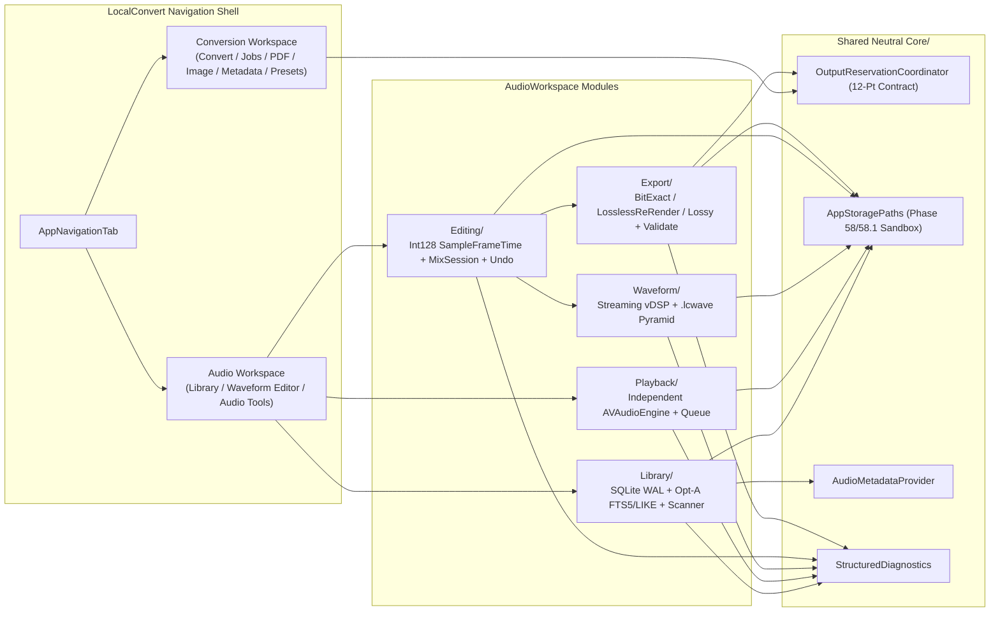

# LocalConvert — Phase 61 / 61.1: Audio Workspace Architecture & Readiness Report

**Document ID:** LC-AW-READY-008  
**Date:** 2026-11-22  
**Target Platform:** macOS 15.0+ (`arm64`), Swift 6.0 (`SWIFT_STRICT_CONCURRENCY: complete`), Xcode `27.x`, XcodeGen (`project.yml`)  
**Phase Type:** Read-Only Architecture Audit, Product Definition & Technical Specification (Corrected in Phase 61.1 — see [PHASE61_1_TECHNICAL_CORRECTION_REPORT.md](file:///Users/cancan/Desktop/LocalConvert/docs/PHASE61_1_TECHNICAL_CORRECTION_REPORT.md))  
**Final Classification:** **`READY FOR PHASE 62`**

---

## 1. Executive Summary & Architectural Decision

Building **Audio Workspace** (Audio Library Manager + Independent Audio Player + Lossless Waveform Editor) inside LocalConvert is **feasible and strongly supported by existing repository foundations**, provided it is built as a cleanly isolated vertical module (`LocalConvert/AudioWorkspace/`) rather than extending `ConversionManager` or nesting everything inside `AudioToolboxView`.

Phase 61.1 resolved five critical pre-implementation specification ambiguities across sample-frame integer mathematics (`Int128`), SQLite Option A external-content `FTS5` synchronization + fallback, lossless vs bit-exact pass-through export terminology, strict codec/benchmark evidence labeling, and the 12-point `OutputReservationCoordinator` Extraction Compatibility Contract.

### Answers to Final Decision Questions

| Decision Question | Recommendation |
|---|---|
| **1. Feasibility within current LocalConvert architecture?** | **Yes — `READY FOR PHASE 62`.** Phase 58/58.1 sandbox + `UserDefaults` isolation, Phase 59 view-update hygiene, Phase 60 async fixture discipline, Swift 6 strict concurrency, and 12 existing `AudioEditor` engine files + 9 UI files provide a solid verified base. |
| **2. Existing components to reuse?** | `AudioDSPEngine` (`Accelerate`), `AudioMixingService`, `AudioEffectPresetStore`, `ProjectPersistenceService` (v2 + `.lcprojpkg` + autosave), `AudioExportService` (after decoupling `ConversionManager` & fixing `.ogg`/ALAC/bit-depth checks), `AudioMetadataProvider` (18 formats), `UndoRedoCoordinator`, `RecoveryArtifactManager`, `AppStoragePaths`, `StructuredDiagnostics`, `DesignSystem`, `TestSandbox`, and existing `Features/AudioEditor/*` views. |
| **3. Components to isolate?** | Keep Conversion Workspace (`ConversionManager`, `ConversionQueue`) 100% isolated from Audio Workspace; extract URL reservation into `OutputReservationCoordinator` in `Core/FileManagement/` (with thin shims preserving Conversion Workspace behavior). Keep the new `AudioLibraryPlayerEngine` completely isolated from `AudioEditorPlaybackEngine` (`PlaybackEngine.swift` + `AudioMixSession`) with arbitration pause notifications only. |
| **4. Preferred native Apple APIs?** | `AVAudioEngine` + `AVAudioPlayerNode` (Library Player & gapless scheduling), `AVAudioEngine` + `AVAudioSourceNode`/`AudioRingBuffer` (Editor multitrack preview), `AVAudioFile` + `AVAudioConverter` + `AudioToolbox`/`ExtAudioFile` (native PCM/ALAC/AIFF/WAV/AAC), `CoreAudio` (`AudioHardware` output device routing), `Accelerate`/`vDSP` (waveform pyramid + RBJ DSP + FFT), SwiftUI `Canvas` + `CoreGraphics` (timeline rendering), and macOS system `libsqlite3` (WAL + Option A external-content FTS5 + `LIKE` fallback) inside an `actor`. |
| **5. Codec dependencies actually necessary?** | **Zero new third-party dependencies.** System Apple frameworks + LocalConvert's existing static bundled FFmpeg 9.0.2 (`LGPLv3+`, `arm64`, `minos 15.0`, `libmp3lame` 4.0, `libmpg123` 1.33.7, `libopus` 1.6.1, `libvpx` 1.17.0) support `PCM` (`wav`/`aiff`/`caf`), `ALAC`, `FLAC`, `MP3`, `AAC`, `Opus`, `vorbis`, `WavPack`, `TTA`, and `APE` (decode-only — `.ape` encoding `UNSUPPORTED`). End-to-end app export verification currently covers `.wav`, `.aiff`, `.flac` (24-bit), `.mp3`, and `.m4a` (`aac`) (`VERIFIED IN REPOSITORY`); `.alac`, `.opus`, 32-float `WAV`, and `.ogg` (`vorbis`) are pending Phase 68 alignment/verification. |
| **6. First implementation phase (Phase 62)?** | Audio Workspace Domain Core & Foundation (`SampleFrameTime` with `Int128` rational arithmetic & checked overflow, `OutputReservationCoordinator` 12-point extraction, `AppStoragePaths` extensions, `StructuredDiagnostics` categories, `SyntheticAudioFixtureWriter`). |
| **7. Highest technical risks?** | (a) Floating-point edit drift in current `TimeInterval` models -> solved by `Int64` `SampleFrameTime` + `Int128` rate math; (b) Memory explosions on 2-hr+ high-rate audio -> solved by streaming `.lcwave` multi-resolution peak pyramids & bounded scratch buffers; (c) External `AVAudioFile` codec failures (`Opus`/`Ogg`/`WavPack`/`APE`) -> solved by automatic FFmpeg proxy/PCM-pipe fallback; (d) Unverified `AudioExportService` edge cases (`-c:a libvorbis` mismatch, `-ac` 1..2 clamp, `.alac` 16-bit TPDF dither gap) -> targeted in Phase 68; (e) SwiftUI `Table`/`List` reentrant state mutation -> prevented via Phase 59 discipline. |
| **8. Deferred requirements?** | MIDI sequencing, third-party AUv3/VST3 plugin hosting, live multi-channel hardware recording, cloud sync / AcousticID / remote metadata lookups (violates offline-first privacy rule), and APE encoding (`UNSUPPORTED` in bundled FFmpeg 9.0.2). |

---

## 2. Current Repository Architecture Findings

1. **Strong Existing Audio Editor Core (`LocalConvert/Engines/AudioEditor/` — 12 files & `Features/AudioEditor/` — 9 files):**
   - Already implements `.lcproject` (`v2`) & `.lcprojpkg` self-contained persistence, crash recovery (`AudioAutosaveSnapshot`), `UndoRedoCoordinator` focus & restart journal rehydration, `Accelerate`/`vDSP` RBJ biquads/dynamics (`AudioDSPEngine`), clip overlap crossfades + 5 fade curves (`ClipFadeCurve`), and LUFS/true-peak + 16-bit dither export (`AudioExportService`).
   - **Mounted Currently Inside Toolbox:** `AudioEditorRootView` is embedded inside [AudioToolboxView.swift:172](file:///Users/cancan/Desktop/LocalConvert/LocalConvert/Features/AudioToolbox/AudioToolboxView.swift#L172) rather than having a dedicated workspace shell.
2. **Verified Gaps in Existing Audio Editor & Export:**
   - **Time representation:** `AudioClip`, `AudioMarker`, and `TimelineState` use `Double` seconds (`TimeInterval`) with `eps = 0.0005` s in `AudioEditingService.swift`.
   - **Single-resolution RAM-only waveform:** `WaveformRenderingService` stores one `framesPerBucket = 512` stereo array in memory (64 MB LRU).
   - **Tight coupling to `ConversionManager`:** `AudioExportService.swift:155, 188` calls `ConversionManager.reserveUniqueOutputURL` / `releaseReservedOutputURL` directly and writes preview `.caf` files to `FileManager.default.temporaryDirectory`.
   - **Export codec/validation findings:** `AudioExportService.swift:502` specifies `-c:a libvorbis` for `.ogg` whereas bundled FFmpeg 9.0.2 lists `vorbis`; `-ac` is clamped `1...2`; `is16BitOutput` TPDF dither gating excludes `.alac`; `validateExportedFile` validates codec name/rate/channels/duration without explicit bit-depth check; no `BitExactPassThrough` payload copy path exists yet.
   - **Missing Library & Independent Player:** No SQLite audio catalog, folder scanner, playlists, duplicate SHA-256 detector, missing-file reconciler, or standalone queue player decoupled from `AudioMixSession`.
3. **Verified Media Toolchain & Build State (`project.yml`):**
   - `macOS 15.0+`, `arm64`, Swift `6.0`, `SWIFT_STRICT_CONCURRENCY: complete`, XcodeGen source of truth.
   - Bundled static FFmpeg 9.0.2 (`minos 15.0`, `LGPLv3+`, zero Homebrew).
   - `AudioMetadataProvider` covers 18 audio formats read, 13 writable tag containers, 5 artwork-writable containers (`.mp3, .m4a, .m4b, .alac, .flac`).

---

## 3. Target Module & Data Flow Architecture

---

## 4. Deliverables Complete (Phase 61 + Phase 61.1 Corrected Baseline)

1. [AUDIO_WORKSPACE_PRODUCT_SPECIFICATION.md](file:///Users/cancan/Desktop/LocalConvert/docs/AUDIO_WORKSPACE_PRODUCT_SPECIFICATION.md)
2. [AUDIO_WORKSPACE_ARCHITECTURE.md](file:///Users/cancan/Desktop/LocalConvert/docs/AUDIO_WORKSPACE_ARCHITECTURE.md)
3. [AUDIO_WORKSPACE_TECHNOLOGY_EVALUATION.md](file:///Users/cancan/Desktop/LocalConvert/docs/AUDIO_WORKSPACE_TECHNOLOGY_EVALUATION.md)
4. [AUDIO_WORKSPACE_DATA_MODEL.md](file:///Users/cancan/Desktop/LocalConvert/docs/AUDIO_WORKSPACE_DATA_MODEL.md)
5. [AUDIO_WORKSPACE_UX_SPECIFICATION.md](file:///Users/cancan/Desktop/LocalConvert/docs/AUDIO_WORKSPACE_UX_SPECIFICATION.md)
6. [AUDIO_WORKSPACE_TEST_STRATEGY.md](file:///Users/cancan/Desktop/LocalConvert/docs/AUDIO_WORKSPACE_TEST_STRATEGY.md)
7. [AUDIO_WORKSPACE_IMPLEMENTATION_ROADMAP.md](file:///Users/cancan/Desktop/LocalConvert/docs/AUDIO_WORKSPACE_IMPLEMENTATION_ROADMAP.md)
8. `docs/PHASE61_FINAL_READINESS_REPORT.md` (this report)
9. [PHASE61_1_TECHNICAL_CORRECTION_REPORT.md](file:///Users/cancan/Desktop/LocalConvert/docs/PHASE61_1_TECHNICAL_CORRECTION_REPORT.md) (Phase 61.1 audit & correction log)

---

## 5. Risks & Open Design Questions to Lock Before Coding

1. **Tab Structure Integration (`AudioToolbox` vs `AudioWorkspace`):** Decide cleanly in Phase 69 whether `Audio Toolbox` sidebar entry is renamed to `Audio Workspace` or kept alongside a separate sidebar tab while maintaining `AppNavigationTab` compatibility in UI tests/restore state.
2. **Hardware Sample Rate Switching in `AudioLibraryPlayerEngine`:** Default to OS mixer SRC (smooth gapless across mixed-rate playlists) with an explicit opt-in *"Match Output Device Sample Rate"* preference if users connect external audiophile DACs.
3. **FFmpeg PCM Pipe vs Disk Cache Threshold for Non-Native Waveforms:** Stream non-native formats (`Ogg`/`Opus`/`WavPack`/`APE`) directly through `ffmpeg -f f32le pipe:1` into `.lcwave` chunk aggregation during Library indexing.

---

## 6. First Implementation Phase (Phase 62) Acceptance Criteria

Phase 62 (**Audio Workspace Foundation, Storage Paths, Diagnostics & Sample-Frame Domain Core**) starts **only** upon explicit user authorization, and will be complete when:
1. `SampleRate`, `SampleFrameTime`, `SourceFrameTime`, `TimelineFrameTime`, `RenderFrameTime`, `FrameDelta`, and `SampleFrameRange` are implemented with exact `Int128` rational arithmetic, deterministic round-half-away-from-zero ties, checked overflow/underflow, and tested across `44.1 / 48 / 96 / 192 kHz` boundaries, zero-length ranges, negative deltas, and 128-bit cross-rate comparisons.
2. `OutputReservationCoordinator` is extracted to `LocalConvert/Core/FileManagement/` honoring all **12 Conversion Workspace compatibility contract points**, with regression tests covering both Conversion Workspace and Audio Workspace (`AudioExportService` zero references to `ConversionManager`).
3. `AppStoragePaths` adds sandbox-safe `audioLibraryDatabaseURL`, `audioWaveformCacheDirectory`, `audioPlayerStateURL`, and `audioExportStagingDirectory`.
4. `DiagnosticCategory` adds `.audioLibrary`, `.audioPlayer`, `.audioWaveform`, `.audioEditor` with redacted sanitization tests.
5. `SyntheticAudioFixtureWriter` is added to `LocalConvertTestSupport/` using Phase 60 async structured concurrency (`0` `DispatchSemaphore`, `0` `Task.detached` QoS inversions).
6. Clean/incremental `arm64` builds pass with `0` Swift 6 warnings, `./scripts/verify-dependencies.sh` passes, and `Phase58_1UserDefaultsIsolationTests` confirms zero mutation to user data or preferences.

---

## 7. Final Classification

**Classification:** **`READY FOR PHASE 62`**

All 9 Phase 61 / 61.1 specification documents are complete, internally consistent, and grounded in verified repository source code and bundled toolchain inspection. No source code, project configuration, tests, binaries, or user data were modified, and no builds or tests were run during this documentation-only phase. Execution stops here pending explicit authorization for Phase 62.
